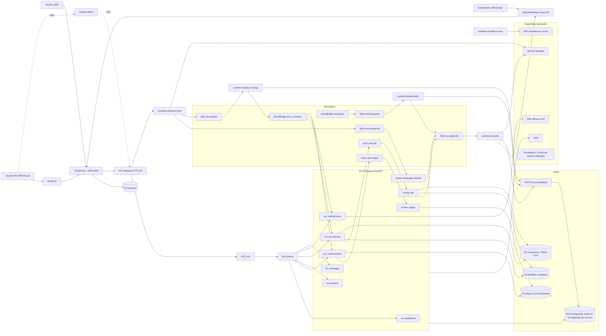
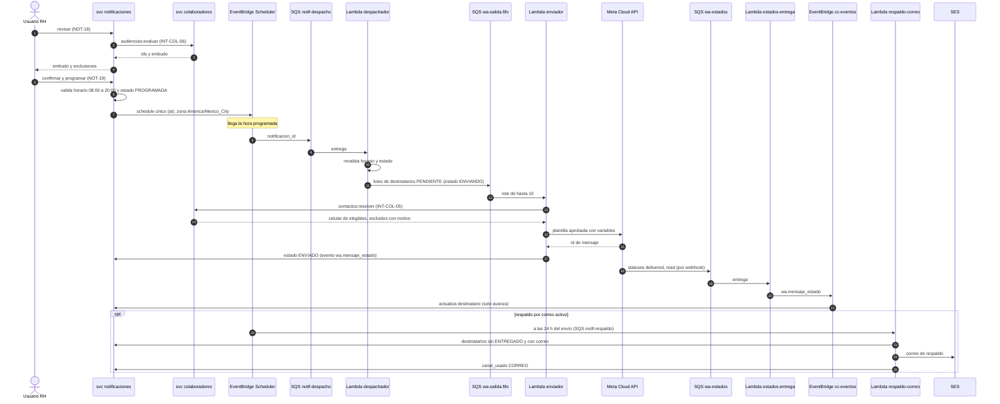
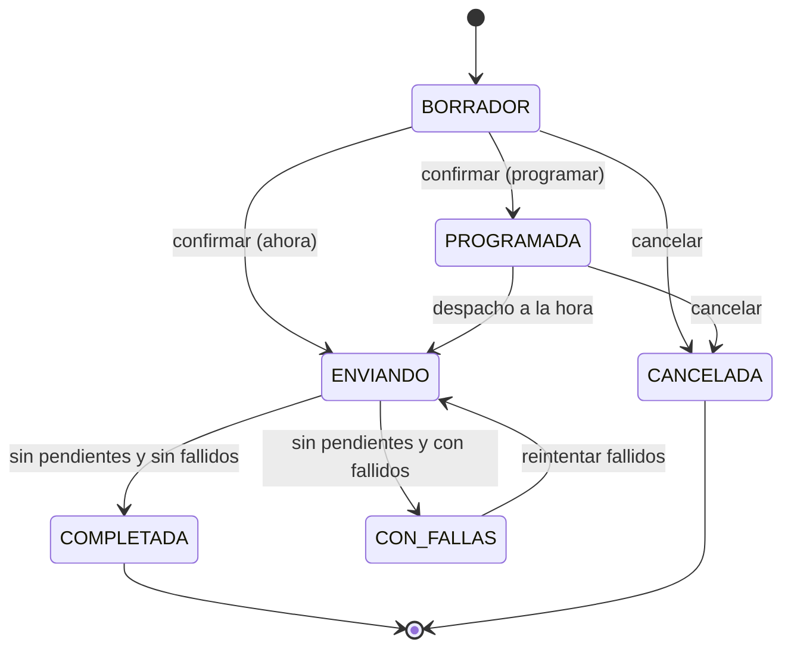
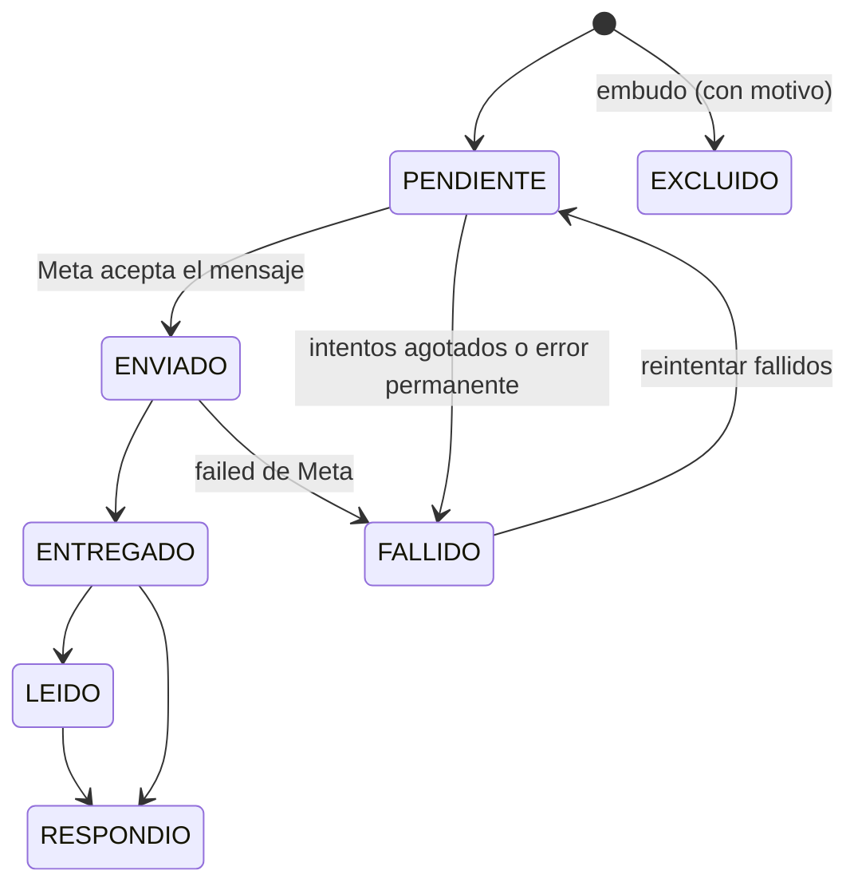
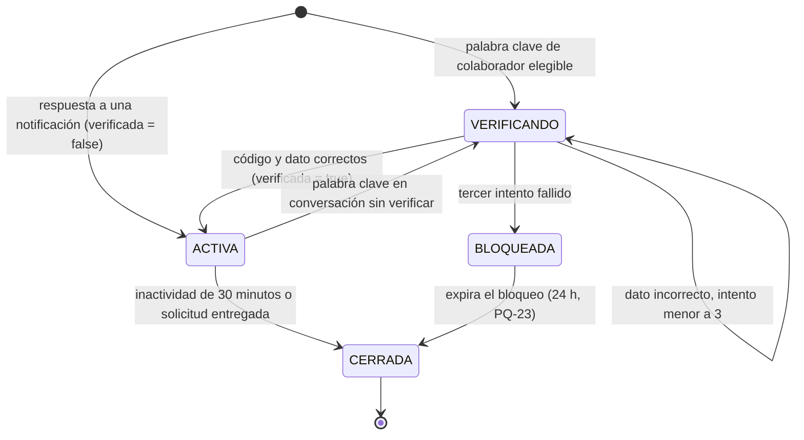
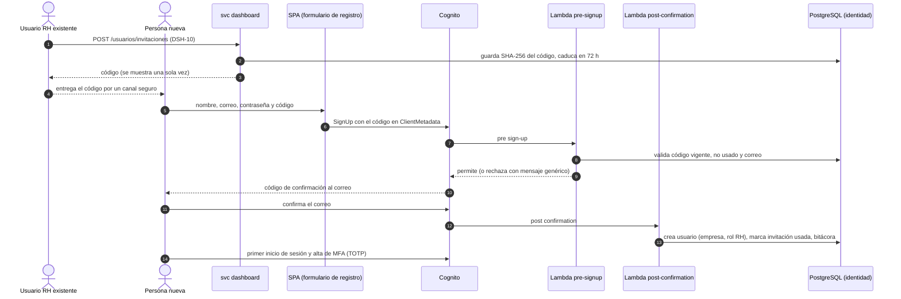
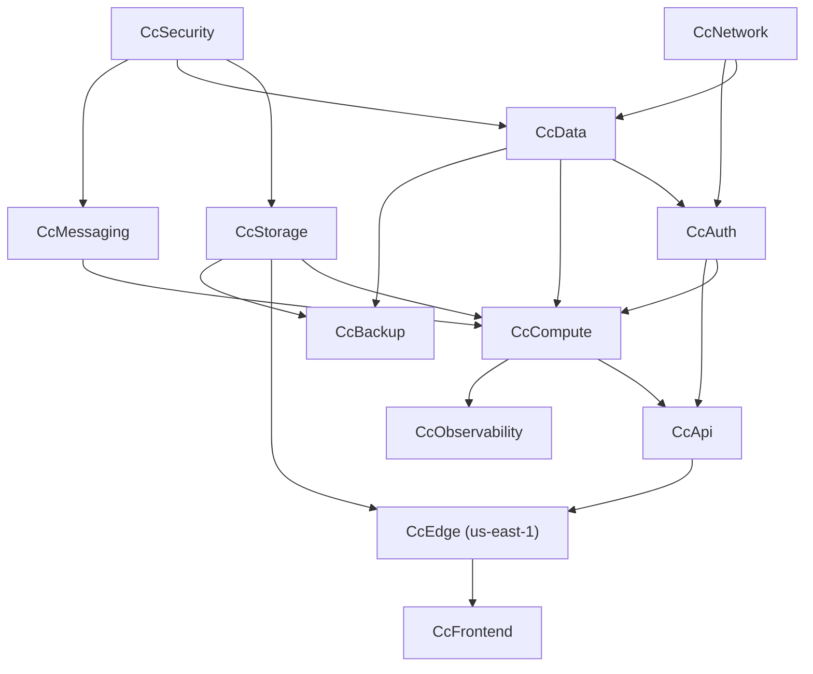
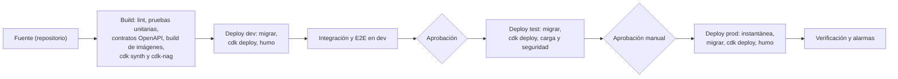
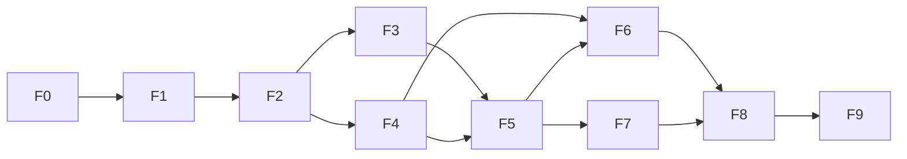

# Command Center v1: Documento de diseño

| Dato | Valor |
|---|---|
| Fase | 2 de spec-driven development (diseño). No incluye tareas de implementación ni código de producción. |
| Versión | 0.1, borrador para aprobación |
| Fecha | 13 de noviembre de 2026 |
| Deriva de | `.kiro/specs/requirements.md` (v0.1). Su único cambio en esta fase: CC-NFR-013 pasó a "AWS CDK" (decisión del cliente). |
| Precedencia | 1) `requirements.md`; 2) `documentos/`; 3) `modelo_completo.dot` y `vistas/`; 4) `arquitectura_aws/`; 5) `disenos/`. Las contradicciones se registran en la sección 17. |
| Convenciones | Las referencias entre corchetes citan el origen: `CC-REQ`, `CC-NFR`, `CC-ASM`, `PQ` (preguntas del requirements.md y nuevas PQ-22 en adelante), `Ronda P1` a `P7`, y `D-01` a `D-10` (decisiones de esta fase, sección 17). `DS-nn` identifica un supuesto de diseño. [POR CONFIRMAR] remite a una PQ. |

Decisiones de esta fase (respuestas "por defecto" del cliente, sección 17.1): unicidad por empresa (D-01), código de invitación para el registro de usuarios RH (D-02), un esquema de PostgreSQL por servicio (D-03), EventBridge Scheduler para los envíos programados (D-04), folio `CG-AAAA-NNNN` con reinicio anual (D-05), WeasyPrint para el PDF (D-06), monorepo (D-07), CDK en Python (D-08), región `us-east-1` con recuperación en `us-east-2`, RPO de hasta 1 hora y RTO de hasta 4 horas (D-09), y entrega por enlace de un solo uso (D-10).

---

## 0. Visión general

### 0.1 Arquitectura lógica

Command Center v1 es una SPA React servida desde S3 y CloudFront, un conjunto de microservicios FastAPI en ECS Fargate, tres Lambdas de mensajería y procesos asíncronos por SQS. Una sola instancia de PostgreSQL (RDS Multi-AZ) guarda los datos operacionales, con un esquema por servicio.

Un servicio lógico agrupa su API de ECS, sus workers y las Lambdas que escriben en sus tablas. Esa regla mantiene la propiedad de las tablas (CC-NFR-012):

| Servicio lógico | Esquema PostgreSQL | Componentes | Módulo de requisitos |
|---|---|---|---|
| `dashboard` (Acceso, dashboard, bitácora) | `identidad`, `auditoria` | API ECS; Lambdas de triggers de Cognito | Acceso y dashboard |
| `colaboradores` (incluye la carga masiva) | `colaboradores` | API ECS; `worker-cargas` | Colaboradores |
| `campos` (campos dinámicos) | `campos` | API ECS | Colaboradores |
| `constancias` (plantillas, versiones, PDF) | `constancias` | API ECS; `worker-pdf` | Constancias |
| `notificaciones` (audiencias, embudo, envíos, respaldo) | `notificaciones` | API ECS; Lambdas `despachador`, `conciliador`, `respaldo-correo` | Notificaciones |
| `whatsapp` (verificación y chat) | `whatsapp` | API ECS; `worker-whatsapp-entrada`; Lambdas `webhook-meta`, `enviador`, `estados-entrega` | Constancias y Notificaciones |

La tabla transversal `auditoria.bitacora` es de solo inserción para todos los servicios y de lectura para `dashboard` (CC-REQ-154 a 156).

Reglas de arquitectura:

1. **Ningún servicio lee tablas de otro** (D-03, CC-NFR-012). La lectura de datos ajenos se hace por API interna (`/internal/...`) o por evento. Las excepciones son las llaves foráneas entre esquemas, que solo garantizan integridad referencial, y las vistas de solo lectura que `dashboard` usa para los indicadores.
2. **Datos sensibles descifrados solo en `colaboradores`.** Los demás servicios piden a `colaboradores` el dato ya resuelto (por ejemplo, el desafío de verificación) y nunca reciben el NSS ni el CURP, salvo `constancias`, que recibe los valores que la plantilla usa (sección 5).
3. **Puerta única de elegibilidad.** Todo envío al colaborador resuelve su celular por `contactos:resolver` en `colaboradores`, que aplica estatus ACTIVO y consentimiento vigente (CC-REQ-157).
4. **Eventos con outbox transaccional.** Cada servicio escribe sus eventos y mensajes de cola en una tabla `outbox` dentro de la misma transacción de negocio. Un relay los publica en EventBridge o SQS. Los consumidores son idempotentes (sección 9.3).
5. **API Gateway es la única entrada de las rutas de negocio** (restricción de la arquitectura). Las rutas `/internal/*` no existen en API Gateway.

### 0.2 Catálogo de interfaces

Autenticación: `JWT` es el token de acceso de Cognito del usuario RH (sección 11); `PUB` es público sin autenticación, con limitación de tasa; `FIRMA` es la firma HMAC de Meta; `INT` es el token interno entre servicios. Todas las rutas de negocio cuelgan de `/api/v1`, salvo `/webhook/meta`, `/d/{token}` e `/internal/...`. Los códigos de error `401` (sin token válido), `403` y `429` aplican a todas las rutas con autenticación y se omiten en la columna de errores. El detalle de esquemas y reglas está en la sección 3.

#### Servicio `dashboard`

| ID | Método y ruta | Auth | Éxito | Errores | Requisito |
|---|---|---|---|---|---|
| DSH-01 | `GET /dashboard/resumen` | JWT | 200 | | CC-REQ-011, 014 |
| DSH-02 | `GET /dashboard/solicitudes-recientes` | JWT | 200 | | CC-REQ-012, 014 |
| DSH-03 | `GET /dashboard/constancias-recientes` | JWT | 200 | | CC-REQ-012, 014 |
| DSH-04 | `GET /dashboard/alertas` | JWT | 200 | | CC-REQ-013 |
| DSH-05 | `GET /bitacora` | JWT | 200 | 422 | CC-REQ-015 |
| DSH-06 | `POST /sesion/iniciar` | JWT | 204 | | CC-REQ-005 |
| DSH-07 | `GET /usuarios/yo` | JWT | 200 | | CC-REQ-009 |
| DSH-08 | `GET /usuarios` | JWT | 200 | | CC-REQ-010 |
| DSH-09 | `POST /usuarios/{id}/desactivar` | JWT | 204 | 404, 409 | CC-REQ-010 |
| DSH-10 | `POST /usuarios/invitaciones` | JWT | 201 | 422 | CC-REQ-007, 008 |
| DSH-11 | `GET /constancias/historial` | JWT | 200 | 422 | CC-REQ-087 |

#### Servicio `colaboradores`

| ID | Método y ruta | Auth | Éxito | Errores | Requisito |
|---|---|---|---|---|---|
| COL-01 | `GET /colaboradores` | JWT | 200 | 422 | CC-REQ-031, 032, 033 |
| COL-02 | `POST /colaboradores` | JWT | 201 | 409, 422 | CC-REQ-020 a 025, 042 |
| COL-03 | `GET /colaboradores/{id}` | JWT | 200 | 404 | CC-REQ-026, 153, 156 |
| COL-04 | `PATCH /colaboradores/{id}` | JWT | 200 | 404, 409, 422 | CC-REQ-026, 028 |
| COL-05 | `POST /colaboradores/{id}/baja` | JWT | 200 | 404, 409, 422 | CC-REQ-029 |
| COL-06 | `POST /colaboradores/{id}/reactivar` | JWT | 200 | 404, 409, 422 | CC-REQ-030 |
| COL-07 | `PUT /colaboradores/{id}/consentimiento` | JWT | 200 | 404, 422 | CC-REQ-022, 027 |
| COL-08 | `GET /organizaciones` | JWT | 200 | | CC-REQ-043 |
| COL-09 | `POST /organizaciones` | JWT | 201 | 409, 422 | CC-REQ-043 |
| COL-10 | `PATCH /organizaciones/{id}` | JWT | 200 | 404, 409, 422 | CC-REQ-043 |
| COL-11 | `POST /organizaciones/{id}/logotipo` | JWT | 200 | 404, 422 | CC-REQ-062 |
| COL-12 | `POST /organizaciones/{id}/logotipo/confirmar` | JWT | 200 | 404, 422 | CC-REQ-062 |
| COL-13 | `GET /plantas` | JWT | 200 | | CC-REQ-044 |
| COL-14 | `POST /plantas` | JWT | 201 | 409, 422 | CC-REQ-044 |
| COL-15 | `PATCH /plantas/{id}` | JWT | 200 | 404, 409, 422 | CC-REQ-044 |
| COL-16 | `GET /cargas/plantilla` | JWT | 200 (xlsx) | | CC-REQ-034 |
| COL-17 | `POST /cargas` | JWT | 201 | 422 | CC-REQ-035 |
| COL-18 | `POST /cargas/{id}/confirmar` | JWT | 202 | 404, 409, 422 | CC-REQ-035, 038, 039 |
| COL-19 | `GET /cargas` | JWT | 200 | | CC-REQ-040 |
| COL-20 | `GET /cargas/{id}` | JWT | 200 | 404 | CC-REQ-040 |
| COL-21 | `GET /cargas/{id}/errores` | JWT | 200 (csv) | 404 | CC-REQ-040 |
| COL-22 | `POST /cargas/{id}/cancelar` | JWT | 200 | 404, 409 | CC-REQ-035 (propuesta, PQ-14) |
| INT-COL-01 | `POST /internal/colaboradores/buscar-por-celular` | INT | 200 | | CC-REQ-071, 072 |
| INT-COL-02 | `POST /internal/colaboradores/{id}/desafio` | INT | 200 | 404 | CC-REQ-073 |
| INT-COL-03 | `POST /internal/colaboradores/{id}/verificar` | INT | 200 | 404 | CC-REQ-073, 074 |
| INT-COL-04 | `POST /internal/colaboradores/{id}/datos-constancia` | INT | 200 | 404, 422 | CC-REQ-076, 077 |
| INT-COL-05 | `POST /internal/colaboradores/contactos:resolver` | INT | 200 | 422 | CC-REQ-157 |
| INT-COL-06 | `POST /internal/colaboradores/audiencias:evaluar` | INT | 200 | 422 | CC-REQ-100, 105 |
| INT-COL-07 | `GET /internal/colaboradores/{id}/resumen` | INT | 200 | 404 | CC-REQ-115 |
| INT-COL-08 | `GET /internal/organizaciones/{id}` | INT | 200 | 404 | CC-REQ-061 |
| INT-COL-09 | `POST /internal/colaboradores/faltantes:contar` | INT | 200 | 422 | CC-REQ-013, 067 |
| INT-COL-10 | `GET /internal/campos/{campo_id}/uso` | INT | 200 | 404 | CC-REQ-048, 050 |

#### Servicio `campos`

| ID | Método y ruta | Auth | Éxito | Errores | Requisito |
|---|---|---|---|---|---|
| CAM-01 | `GET /campos` | JWT | 200 | | CC-REQ-045, 051 |
| CAM-02 | `POST /campos` | JWT | 201 | 409, 422 | CC-REQ-045 a 047 |
| CAM-03 | `GET /campos/{id}` | JWT | 200 | 404 | CC-REQ-045 |
| CAM-04 | `PATCH /campos/{id}` | JWT | 200 | 404, 409, 422 | CC-REQ-045, 048, 052 |
| CAM-05 | `DELETE /campos/{id}` | JWT | 204 | 404, 409 | CC-REQ-049, 050 |
| CAM-06 | `PUT /campos/orden` | JWT | 204 | 422 | CC-REQ-045 |
| CAM-07 | `GET /campos/{id}/opciones` | JWT | 200 | 404 | CC-REQ-047 |
| CAM-08 | `POST /campos/{id}/opciones` | JWT | 201 | 404, 409, 422 | CC-REQ-047 |
| CAM-09 | `PATCH /campos/{id}/opciones/{opcion_id}` | JWT | 200 | 404, 409, 422 | CC-REQ-047 |
| INT-CAM-01 | `GET /internal/campos` | INT | 200 | | CC-REQ-021, 034, 061 |
| INT-CAM-02 | `POST /internal/empresas/{id}/campos-sugeridos` | INT | 201 | 409 | CC-REQ-049 |

#### Servicio `constancias`

| ID | Método y ruta | Auth | Éxito | Errores | Requisito |
|---|---|---|---|---|---|
| CON-01 | `GET /plantillas` | JWT | 200 | | CC-REQ-069 |
| CON-02 | `POST /plantillas` | JWT | 201 | 409, 422 | CC-REQ-060 |
| CON-03 | `GET /plantillas/{id}` | JWT | 200 | 404 | CC-REQ-069 |
| CON-04 | `PATCH /plantillas/{id}` | JWT | 200 | 404, 409, 422 | CC-REQ-069, 070 |
| CON-05 | `POST /plantillas/{id}/duplicar` | JWT | 201 | 404, 409 | CC-REQ-069 |
| CON-06 | `DELETE /plantillas/{id}` | JWT | 204 | 404 | CC-REQ-069 |
| CON-07 | `GET /plantillas/{id}/borrador` | JWT | 200 | 404 | CC-REQ-064 |
| CON-08 | `PUT /plantillas/{id}/borrador` | JWT | 200 | 404, 413, 422 | CC-REQ-060, 061, 062, 064 |
| CON-09 | `POST /plantillas/{id}/borrador/validar` | JWT | 200 | 404 | CC-REQ-065, 067 |
| CON-10 | `POST /plantillas/{id}/publicar` | JWT | 201 | 404, 409, 422 | CC-REQ-065, 066, 067 |
| CON-11 | `GET /plantillas/{id}/versiones` | JWT | 200 | 404 | CC-REQ-066, 068 |
| CON-12 | `GET /plantillas/{id}/versiones/{numero}` | JWT | 200 | 404 | CC-REQ-066 |
| CON-13 | `POST /plantillas/{id}/versiones/{numero}/restaurar` | JWT | 201 | 404, 422 | CC-REQ-068 |
| CON-14 | `POST /plantillas/{id}/vista-previa` | JWT | 200 | 404, 422 | CC-REQ-063 |
| CON-15 | `GET /constancias/variables` | JWT | 200 | | CC-REQ-061 |
| CON-16 | `GET /constancias/{id}` | JWT | 200 | 404 | CC-REQ-087 |
| CON-17 | `POST /constancias/{id}/descarga` | JWT | 200 | 404, 409 | CC-REQ-088 |
| CON-18 | `POST /constancias/{id}/reenviar` | JWT | 202 | 404, 409 | CC-REQ-089 |
| CON-19 | `GET /publico/verificar/{codigo}` | PUB | 200 | 404 | CC-REQ-090 |
| CON-20 | `GET /d/{token}` | PUB | 200 (HTML) | 404, 410 | CC-REQ-084 |
| CON-21 | `POST /d/{token}/descargar` | PUB | 302 | 404, 410 | CC-REQ-084 |
| INT-CON-01 | `GET /internal/plantillas/activas` | INT | 200 | | CC-REQ-070, 075 |
| INT-CON-02 | `POST /internal/solicitudes` | INT | 201 | 409 | CC-REQ-071 |
| INT-CON-03 | `POST /internal/solicitudes/{id}/plantilla` | INT | 200 | 404, 409 | CC-REQ-075 |
| INT-CON-04 | `POST /internal/solicitudes/{id}/generar` | INT | 202 | 404, 409, 422 | CC-REQ-076, 077 |
| INT-CON-05 | `POST /internal/solicitudes/{id}/cancelar` | INT | 200 | 404, 409 | CC-REQ-091 |
| INT-CON-06 | `GET /internal/plantillas/uso-de-variable` | INT | 200 | | CC-REQ-052 |

#### Servicio `notificaciones`

| ID | Método y ruta | Auth | Éxito | Errores | Requisito |
|---|---|---|---|---|---|
| NOT-01 | `GET /audiencias` | JWT | 200 | | CC-REQ-101 |
| NOT-02 | `POST /audiencias` | JWT | 201 | 409, 422 | CC-REQ-100, 101 |
| NOT-03 | `GET /audiencias/{id}` | JWT | 200 | 404 | CC-REQ-101 |
| NOT-04 | `PATCH /audiencias/{id}` | JWT | 200 | 404, 409, 422 | CC-REQ-101 |
| NOT-05 | `DELETE /audiencias/{id}` | JWT | 204 | 404 | CC-REQ-101 |
| NOT-06 | `POST /audiencias/previsualizar` | JWT | 200 | 422 | CC-REQ-100, 101 |
| NOT-07 | `GET /plantillas-mensaje` | JWT | 200 | | CC-REQ-117 |
| NOT-08 | `POST /plantillas-mensaje` | JWT | 201 | 409, 422 | CC-REQ-117 |
| NOT-09 | `GET /plantillas-mensaje/{id}` | JWT | 200 | 404 | CC-REQ-117 |
| NOT-10 | `PATCH /plantillas-mensaje/{id}` | JWT | 200 | 404, 409, 422 | CC-REQ-117 |
| NOT-11 | `POST /plantillas-mensaje/{id}/enviar-a-revision` | JWT | 202 | 404, 409, 502 | CC-REQ-117 |
| NOT-12 | `POST /plantillas-mensaje/{id}/duplicar` | JWT | 201 | 404 | CC-REQ-117 |
| NOT-13 | `POST /plantillas-mensaje/sincronizar` | JWT | 202 | 502 | CC-REQ-117 |
| NOT-14 | `GET /notificaciones` | JWT | 200 | 422 | CC-REQ-120 |
| NOT-15 | `POST /notificaciones` | JWT | 201 | 422 | CC-REQ-102, 103 |
| NOT-16 | `GET /notificaciones/{id}` | JWT | 200 | 404 | CC-REQ-119 |
| NOT-17 | `PATCH /notificaciones/{id}` | JWT | 200 | 404, 409, 422 | CC-REQ-102, 103 |
| NOT-18 | `POST /notificaciones/{id}/revisar` | JWT | 200 | 404, 409, 422 | CC-REQ-105, 106, 107 |
| NOT-19 | `POST /notificaciones/{id}/confirmar` | JWT | 202 | 404, 409, 422 | CC-REQ-108, 109, 110 |
| NOT-20 | `POST /notificaciones/{id}/cancelar` | JWT | 200 | 404, 409 | CC-REQ-112 (propuesta, PQ-14) |
| NOT-21 | `GET /notificaciones/{id}/destinatarios` | JWT | 200 | 404 | CC-REQ-119, 121 |
| NOT-22 | `POST /notificaciones/{id}/reintentar-fallidos` | JWT | 202 | 404, 409 | CC-REQ-118 |
| NOT-23 | `POST /notificaciones/{id}/duplicar` | JWT | 201 | 404 | CC-REQ-122 |
| NOT-24 | `GET /notificaciones/indicadores` | JWT | 200 | | CC-REQ-120 |

#### Servicio `whatsapp`

| ID | Método y ruta | Auth | Éxito | Errores | Requisito |
|---|---|---|---|---|---|
| WAP-01 | `GET /conversaciones` | JWT | 200 | 422 | CC-REQ-115 |
| WAP-02 | `GET /conversaciones/{id}/mensajes` | JWT | 200 | 404 | CC-REQ-115, 116 |
| WAP-03 | `POST /conversaciones/{id}/mensajes` | JWT | 202 | 404, 409, 422 | CC-REQ-116, 104 |
| WAP-04 | `POST /conversaciones/{id}/mensajes/plantilla` | JWT | 202 | 404, 422 | CC-REQ-116 |
| WAP-05 | `PUT /conversaciones/{id}/asignacion` | JWT | 200 | 404, 422 | CC-REQ-115 |
| WAP-06 | `GET /webhook/meta` (verificación de suscripción) | token de verificación | 200 | 403 | CC-REQ-158 |
| WAP-07 | `POST /webhook/meta` | FIRMA | 200 | 403 | CC-REQ-114, 158 |

#### Lambdas y workers (detalle en la sección 4)

| ID | Componente | Disparador | Servicio | Requisito |
|---|---|---|---|---|
| LAM-01 | `webhook-meta` | WAP-06 y WAP-07 (API Gateway) | whatsapp | CC-REQ-114, 158 |
| LAM-02 | `enviador` | SQS `wa-salida.fifo` | whatsapp | CC-REQ-111, 157, 104 |
| LAM-03 | `estados-entrega` | SQS `wa-estados` | whatsapp | CC-REQ-114 |
| LAM-04 | `despachador` | SQS `notif-despacho` | notificaciones | CC-REQ-108, 109, 111 |
| LAM-05 | `conciliador` | EventBridge, cada 5 minutos | notificaciones | CC-REQ-108, 113 |
| LAM-06 | `respaldo-correo` | SQS `notif-respaldo` | notificaciones | CC-REQ-110, 113 |
| LAM-07 | `cognito-pre-signup` | Cognito | dashboard | CC-REQ-007, 008 |
| LAM-08 | `cognito-post-confirmation` | Cognito | dashboard | CC-REQ-007, 008 |
| LAM-09 | `cognito-pre-token` | Cognito | dashboard | CC-REQ-004, 009, 010 |
| WRK-01 | `worker-pdf` (Fargate) | SQS `cola-pdf` | constancias | CC-REQ-077 a 083 |
| WRK-02 | `worker-cargas` (Fargate) | SQS `cola-cargas` | colaboradores | CC-REQ-036, 037 |
| WRK-03 | `worker-whatsapp-entrada` (Fargate) | SQS `wa-entrada.fifo` | whatsapp | CC-REQ-071 a 076 |
| WRK-04 | `relay-outbox` y `consumidor-eventos` (en cada API o worker) | tabla `outbox`; colas `ev-*` | todos | CC-NFR-007 |

### 0.3 Diagrama de componentes y flujo de datos



### 0.4 Secuencia (a): solicitud de constancia por WhatsApp (UC-14, UC-15, UC-16)

```mermaid
sequenceDiagram
  autonumber
  actor C as Colaborador
  participant M as Meta Cloud API
  participant WH as Lambda webhook-meta
  participant QI as SQS wa-entrada.fifo
  participant BOT as worker-whatsapp-entrada
  participant COL as svc colaboradores
  participant CON as svc constancias
  participant QP as SQS cola-pdf
  participant WP as worker-pdf
  participant QO as SQS wa-salida.fifo
  participant ENV as Lambda enviador
  participant S3 as S3 constancias

  C->>M: "constancia"
  M->>WH: POST /webhook/meta (firma HMAC)
  WH->>WH: valida firma, responde 200
  WH->>QI: mensaje (grupo = hash del número)
  QI->>BOT: entrega
  BOT->>COL: buscar-por-celular (INT-COL-01)
  COL-->>BOT: colaborador, estatus, consentimiento
  alt no registrado, BAJA o sin consentimiento
    BOT->>QO: respuesta de rechazo y aviso a RH (SNS)
  else elegible
    BOT->>QO: aviso de privacidad y código de 6 dígitos
    QO->>ENV: envía
    ENV->>M: mensaje al colaborador
    C->>M: código y dato adicional
    M->>WH: webhook
    WH->>QI: mensaje
    BOT->>COL: verificar (INT-COL-03)
    COL-->>BOT: válido o inválido
    alt 3 intentos inválidos
      BOT->>QO: bloqueo y aviso a RH
    else verificado
      BOT->>CON: plantillas activas (INT-CON-01)
      BOT->>QO: lista de plantillas
      C->>M: elige plantilla
      BOT->>CON: crear solicitud y generar (INT-CON-02, 04)
      CON->>COL: datos-constancia (INT-COL-04)
      alt faltan campos obligatorios
        CON-->>BOT: faltantes
        BOT->>QO: "falta información" y aviso a RH
      else completos
        CON->>QP: solicitud (outbox)
        QP->>WP: toma solicitud
        WP->>S3: PDF con Object Lock, folio, hash
        WP->>CON: constancia_generada y snapshot
        WP->>QO: enlace de un solo uso
        QO->>ENV: envía
        ENV->>M: enlace de descarga
        M-->>WH: estado delivered
        Note over WH,CON: estados-entrega publica wa.mensaje_estado; constancias marca ENTREGADA
      end
    end
  end
```

### 0.5 Secuencia (b): envío programado de notificación (UC-23, UC-24, UC-25)



---

## 1. Estructura del código

### 1.1 Decisión: monorepo (D-07)

Se usa un solo repositorio.

- Los seis servicios, las Lambdas, la SPA y la infraestructura cambian juntos: un campo nuevo toca el esquema, el contrato OpenAPI, la SPA y la plantilla de carga.
- Un solo pipeline puede construir solo lo que cambió (filtros por ruta) y a la vez garantizar versiones coherentes de `cc_common` y de los contratos.
- Las migraciones de varios esquemas se ordenan en un solo lugar (sección 2.8).
- Con un equipo pequeño, repositorios separados agregan coordinación de versiones sin beneficio de aislamiento.
- Costo: el pipeline necesita detección de cambios por carpeta. La propiedad de las tablas se protege con roles de base de datos y revisiones de código por carpeta (`CODEOWNERS`), no con repositorios.

### 1.2 Árbol de carpetas

```text
command-center/
├─ .kiro/specs/                      requirements.md, design.md, tasks.md
├─ infra/                            AWS CDK en Python (D-08)
│  ├─ app.py, cdk.json, pyproject.toml
│  ├─ stacks/                        network, security, data, storage, messaging, auth,
│  │                                 compute, api, edge, frontend, observability, backup, pipeline
│  ├─ constructs/                    fargate_service, lambda_python, queue_con_dlq, bucket_seguro
│  └─ tests/                         aserciones de CDK (sección 16)
├─ services/
│  ├─ shared/cc_common/              paquete compartido (sección 1.3)
│  ├─ dashboard/                     API de acceso, dashboard, bitácora
│  ├─ colaboradores/                 API, worker_cargas, excel
│  ├─ campos/
│  ├─ constancias/                   API, worker_pdf, render
│  ├─ notificaciones/                API, audiencias, embudo
│  └─ whatsapp/                      API de chat, bot (worker_entrada)
│     (cada servicio: app/{main.py, api, dominio, servicios, repos, schemas, workers},
│      migrations/, tests/, Dockerfile, pyproject.toml)
├─ lambdas/
│  ├─ webhook_meta/  enviador/  estados_entrega/
│  ├─ despachador/  conciliador/  respaldo_correo/
│  └─ cognito_triggers/              pre_signup, post_confirmation, pre_token
├─ contracts/
│  ├─ openapi/                       un OpenAPI por servicio, generado desde FastAPI
│  ├─ eventos/                       JSON Schema de eventos de cc-eventos
│  └─ mensajes/                      JSON Schema de mensajes SQS
├─ frontend/                         React + TypeScript (Vite)
│  └─ src/{app, features/{auth, dashboard, colaboradores, campos, constancias,
│     notificaciones, chat}, shared, api-client}
├─ scripts/                          bootstrap_admin.py, sembrar_dev.py, ops
├─ docs/runbooks/
└─ tests/                            e2e (Playwright), carga, seguridad
```

### 1.3 Paquetes, responsabilidades y módulos principales

| Paquete | Responsabilidades | Módulos o clases principales |
|---|---|---|
| `cc_common` | Código compartido sin lógica de negocio. | `config` (variables y SSM), `db` (motor, sesión, `SET LOCAL app.empresa_id`), `auth` (claims del JWT, `UsuarioActual`, `requiere_permiso`), `errores` (jerarquía y manejador problem+json), `logging` (structlog con filtro de datos personales), `crypto` (`EnvelopeCrypto`, `hmac_celular`), `outbox` (escritura y relay), `eventos` (publicación y consumo idempotente), `internal_client` (httpx con token interno), `bitacora` (`registrar()`), `paginacion` (keyset), `aws` (clientes con reintentos). |
| `dashboard` | Acceso, usuarios, invitaciones, indicadores, alertas, bitácora e historial de constancias. | `routers/{dashboard,bitacora,usuarios,historial}`, `servicios/InvitacionService`, `repos/*`, vistas de solo lectura. |
| `colaboradores` | Colaboradores, organizaciones, plantas, valores de campos, cifrado de sensibles, carga masiva, elegibilidad y evaluación de audiencias. | `servicios/ColaboradorService`, `servicios/ElegibilidadService`, `servicios/AudienciaQueryService`, `excel/{generador,lector,validador}`, `workers/worker_cargas`. |
| `campos` | Definición de campos, opciones, sembrado de sugeridos, protección de tipo y clave. | `servicios/CampoService`, `servicios/SembradoSugeridos`. |
| `constancias` | Plantillas, borradores, versiones, solicitudes, generación de PDF, folio, enlaces de descarga, verificación pública. | `servicios/PlantillaService`, `servicios/PublicacionService`, `render/{resolutor_variables,derivadas,html,pdf,qr}`, `servicios/FolioService`, `servicios/EnlaceDescargaService`, `workers/worker_pdf`. |
| `notificaciones` | Audiencias, plantillas de mensaje (Meta), notificaciones, embudo, máquina de estados, programación. | `servicios/NotificacionService`, `servicios/EmbudoService`, `servicios/ProgramadorService`, `meta/PlantillasMetaClient`. |
| `whatsapp` | Conversaciones, bot de verificación, chat de RH, ventana de 24 horas. | `bot/{maquina_estados,verificacion,menu,mensajes_es}`, `servicios/VentanaService`, `servicios/ChatService`, `workers/worker_entrada`. |
| `lambdas/*` | Entrada de Meta, salida, estados, despacho y respaldo por correo, triggers de Cognito. | Un `handler.py` por función y un módulo de dominio por función. |
| `contracts` | Fuente de verdad de los contratos entre la SPA, los servicios y las colas. | OpenAPI generado en CI y verificado contra la SPA (sección 16). |
| `frontend` | SPA de RH. | Rutas por módulo, cliente tipado desde OpenAPI, editor de plantillas con TipTap (nodo de variable propio), formularios con React Hook Form y Zod, TanStack Query, Amplify Auth solo para Cognito. |
| `infra` | Stacks de CDK y constructos reutilizables. | Sección 13. |

Bibliotecas propuestas (DS-01): FastAPI y Pydantic v2, SQLAlchemy 2 con asyncpg en los servicios y psycopg en las Lambdas, Alembic, httpx, tenacity, structlog, aioboto3 y boto3, openpyxl, WeasyPrint, segno, num2words, pytest. Python 3.12 en todos los componentes (restricción de stack).

---

## 2. Modelo de datos físico (PostgreSQL)

Base: PostgreSQL 16 en RDS Multi-AZ (CC-NFR-005). Extensiones: `pg_trgm`, `unaccent`, `pgcrypto` (solo `gen_random_uuid`). Un esquema por servicio (D-03). El diseño parte de `modelo_completo.dot` (20 entidades). Todo lo que no está en el `.dot` se marca **[nuevo]** y se resume como cambio al modelo en la sección 2.3.

### 2.1 Convenciones

- Llaves primarias `bigint GENERATED ALWAYS AS IDENTITY`. El `.dot` dice `int`; se usa `bigint` por la tabla de bitácora y de destinatarios (cambio menor, sin impacto en nombres).
- Fechas y horas `timestamptz` en UTC. `fecha_ingreso`, `fecha_baja` y `valor_fecha` son `date`. La zona horaria de la empresa solo se aplica al mostrar y al validar el horario (CC-NFR-014).
- Enumeraciones como `text` más `CHECK` (no tipos `ENUM`), para cambiar valores con migraciones simples.
- Borrado lógico con `activa`/`activo`/`eliminada` (CC-REQ-161). No hay `DELETE` de negocio en las tablas con historial.
- Cada tabla de negocio lleva `empresa_id bigint NOT NULL` con llave foránea a `identidad.empresa`. El `.dot` no lo incluye en nueve tablas: `opcion_campo`, `valor_campo`, `fila_carga`, `version_plantilla`, `conversacion_whatsapp`, `solicitud_constancia`, `constancia_generada`, `notificacion_destinatario` y `bitacora`. Se agrega para aislar por empresa con seguridad a nivel de fila (CC-REQ-150, CC-ASM-006).
- **Seguridad a nivel de fila (RLS):** cada tabla con `empresa_id` tiene `ENABLE ROW LEVEL SECURITY` y una política `USING (empresa_id = current_setting('app.empresa_id')::bigint)`. Los roles de servicio no son dueños de las tablas (el dueño es el rol `migrador`), así que la política siempre aplica. Cada transacción ejecuta `SELECT set_config('app.empresa_id', :id, true)`. Es defensa en profundidad: la aplicación sigue filtrando por `empresa_id` (DS-02).
- Nombres en `snake_case` sin acentos, igual que el `.dot`.

### 2.2 Tablas por esquema

#### Esquema `identidad` (servicio `dashboard`)

| Tabla | Columnas | Restricciones |
|---|---|---|
| `empresa` | `id`, `razon_social text NN`, `rfc text`, `activa boolean NN default true`, `zona_horaria text NN default 'America/Mexico_City'` [nuevo], `horario_envio_inicio time NN default '08:00'` [nuevo], `horario_envio_fin time NN default '20:00'` [nuevo] | `CHECK (horario_envio_inicio < horario_envio_fin)` |
| `usuario` | `id`, `empresa_id FK NN`, `nombre text NN`, `correo text NN`, `cognito_sub text NN`, `activo boolean NN default true`, `rol text NN default 'RH'` [nuevo], `ultima_actividad timestamptz` [nuevo], `fecha_creacion timestamptz NN default now()` [nuevo] | `UNIQUE (cognito_sub)`, `UNIQUE INDEX (lower(correo))`, `CHECK (rol IN ('RH'))` (se amplía al agregar roles, CC-NFR-017) |
| `invitacion_registro` [nuevo] | `id`, `empresa_id FK NN`, `codigo_hash bytea NN`, `correo_destino text`, `creada_por_usuario_id FK`, `fecha_creacion`, `fecha_expira timestamptz NN`, `usada_por_usuario_id FK`, `fecha_uso timestamptz` | `UNIQUE (codigo_hash)`; el código se guarda como SHA-256 y nunca en claro (CC-REQ-008, D-02) |

#### Esquema `auditoria` (transversal, propietario `dashboard`)

| Tabla | Columnas | Restricciones |
|---|---|---|
| `bitacora` | `id`, `empresa_id NN` [nuevo], `usuario_id FK null`, `colaborador_id bigint null` (sin FK, para no acoplar), `accion text NN`, `entidad text NN`, `entidad_id bigint`, `fecha_hora timestamptz NN default now()`, `ip inet`, `origen text NN` [nuevo], `detalle jsonb NN default '{}'` [nuevo] | `CHECK (origen IN ('USUARIO','SISTEMA'))`; inmutable (sección 2.7) |

#### Esquema `campos` (servicio `campos`)

| Tabla | Columnas | Restricciones |
|---|---|---|
| `campo_colaborador` | `id`, `empresa_id FK NN`, `nombre_campo text NN`, `clave text NN`, `codigo_interno text NN`, `tipo_dato text NN`, `formato_validacion text`, `obligatorio bool NN default false`, `orden int NN`, `activo bool NN default true`, `es_sensible bool NN default false`, `es_sugerido bool NN default false`, `eliminado bool NN default false` [nuevo], `fecha_creacion`, `fecha_modificacion` | `UNIQUE (empresa_id, codigo_interno)`, `UNIQUE (empresa_id, clave)`, `CHECK (tipo_dato IN ('TEXTO','NUMERO','FECHA','LISTA','SI_NO'))`, `CHECK (clave ~ '^[a-z][a-z0-9_]{1,40}$')`, `CHECK (NOT (es_sugerido AND eliminado))`. El `.dot` marca `codigo_interno` como `UK` global; se ajusta a único por empresa porque el formato `CAMP-nnnn` lo asigna un contador por empresa (cambio al modelo). |
| `contador_campo` [nuevo] | `empresa_id PK`, `ultimo int NN` | Genera `CAMP-0001`; se incrementa con `UPDATE ... RETURNING` |
| `opcion_campo` | `id`, `empresa_id FK NN` [nuevo], `campo_id FK NN`, `etiqueta text NN`, `valor text NN`, `descripcion text`, `orden int NN`, `activo bool NN default true` | `UNIQUE (campo_id, valor)`; `valor` no cambia después de crearse |
| `outbox`, `evento_procesado` [nuevo] | Patrón de eventos (sección 9.3) | |

#### Esquema `colaboradores` (servicio `colaboradores`)

| Tabla | Columnas | Restricciones |
|---|---|---|
| `organizacion` | `id`, `empresa_id FK NN`, `clave text NN`, `razon_social text NN`, `rfc text`, `registro_patronal text`, `domicilio_fiscal text`, `ciudad text`, `logotipo_s3_key text`, `nombre_firmante text`, `cargo_firmante text`, `correo_firmante text`, `activa bool NN default true` | `UNIQUE (empresa_id, clave)`; `rfc` 12 o 13 caracteres (PQ-13). El diagrama del `.dot` repite "registro_patronal" en dos filas; la tabla lo define una sola vez. |
| `planta` | `id`, `empresa_id FK NN`, `nombre text NN`, `activa bool NN default true` | `UNIQUE (empresa_id, lower(nombre))` |
| `colaborador` | `id`, `empresa_id FK NN`, `organizacion_id FK NN`, `planta_id FK NN`, `numero_empleado text NN`, `nombres NN`, `apellido_paterno NN`, `apellido_materno NN`, `celular_cifrado bytea NN`, `celular_hash bytea NN`, `fecha_ingreso date NN`, `puesto text NN`, `tipo_empleado text NN`, `estatus text NN default 'ACTIVO'`, `consentimiento_whatsapp bool NN default false`, y [nuevo]: `celular_ultimos4 char(4) NN`, `celular_invalido bool NN default false`, `fecha_baja date`, `fecha_consentimiento timestamptz`, `consentimiento_vigente_hasta timestamptz`, `consentimiento_registrado_por FK usuario`, `fecha_creacion`, `fecha_modificacion` | `UNIQUE (empresa_id, numero_empleado)` (D-01), `UNIQUE (empresa_id, celular_hash)` (D-01), `CHECK (numero_empleado = upper(btrim(numero_empleado)) AND numero_empleado <> '')`, `CHECK (tipo_empleado IN ('ADMINISTRATIVO','OPERATIVO'))`, `CHECK (estatus IN ('ACTIVO','BAJA'))`, `CHECK (estatus = 'BAJA' OR fecha_baja IS NULL)` |
| `valor_campo` | `id`, `empresa_id FK NN` [nuevo], `colaborador_id FK NN`, `campo_id FK NN` (a `campos.campo_colaborador`), `valor_texto text`, `valor_numero numeric(18,4)`, `valor_fecha date`, `valor_opcion_id FK` (a `campos.opcion_campo`), `valor_cifrado bytea` [nuevo] | `UNIQUE (colaborador_id, campo_id)`; `CHECK (num_nonnulls(valor_texto, valor_numero, valor_fecha, valor_opcion_id, valor_cifrado) = 1)`. Un campo SI_NO guarda `'SI'` o `'NO'` en `valor_texto`. |
| `carga_colaboradores` | `id`, `empresa_id FK NN`, `usuario_id FK NN`, `nombre_archivo text NN`, `version_plantilla text NN`, `hash_archivo char(64)`, `total_filas int`, `filas_ok int default 0`, `filas_error int default 0`, `estado text NN`, `fecha_carga timestamptz NN default now()`, y [nuevo]: `s3_key text`, `motivo_cierre text`, `fecha_fin timestamptz` | `CHECK (estado IN ('EN_PROCESO','TERMINADA','CANCELADA'))` |
| `fila_carga` | `id`, `empresa_id FK NN` [nuevo], `carga_id FK NN`, `colaborador_id FK null`, `numero_fila int NN`, `numero_empleado text`, `resultado text NN`, `mensaje text` | `UNIQUE (carga_id, numero_fila)`, `CHECK (resultado IN ('NUEVO','ACTUALIZADO','ERROR','OMITIDO'))`; `mensaje` nunca lleva datos personales (CC-REQ-040) |
| `clave_datos`, `outbox`, `evento_procesado` [nuevo] | `clave_datos (empresa_id, version, dek_cifrada bytea, activa, fecha_creacion)` con `PK (empresa_id, version)` | Cifrado de sobre (sección 8.3) |

#### Esquema `whatsapp` (servicio `whatsapp`)

| Tabla | Columnas | Restricciones |
|---|---|---|
| `conversacion_whatsapp` | `id`, `empresa_id FK NN` [nuevo], `colaborador_id bigint null` (FK a `colaboradores.colaborador`), `estado text NN`, `intentos_verificacion int NN default 0`, `fecha_inicio`, `fecha_ultimo_mensaje`, y [nuevo]: `celular_hash bytea NN`, `origen text NN`, `verificada bool NN default false`, `ultimo_mensaje_entrante_at timestamptz`, `bloqueada_hasta timestamptz`, `asignada_a_usuario_id FK`, `fecha_asignacion` | `CHECK (estado IN ('VERIFICANDO','ACTIVA','BLOQUEADA','CERRADA'))`, `CHECK (origen IN ('CONSTANCIA','NOTIFICACION'))`; `UNIQUE (colaborador_id) WHERE estado = 'VERIFICANDO'` (una verificación activa por colaborador); `UNIQUE (empresa_id, celular_hash) WHERE estado IN ('VERIFICANDO','ACTIVA','BLOQUEADA')` (una conversación abierta por número) |
| `mensaje_whatsapp` [nuevo] | `id`, `empresa_id FK NN`, `conversacion_id FK`, `colaborador_id bigint`, `direccion text NN`, `tipo text NN`, `plantilla_meta text`, `contenido_cifrado bytea`, `id_mensaje_proveedor text`, `clave_idempotencia uuid NN`, `estado text NN`, `origen_tipo text NN`, `origen_id bigint`, `intentos int NN default 0`, `error_codigo text`, `enviado_por_usuario_id FK`, `fecha_hora timestamptz NN default now()` | `UNIQUE (clave_idempotencia)`, `UNIQUE (id_mensaje_proveedor)` donde no sea nulo, `CHECK (direccion IN ('ENTRANTE','SALIENTE'))`, `CHECK (tipo IN ('TEXTO','PLANTILLA','INTERACTIVO'))`, `CHECK (estado IN ('ENCOLADO','ENVIADO','ENTREGADO','LEIDO','FALLIDO','RECIBIDO'))`, `CHECK (origen_tipo IN ('VERIFICACION','CONSTANCIA','NOTIFICACION','CHAT','BOT'))` |
| `codigo_verificacion` [nuevo] | `id`, `empresa_id FK NN`, `conversacion_id FK NN`, `codigo_hmac bytea NN`, `fecha_expira timestamptz NN`, `usado bool NN default false` | El código de seis dígitos nunca se guarda en claro (sección 7.2) |
| `clave_datos`, `outbox`, `evento_procesado` | Igual que en `colaboradores` | |

#### Esquema `constancias` (servicio `constancias`)

| Tabla | Columnas | Restricciones |
|---|---|---|
| `plantilla_constancia` | `id`, `empresa_id FK NN`, `nombre NN`, `descripcion`, `activa bool NN default false`, `eliminada bool NN default false`, `fecha_creacion`, `fecha_modificacion` | `UNIQUE INDEX (empresa_id, lower(nombre)) WHERE NOT eliminada` |
| `version_plantilla` | `id`, `empresa_id FK NN` [nuevo], `plantilla_id FK NN`, `numero int NN`, `contenido_s3_key text NN`, `hash_sha256 char(64) NN`, `creada_por_usuario_id FK NN`, `fecha_creacion` | `UNIQUE (plantilla_id, numero)`; inmutable (sección 2.7). El contenido vive en S3 (decisión 6). |
| `borrador_plantilla` [nuevo] | `plantilla_id PK FK`, `empresa_id FK NN`, `contenido_s3_key NN`, `hash_sha256 char(64) NN`, `actualizado_por_usuario_id FK`, `fecha_modificacion` | A lo más un borrador por plantilla (Ronda P6). |
| `solicitud_constancia` | `id`, `empresa_id FK NN` [nuevo], `colaborador_id FK NN`, `conversacion_id FK` (a `whatsapp.conversacion_whatsapp`), `version_plantilla_id FK null`, `estado text NN`, `motivo_fallo text`, `fecha_solicitud`, `fecha_atencion`, y [nuevo]: `colaborador_nombre text NN`, `folio_reservado text`, `intentos_entrega smallint NN default 0` | `CHECK (estado IN ('RECIBIDA','EN_PROCESO','GENERADA','ENTREGADA','FALLIDA','CANCELADA'))`; `UNIQUE (conversacion_id) WHERE estado IN ('RECIBIDA','EN_PROCESO')` |
| `constancia_generada` | `id`, `empresa_id FK NN` [nuevo], `solicitud_id FK NN`, `colaborador_id FK NN`, `version_plantilla_id FK NN`, `generada_por_usuario_id FK null`, `folio text NN`, `pdf_s3_key text NN`, `pdf_hash_sha256 char(64) NN`, `datos_snapshot_json jsonb NN`, `estado_entrega text NN default 'PENDIENTE'`, `fecha_generacion`, `fecha_entrega`, y [nuevo]: `colaborador_nombre text NN`, `numero_empleado text NN`, `codigo_verificacion text NN`, `estado_vigencia text NN default 'VIGENTE'`, `fecha_cancelacion`, `motivo_cancelacion text` | `UNIQUE (solicitud_id)`, `UNIQUE (empresa_id, folio)` (D-01), `UNIQUE (codigo_verificacion)`, `CHECK (estado_entrega IN ('PENDIENTE','ENTREGADA','FALLIDA'))`, `CHECK (estado_vigencia IN ('VIGENTE','CANCELADA'))`; `generada_por_usuario_id` queda siempre nulo en v1 (Ronda P5) |
| `contador_folio` [nuevo] | `empresa_id`, `anio int`, `ultimo int NN`, `PK (empresa_id, anio)` | Folio `CG-AAAA-NNNN` (D-05, sección 5.4) |
| `token_descarga` [nuevo] | `id`, `empresa_id FK NN`, `constancia_id FK NN`, `token_hash bytea NN`, `fecha_expira timestamptz NN`, `usado_en timestamptz`, `generado_por text NN`, `usuario_id FK` | `UNIQUE (token_hash)`, `CHECK (generado_por IN ('BOT','RH_REENVIO'))` |
| `alerta_plantilla` [nuevo] | `id`, `empresa_id`, `plantilla_id FK`, `codigo_interno text`, `total_afectados int`, `fecha_calculo` | Alimenta la alerta "NSS vacío en 2 colaboradores" (CC-REQ-013) sin que `dashboard` cruce servicios |
| `clave_datos`, `outbox`, `evento_procesado` | Igual que en `colaboradores` | `clave_datos` cifra los valores sensibles del snapshot |

#### Esquema `notificaciones` (servicio `notificaciones`)

| Tabla | Columnas | Restricciones |
|---|---|---|
| `audiencia` | `id`, `empresa_id FK NN`, `nombre NN`, `activa bool NN default true`, `criterios_json jsonb NN`, `creada_por_usuario_id FK NN`, `fecha_creacion` | `UNIQUE INDEX (empresa_id, lower(nombre)) WHERE activa` |
| `plantilla_mensaje` | `id`, `empresa_id FK NN`, `creada_por_usuario_id FK NN`, `nombre NN`, `categoria NN`, `texto_con_variables text NN`, `estado_meta text NN default 'BORRADOR'`, `id_plantilla_meta text`, `fecha_creacion`, y [nuevo]: `motivo_rechazo text`, `idioma text NN default 'es_MX'`, `ejemplos_json jsonb` | `CHECK (estado_meta IN ('BORRADOR','EN_REVISION','APROBADA','RECHAZADA'))`, `CHECK (categoria IN ('UTILITY','MARKETING','AUTHENTICATION'))`, `UNIQUE (empresa_id, nombre)` |
| `notificacion` | `id`, `empresa_id FK NN`, `usuario_id FK NN`, `audiencia_id FK null`, `plantilla_mensaje_id FK null`, `canal text NN`, `mensaje text`, `variables_json jsonb`, `criterios_snapshot_json jsonb`, `respaldo_correo bool NN default false`, `programada_para timestamptz`, `zona_horaria text NN`, `estado text NN default 'BORRADOR'`, `total_seleccionados int`, `total_excluidos int`, `fecha_creacion`, `fecha_envio`, y [nuevo]: `titulo text NN`, `modo text NN`, `revisada_en timestamptz`, `confirmada_fuera_horario bool NN default false`, `schedule_nombre text`, `motivo_cancelacion text` | `CHECK (canal IN ('PLANTILLA_META','RESPUESTA_24H'))` (la API de v1 solo acepta `PLANTILLA_META`, CC-REQ-104), `CHECK (estado IN ('BORRADOR','PROGRAMADA','ENVIANDO','COMPLETADA','CON_FALLAS','CANCELADA'))`, `CHECK (modo IN ('CRITERIOS','INDIVIDUAL','GRUPO'))` |
| `notificacion_destinatario` | `id`, `empresa_id FK NN` [nuevo], `notificacion_id FK NN`, `colaborador_id bigint NN`, `conversacion_id bigint null`, `estado_envio text NN default 'PENDIENTE'`, `motivo_exclusion text`, `canal_usado text`, `id_mensaje_proveedor text`, `intentos int NN default 0`, `fecha_estado`, y [nuevo]: `colaborador_nombre text NN`, `planta_nombre text`, `celular_ultimos4 char(4)`, `encolado_en timestamptz`, `motivo_fallo text`, `respaldo_enviado_en timestamptz` | `UNIQUE (notificacion_id, colaborador_id)`, `CHECK (estado_envio IN ('PENDIENTE','EXCLUIDO','ENVIADO','ENTREGADO','LEIDO','RESPONDIO','FALLIDO'))`, `CHECK (motivo_exclusion IN ('SIN_CONSENTIMIENTO','ESTATUS_BAJA','SIN_CELULAR_VALIDO'))`, `CHECK (canal_usado IN ('WHATSAPP','CORREO'))`, `CHECK ((estado_envio = 'EXCLUIDO') = (motivo_exclusion IS NOT NULL))` |
| `outbox`, `evento_procesado` | Igual que en `colaboradores` | |

Los nombres y valores de enumeración de cada tabla coinciden con `modelo_completo.dot`, salvo los marcados [nuevo].

### 2.3 Brechas del modelo (PQ-14): cambio mínimo propuesto

| Brecha | Cambio al modelo | Requisito |
|---|---|---|
| Fecha de baja | `colaborador.fecha_baja date` y `CHECK (estatus = 'BAJA' OR fecha_baja IS NULL)` | CC-REQ-029 |
| Cancelación de constancias | `constancia_generada.estado_vigencia` (`VIGENTE` o `CANCELADA`), `fecha_cancelacion`, `motivo_cancelacion`. Sin caso de uso ni endpoint en v1: la página pública ya la respeta y un procedimiento operativo la marca (PQ-14). | CC-REQ-090 |
| Cancelación de cargas | Se usa el estado `CANCELADA` existente más `motivo_cierre` y `fecha_fin`. Endpoint COL-22, solo con carga `EN_PROCESO`. | CC-REQ-035 |
| Cancelación de notificaciones | Se usa `CANCELADA` más `motivo_cancelacion`. Endpoint NOT-20, solo desde `BORRADOR` o `PROGRAMADA`. | CC-REQ-112 |
| Estado inicial de campos sugeridos | Todos nacen activos y no obligatorios, salvo `ruta_transporte`, que nace inactivo como en `cv1_04`. Sueldo, NSS, RFC y CURP nacen con `es_sensible = true`. | CC-REQ-049 |
| Borradores de plantilla | Tabla `borrador_plantilla` (un borrador por plantilla, contenido en S3). El estado visible BORRADOR es derivado: plantilla sin versión publicada. | CC-REQ-064 |
| Chat y asignación | Tabla `mensaje_whatsapp`; columnas `asignada_a_usuario_id`, `fecha_asignacion`, `ultimo_mensaje_entrante_at`, `verificada` y `origen` en `conversacion_whatsapp` | CC-REQ-115, 116 |
| Motivo de rechazo de plantilla | `plantilla_mensaje.motivo_rechazo` | CC-REQ-117 |
| Detalle y audiencia en bitácora | `bitacora.detalle jsonb` (campos cambiados, criterios y totales de la audiencia, nunca valores personales), `bitacora.origen` y `bitacora.empresa_id` | CC-REQ-154, 156 |
| Fecha de consentimiento | `colaborador.fecha_consentimiento`, `consentimiento_vigente_hasta` (nulo significa sin caducidad hasta que PQ-04 la defina) y `consentimiento_registrado_por`. Consentimiento vigente = `consentimiento_whatsapp AND (consentimiento_vigente_hasta IS NULL OR consentimiento_vigente_hasta > now())`. | CC-REQ-022, 041 |
| Códigos de verificación y enlaces de un solo uso | Tablas `codigo_verificacion` y `token_descarga` | CC-REQ-073, 084 |
| Aislamiento por empresa | `empresa_id` en las nueve tablas que no lo tenían | CC-REQ-150 |
| Título de la notificación | `notificacion.titulo` (los diseños `cv1_08` y `cv1_10` muestran un nombre del envío) | CC-REQ-120 |
| Enmascaramiento y celular inválido | `colaborador.celular_ultimos4` y `celular_invalido` (la marca para corrección de UC-29 A1) | CC-REQ-118, 121 |
| Valores sensibles | `valor_campo.valor_cifrado bytea` (el sueldo es `NUMERO`, pero cifrado no cabe en `valor_numero`) | CC-REQ-151 |
| Folio y verificación pública | `contador_folio`, `solicitud_constancia.folio_reservado`, `constancia_generada.codigo_verificacion` | CC-REQ-079, 090 |
| Datos denormalizados para listar sin cruzar servicios | `colaborador_nombre` en `solicitud_constancia`, `constancia_generada` y `notificacion_destinatario`; `numero_empleado` en `constancia_generada`; `planta_nombre` en `notificacion_destinatario` | CC-REQ-087, 119, CC-NFR-012 |
| Horario de envío y zona horaria por empresa | `empresa.zona_horaria`, `horario_envio_inicio`, `horario_envio_fin` | CC-REQ-109 |
| Roles futuros | `usuario.rol` con `CHECK (rol IN ('RH'))` | CC-NFR-017 |
| Invitaciones de registro | `invitacion_registro` | CC-REQ-008 |
| Alertas por plantilla | `alerta_plantilla` | CC-REQ-013 |
| Contador de campos y claves de datos | `contador_campo`, `clave_datos` | CC-REQ-046, 151 |
| Idempotencia de eventos | `outbox`, `evento_procesado` por esquema | CC-NFR-007 |

### 2.4 Índices por patrón de acceso

| Patrón de acceso | Índice | Requisito |
|---|---|---|
| Listado y filtros de colaboradores | `colaborador (empresa_id, estatus, organizacion_id, planta_id)`, `colaborador (empresa_id, tipo_empleado)` | CC-REQ-031, 032 |
| Búsqueda por nombre (con acentos y parcial) | `GIN (unaccent(lower(nombres \|\| ' ' \|\| apellido_paterno \|\| ' ' \|\| apellido_materno)) gin_trgm_ops)` y la restricción única de `numero_empleado` (prefijo) | CC-REQ-032 |
| Filtro por campo dinámico | `valor_campo (campo_id, valor_texto)`, `(campo_id, valor_opcion_id)`, `(campo_id, valor_fecha)`, `(campo_id, valor_numero)`, más la restricción única `(colaborador_id, campo_id)` | CC-REQ-032 |
| Búsqueda por celular | restricción única `(empresa_id, celular_hash)` | CC-REQ-024, 071 |
| Bitácora por fecha, usuario, colaborador y acción | `bitacora (empresa_id, fecha_hora DESC)`, `(empresa_id, usuario_id, fecha_hora DESC)`, `(empresa_id, colaborador_id, fecha_hora DESC)`, `(empresa_id, accion, fecha_hora DESC)` | CC-REQ-015 |
| Historial de constancias | `constancia_generada (empresa_id, fecha_generacion DESC)`, `(empresa_id, version_plantilla_id)`, `(empresa_id, colaborador_id)`, `(empresa_id, estado_entrega)` y `GIN` trigram sobre `lower(colaborador_nombre)` y `lower(folio)` | CC-REQ-087 |
| Solicitudes en proceso y recientes | `solicitud_constancia (empresa_id, estado, fecha_solicitud DESC)` | CC-REQ-011, 012 |
| Verificación pública y descarga | restricción única en `codigo_verificacion` y en `token_hash` | CC-REQ-084, 090 |
| Cola de mensajes pendientes del despachador | índice parcial `notificacion_destinatario (notificacion_id) WHERE estado_envio = 'PENDIENTE' AND encolado_en IS NULL` | CC-REQ-111 |
| Detalle de envío por estado | `notificacion_destinatario (notificacion_id, estado_envio)` | CC-REQ-119 |
| Estado por mensaje del proveedor | `notificacion_destinatario (id_mensaje_proveedor)` y `mensaje_whatsapp (id_mensaje_proveedor)` | CC-REQ-114 |
| Notificaciones programadas por conciliar | `notificacion (estado, programada_para) WHERE estado = 'PROGRAMADA'` | CC-REQ-108 |
| Conversaciones de RH | `conversacion_whatsapp (empresa_id, asignada_a_usuario_id, fecha_ultimo_mensaje DESC)` | CC-REQ-115 |
| Outbox pendiente | `outbox (id) WHERE publicado_en IS NULL` | CC-NFR-007 |

### 2.5 Uso de JSONB

| Columna | Contenido | Justificación |
|---|---|---|
| `audiencia.criterios_json` | Árbol de criterios con `codigo_interno` (sección 6.1) | Estructura variable; se valida con un esquema JSON antes de guardar y siempre se compila a SQL parametrizado, nunca se interpola |
| `notificacion.criterios_snapshot_json` | Criterios, fecha de evaluación y embudo del momento del envío | Congela la audiencia (CC-REQ-106) |
| `notificacion.variables_json` | Correspondencia `{{n}}` a fuente del dato | Cada plantilla de Meta tiene un número distinto de variables |
| `constancia_generada.datos_snapshot_json` | Valores resueltos de todas las variables, con los sensibles cifrados individualmente | Congela la constancia (CC-REQ-082); no se consulta por contenido |
| `bitacora.detalle` | Nombres de campos cambiados, criterios y totales, identificadores | Forma variable por acción; sin datos personales (CC-REQ-156) |
| `plantilla_mensaje.ejemplos_json` | Ejemplos de variables que Meta exige para aprobar | Estructura definida por Meta |
| `outbox.payload` | Mensaje o evento | Contrato versionado en `contracts/` |

El contenido de las plantillas de constancia **no** va en JSONB: vive en S3 como JSON y la base guarda ruta y hash (decisión 6, CC-REQ-066).

### 2.6 Propiedad de tablas, roles y accesos entre esquemas

| Rol de base de datos | Esquema propio (lectura y escritura) | Otros accesos |
|---|---|---|
| `svc_dashboard` | `identidad` | `INSERT` y `SELECT` en `auditoria.bitacora`; `SELECT` en las vistas `colaboradores.v_resumen`, `constancias.v_resumen`, `constancias.v_historial`, `constancias.v_solicitudes_recientes`, `constancias.v_alertas`, `colaboradores.v_alertas` (todas con `security_invoker = true`) |
| `svc_colaboradores` | `colaboradores` | `INSERT` en `auditoria.bitacora`; `REFERENCES` sobre `campos` e `identidad` |
| `svc_campos` | `campos` | `INSERT` en `auditoria.bitacora` |
| `svc_constancias` | `constancias` | `INSERT` en `auditoria.bitacora`; `REFERENCES` sobre `colaboradores`, `whatsapp` e `identidad` |
| `svc_notificaciones` | `notificaciones` | `INSERT` en `auditoria.bitacora`; `REFERENCES` sobre `whatsapp` e `identidad` |
| `svc_whatsapp` | `whatsapp` | `INSERT` en `auditoria.bitacora`; `REFERENCES` sobre `colaboradores` e `identidad` |
| `migrador` | Dueño de todos los objetos | Solo lo usa la tarea de migraciones |

Los roles de servicio no tienen `SELECT` sobre tablas de otros esquemas. Esto se verifica en una prueba de integración que intenta la lectura y espera `permission denied` (sección 16). Las credenciales de cada rol están en Secrets Manager con rotación (sección 13).

### 2.7 Restricciones de la bitácora y de los objetos inmutables

- `auditoria.bitacora`: `REVOKE UPDATE, DELETE, TRUNCATE` a todos los roles de servicio y un `TRIGGER BEFORE UPDATE OR DELETE` que lanza una excepción (CC-REQ-155). Los roles de servicio solo tienen `INSERT`; `svc_dashboard` además tiene `SELECT`.
- `bitacora.detalle` solo acepta claves de una lista permitida, validada por una función `CHECK`. Se prohíben claves como `valor`, `nombre` o `celular` (CC-REQ-156, 162).
- `version_plantilla`: un trigger rechaza `UPDATE` y `DELETE` (CC-REQ-066, RN-10).
- `constancia_generada`: un trigger solo permite cambiar `estado_entrega`, `fecha_entrega`, `estado_vigencia`, `fecha_cancelacion` y `motivo_cancelacion`. Cualquier otro cambio, y todo `DELETE`, se rechaza (RN-11).
- La bitácora no se particiona en v1: el volumen estimado (decenas de miles de filas al mes) no lo justifica. Si la política de retención de PQ-12 exige purgar, se evaluará partición mensual.

### 2.8 Migraciones

- Herramienta: **Alembic** (DS-03), una carpeta `migrations/` por servicio con su propia tabla de versiones (`alembic_version` en el esquema del servicio). Las migraciones usan el rol `migrador`.
- Orden entre servicios (por las llaves foráneas entre esquemas): `identidad`, `auditoria`, `campos`, `colaboradores`, `whatsapp`, `constancias`, `notificaciones`. El orden queda fijo en un script `scripts/migrar_todo`.
- **Ejecución en cada despliegue:** una tarea de ECS de un solo uso (`migrar`, misma imagen de cada servicio con el comando `alembic upgrade head`) que el pipeline ejecuta con `ecs run-task` antes de actualizar los servicios, y espera su código de salida. Si falla, el despliegue se detiene.
- Estrategia expandir y contraer: una migración nunca rompe a la versión anterior de la aplicación. Se agregan columnas nulas o con valor por defecto en una versión y se eliminan en una posterior. Esto permite el despliegue continuo con ECS sin ventana de parada.
- Antes de migrar en producción se toma una instantánea manual de RDS. La reversión es avanzar con una migración correctiva o restaurar la instantánea (sección 14).
- Semillas: `campos-sugeridos` se carga con INT-CAM-02 al dar de alta la empresa (CC-REQ-049). El primer usuario y la primera empresa los crea `scripts/bootstrap_admin.py` (sección 11.2).

---

## 3. Diseño de los microservicios FastAPI

### 3.1 Estructura común

Todos los servicios comparten `cc_common` y la misma estructura de capas:

- **Routers** (`app/api`): validan con Pydantic, resuelven `UsuarioActual` y devuelven modelos de respuesta. No contienen reglas de negocio.
- **Servicios de dominio** (`app/servicios`): reglas de negocio, transacciones y orquestación. Lanzan excepciones de dominio (sección 9).
- **Repositorios** (`app/repos`): SQL con SQLAlchemy Core, parametrizado. Son la única capa que toca la base.
- **Esquemas** (`app/schemas`): modelos Pydantic de entrada y salida; se publican como OpenAPI en `contracts/openapi/` (CC-NFR-012).
- Cada petición abre una transacción con `app.empresa_id` fijado (RLS), registra su acción en la bitácora dentro de la misma transacción y escribe sus eventos en `outbox`.
- Paginación: listados de colaboradores y de cargas por página (`pagina`, `limite` máximo 100), porque `cv1_02` muestra "Mostrando 1 a 8 de 118". Bitácora, historial y chat usan paginación por cursor (`cursor`, `limite` máximo 200).

### 3.2 Servicio `dashboard`

- **Responsabilidades:** indicadores y alertas, bitácora, historial de constancias, usuarios RH e invitaciones, registro del inicio de sesión (CC-REQ-005 a 015, 087).
- **Dueño de:** `identidad.*` y `auditoria.bitacora` (esta última compartida de solo inserción).
- **Lee mediante vistas** `security_invoker` de `colaboradores` y `constancias`, diseñadas como contrato (sección 2.6).

| ID | Request | Response | Reglas aplicadas |
|---|---|---|---|
| DSH-01 | Sin parámetros | `ResumenDashboard {colaboradores_activos, constancias_mes, solicitudes_en_proceso, plantillas_activas}` | El mes es el calendario en la zona de la empresa. Cifras solo de la empresa del usuario (CC-REQ-150). Si todo es cero, `vacio: true` para mostrar el mensaje (CC-REQ-014). |
| DSH-02, 03 | `limite` (por defecto 10) | `ItemSolicitud {id, colaborador_nombre, plantilla_nombre, version, estado}` y `ItemConstancia {folio, colaborador_nombre, plantilla_nombre, version, fecha, estado_entrega}` | Lee `constancias.v_solicitudes_recientes` y `constancias.v_historial`. |
| DSH-04 | Sin parámetros | `Alerta[] {tipo, titulo, detalle, total, enlace}` | Tipos: `SIN_CONSENTIMIENTO` (vista de `colaboradores`), `CONSTANCIA_FALLIDA` (vista de `constancias`) y `CAMPO_VACIO_EN_PLANTILLA` (tabla `alerta_plantilla`). Los nombres de colaboradores del detalle se limitan a tres. |
| DSH-05 | `BitacoraFiltro {desde, hasta, usuario_id, colaborador_id, accion, orden, cursor, limite}` | `Pagina[RegistroBitacora]` | Por defecto orden descendente por fecha; `orden=asc` da el orden cronológico de CC-REQ-015. Rango máximo de consulta [POR CONFIRMAR, PQ-20]. |
| DSH-06 | Vacío | 204 | Registra `LOGIN` con la IP real del visitante (encabezado `CloudFront-Viewer-Address`, que la política de origen de CloudFront reenvía) y actualiza `ultima_actividad`. Idempotente por `jti` del token. |
| DSH-07 a 09 | `UsuarioDesactivar` | `Usuario` | No se puede desactivar a sí mismo ni al último usuario activo (409). Desactivar llama a `AdminDisableUser` y `AdminUserGlobalSignOut` de Cognito y deja `activo = false` (CC-REQ-010). |
| DSH-10 | `InvitacionCrear {correo_destino?}` | `Invitacion {codigo, fecha_expira}` (el código se muestra una sola vez) | Código de 128 bits aleatorios, caducidad 72 horas, solo se guarda el SHA-256 (D-02, CC-REQ-008). Con `correo_destino`, el registro exige ese correo. |
| DSH-11 | `HistorialFiltro {desde, hasta, plantilla_id, colaborador_id, estado, q, pagina, limite}` | `Pagina[ItemHistorial {folio, colaborador_nombre, plantilla_nombre, version, fecha, canal, estado_entrega}]` | `canal` es siempre `WHATSAPP` en v1 (Ronda P5). Lee `constancias.v_historial`. |

### 3.3 Servicio `colaboradores`

- **Responsabilidades:** colaboradores, organizaciones, plantas, valores de campos dinámicos, consentimiento, baja y reactivación, carga masiva, elegibilidad de contacto, desafíos de verificación, evaluación de audiencias y resolución de datos para constancias (CC-REQ-020 a 044).
- **Dueño de:** esquema `colaboradores` (incluye `valor_campo`, porque los valores son datos del colaborador). Las definiciones de campo las lee de `campos` por INT-CAM-01 con caché en memoria de 60 segundos, invalidada por el evento `campo.actualizado`.
- **Único servicio que descifra** celular y valores sensibles (sección 8.3).

| ID | Request | Response | Reglas aplicadas |
|---|---|---|---|
| COL-01 | `ColaboradorFiltro {q, organizacion_id, planta_id, estatus, tipo_empleado, f.{codigo_interno}, columnas[], pagina, limite}` | `Pagina[ColaboradorFila]` más `total` | Búsqueda por nombre o número (CC-REQ-032). Los filtros por campo dinámico solo aplican a campos activos no sensibles (sección 8.3, PQ-25). La lista nunca devuelve valores sensibles. |
| COL-02 | `ColaboradorCrear {fijos(11), campos: {codigo_interno: valor}, consentimiento: bool}` | `ColaboradorDetalle` | Los once fijos son obligatorios (CC-REQ-020); número normalizado en mayúsculas; celular de 10 dígitos; duplicados dan 409 `NUMERO_EMPLEADO_DUPLICADO` o `CELULAR_DUPLICADO`; cifra los sensibles; sin consentimiento se guarda igual (CC-REQ-022); registra `ALTA`. |
| COL-03 | `incluir_sensibles: bool` (por defecto falso) | `ColaboradorDetalle` | Los sensibles salen enmascarados (`{presente: true}`) salvo `incluir_sensibles=true`, que registra `CONSULTA_SENSIBLE` con los códigos de campo consultados, sin valores (CC-REQ-153, 156). Toda consulta de detalle registra `CONSULTA_DETALLE`. |
| COL-04 | `ColaboradorActualizar` (parcial) | `ColaboradorDetalle` | No permite cambiar `estatus` (se usa baja o reactivar) ni `numero_empleado`. Registra `MODIFICACION` con los nombres de campos cambiados. El cambio de organización o planta no requiere recalcular nada: las audiencias se evalúan al usarse (CC-REQ-028). |
| COL-05 | `Baja {fecha_baja}` | `ColaboradorDetalle` | 409 si ya está en BAJA. Registra `BAJA`. Nunca borra (CC-REQ-029). |
| COL-06 | `Reactivar {consentimiento?: bool}` | `ColaboradorDetalle` | Sin consentimiento vigente y sin `consentimiento=true`, 422 `CONSENTIMIENTO_REQUERIDO` (CC-REQ-030). Registra `REACTIVACION`. |
| COL-07 | `Consentimiento {otorgado, vigente_hasta?}` | `ColaboradorDetalle` | Actualiza fechas y registra `MODIFICACION`. Retirarlo bloquea constancias y notificaciones por la regla de elegibilidad (CC-REQ-027). |
| COL-08 a 10 | `OrganizacionCrear`, `OrganizacionActualizar` | `Organizacion` | Clave única por empresa, inmutable tras crearse (DS-04). `rfc` de 12 o 13 caracteres. Sin endpoint de borrado: solo `activa = false` (CC-REQ-043). |
| COL-11, 12 | `LogotipoSolicitud {content_type, tamano}` y confirmación | `UrlSubida {url, s3_key, expira}` | PNG o JPG de hasta 1 MB; la confirmación verifica existencia, tipo real (bytes iniciales) y tamaño antes de guardar `logotipo_s3_key` (clave bajo `logotipos/{empresa_id}/`). |
| COL-13 a 15 | `PlantaCrear`, `PlantaActualizar` | `Planta` | Nombre único por empresa sin distinguir mayúsculas; solo se desactiva (CC-REQ-044). |
| COL-16 | Sin parámetros | Archivo `.xlsx` | Generado desde la configuración vigente de campos (CC-REQ-034, sección 10.4). |
| COL-17 | `CargaIniciar {nombre_archivo, tamano}` | `CargaIniciada {carga_id, url_subida, s3_key}` | Máximo 5 MB, solo `.xlsx`. Crea la carga `EN_PROCESO` con `s3_key`; URL de subida firmada de 15 minutos (CC-REQ-035). |
| COL-18 | Vacío | 202 | Verifica el objeto, calcula el SHA-256, valida estructura y que no pase de 2,000 filas. Si no corresponde a la plantilla, 422 `CARGA_ARCHIVO_INVALIDO` (CC-REQ-039) y la carga pasa a `CANCELADA` con motivo. Si pasa, escribe en `outbox` el mensaje de `cola-cargas`. Una carga que no se confirma en 1 hora la cancela una tarea periódica de `worker-cargas`, con motivo `NO_CONFIRMADA`. |
| COL-19 a 21 | `CargaFiltro` | `Carga`, `Pagina[FilaCarga]`, CSV | CSV en UTF-8 con BOM; las celdas que empiezan con `=`, `+`, `-` o `@` se prefijan con apóstrofo (inyección de fórmulas). Sin datos personales (CC-REQ-040). |
| COL-22 | Vacío | `Carga` | Solo `EN_PROCESO`. El worker lo detecta entre lotes y se detiene; las filas ya aplicadas se conservan. |
| INT-COL-01 | `{empresa_id, celular}` | `{encontrado, colaborador_id?, estatus?, consentimiento_vigente?, celular_hash}` | Normaliza a 10 dígitos, calcula el HMAC y busca. Devuelve el hash aun si no existe, para registrar el intento sin guardar el número (CC-REQ-072). |
| INT-COL-02 | Vacío | `{tipo: 'NSS_ULTIMOS4' o 'FECHA_INGRESO_DDMM'}` | NSS si el campo `nss` está activo y el colaborador tiene valor; si no, fecha de ingreso (PQ-05). |
| INT-COL-03 | `{dato}` | `{valido}` | Comparación en tiempo constante; nunca devuelve el dato. |
| INT-COL-04 | `{variables[]}` | `{valores{}, faltantes[]}` | Descifra solo lo pedido, con datos de la organización. Registra `CONSULTA_SENSIBLE` con origen `SISTEMA`. |
| INT-COL-05 | `{ids[], proposito, variables[]?}` | `Item[] {id, elegible, motivo?, celular?, correo?, valores?}` | Regla única de elegibilidad (CC-REQ-157). Propósitos: `NOTIFICACION`, `CONSTANCIA`, `VERIFICACION`, `CHAT` y `CORREO`. Solo `CORREO` devuelve correo. |
| INT-COL-06 | `{criterios, solo_conteo, cursor, limite}` | `{total, embudo, items[]}` | Compila los criterios a SQL parametrizado (sección 6.1). |
| INT-COL-07, 08 | Vacío | Resumen del colaborador; datos de organización | Sin datos sensibles. |
| INT-COL-09 | `{codigos_internos[]}` | `{codigo: total_activos_sin_valor}` | Cuenta colaboradores ACTIVO con el campo vacío (CC-REQ-013, 067). Se añade al catálogo. |
| INT-COL-10 | Vacío | `{con_valores: bool}` | Para `campos` (tipo de dato y sensibilidad inmutables, CC-REQ-048, 050). Se añade al catálogo. |

### 3.4 Servicio `campos`

- **Responsabilidades:** configuración de campos dinámicos, opciones, sembrado de sugeridos, validación de formato y reglas de protección (CC-REQ-045 a 053).
- **Dueño de:** esquema `campos`. Publica `campo.actualizado` por `outbox` en cada cambio.
- **Reglas de protección** (consultan por API a `colaboradores` y `constancias`): ver la columna de reglas.

| ID | Request | Response | Reglas aplicadas |
|---|---|---|---|
| CAM-01 | `estado`, `tipo` (todos, sugeridos, personalizados) | `{fijos[11], dinamicos[CampoDto]}` | Los once fijos son una lista estática de solo lectura (CC-REQ-051). Cada campo incluye `usada_en_plantillas` (consulta por lote a INT-CON-06). |
| CAM-02 | `CampoCrear {nombre_campo, clave, tipo_dato, formato_validacion?, obligatorio, es_sensible, orden?}` | `CampoDto` | `clave` con el patrón de la tabla y fuera de las palabras reservadas (variables fijas, de organización y del sistema) → 422 `CLAVE_RESERVADA`. `formato_validacion` se prueba con un motor de expresiones regulares de tiempo lineal (`re2`) y un máximo de 200 caracteres para evitar ReDoS. Asigna `codigo_interno` (`CAMP-nnnn`) que no cambia (CC-REQ-046). |
| CAM-04 | `CampoActualizar` | `CampoDto` | `tipo_dato` y `es_sensible` no cambian si hay valores (INT-COL-10) → 409 `CAMPO_TIPO_INMUTABLE` (CC-REQ-048). Cambiar `clave` de un campo usado en plantillas (INT-CON-06) sin `confirmar=true` → 409 `CLAVE_EN_USO_REQUIERE_CONFIRMACION` con las plantillas afectadas (CC-REQ-052, PQ-17: pide confirmación y no bloquea). Activar, desactivar, renombrar y reordenar no necesitan un desarrollador (CC-REQ-045). |
| CAM-05 | Vacío | 204 | Siempre 409 para sugeridos (`CAMPO_SUGERIDO_NO_ELIMINABLE`) y para campos con valores (`CAMPO_CON_VALORES`); en otro caso marca `eliminado` (CC-REQ-049, 050). |
| CAM-06 | `[{id, orden}]` | 204 | Reordena sin tocar valores. |
| CAM-07 a 09 | `OpcionCrear {etiqueta, valor, descripcion?, orden?}`, `OpcionActualizar` | `Opcion` | Solo para campos `LISTA`. `valor` no cambia; desactivar una opción conserva los valores históricos (CC-REQ-047, 050). |
| INT-CAM-01 | Vacío | Definiciones activas con opciones | Fuente de verdad para `colaboradores`, `constancias` y `notificaciones`. |
| INT-CAM-02 | `{empresa_id}` | 201 | Siembra el catálogo (tabla siguiente). Idempotente por `(empresa_id, codigo_interno)`. |

**Catálogo de campos sugeridos** (CC-REQ-049, decisión 2, `02_modelo_datos.md` §1):

| Clave | Tipo | Sensible | Inicial | Formato | Opciones iniciales |
|---|---|---|---|---|---|
| `area` | LISTA | no | activo | | RH las define |
| `departamento` | LISTA | no | activo | | RH las define |
| `turno` | LISTA | no | activo | | RH las define, con `descripcion` de horario |
| `ruta_transporte` | TEXTO | no | **inactivo** | | |
| `sueldo` | NUMERO | sí | activo | mayor que cero | |
| `periodicidad_sueldo` | LISTA | no | activo | | `SEMANAL`, `CATORCENAL`, `QUINCENAL`, `MENSUAL` (valores fijos, base del cálculo de la sección 5.3) |
| `registro_patronal` | TEXTO | no | activo | `^[A-Z0-9]{11}$` | |
| `nss` | TEXTO | sí | activo | `^\d{11}$` | |
| `rfc` | TEXTO | sí | activo | RFC de persona física, 13 caracteres | |
| `curp` | TEXTO | sí | activo | CURP, 18 caracteres | |
| `correo` | TEXTO | no | activo | correo electrónico | |

### 3.5 Servicio `constancias`

- **Responsabilidades:** plantillas, borradores, versiones inmutables, restauración, vista previa, solicitudes, generación de PDF, folio, entrega por enlace, historial detallado, reenvío y verificación pública (CC-REQ-060 a 091).
- **Dueño de:** esquema `constancias`. `worker-pdf` es parte del servicio.

| ID | Request | Response | Reglas aplicadas |
|---|---|---|---|
| CON-02 | `PlantillaCrear {nombre, descripcion?}` | `Plantilla` | Nace inactiva y sin versión: estado visible BORRADOR (CC-REQ-064). Nombre único por empresa → 409. |
| CON-04 | `PlantillaActualizar {nombre?, descripcion?, activa?}` | `Plantilla` | Activar exige al menos una versión publicada → 409 `PLANTILLA_SIN_VERSION`. Una plantilla desactivada deja de aparecer en el menú de WhatsApp (CC-REQ-070). |
| CON-05, 06 | Vacío | `Plantilla` o 204 | Duplicar copia el último contenido a un borrador nuevo. Eliminar es siempre lógica (`eliminada = true`, `activa = false`) y no toca constancias emitidas (CC-REQ-069, 161). |
| CON-07, 08 | `ContenidoPlantilla` (JSON versionado, máximo 512 KB) | `Borrador {hash, fecha_modificacion}` | Valida solo estructura. Guarda en S3 `plantillas/{empresa}/{plantilla}/borrador.json` y registra ruta y hash en `borrador_plantilla` (CC-REQ-064). 413 si excede el tamaño. |
| CON-09 | Vacío | `ResultadoValidacion {errores[], advertencias[]}` | Errores: variable inexistente o inactiva (CC-REQ-065). Advertencias: variables sensibles y, por cada variable de campo, cuántos colaboradores activos tienen el valor vacío (INT-COL-09, CC-REQ-067). |
| CON-10 | `Publicar {confirmar_sensibles?}` | `Version` | Con errores → 422 `PLANTILLA_VARIABLE_INVALIDA`. Con variables sensibles y sin confirmación → 409 `PLANTILLA_SENSIBLES_REQUIERE_CONFIRMACION`. Crea la versión siguiente con hash SHA-256 (sección 8.2); la primera publicación activa la plantilla. |
| CON-11, 12 | Vacío | `Version[]`, `Version` | |
| CON-13 | Vacío | `Version` | Crea una versión nueva con el contenido de la elegida; la original no cambia. Revalida variables y falla con 422 si alguna dejó de existir (CC-REQ-068, Ronda P6). |
| CON-14 | `VistaPrevia {colaborador_id, version? o usar_borrador}` | `{html, faltantes[]}` | Usa el mismo renderizador que el PDF, con folio de muestra. La SPA lo muestra en un `iframe` con `sandbox` (CC-REQ-063). Registra `CONSULTA_SENSIBLE` si hay datos sensibles. |
| CON-15 | Vacío | `Variable[] {grupo, nombre, sensible}` | Compone variables fijas, de organización y del sistema con los campos activos de INT-CAM-01. Grupos: COLABORADOR, ORGANIZACION, SENSIBLES, SISTEMA (como `cv1_06`). `{{empresa}}` queda pendiente (PQ-17). |
| CON-16 | Vacío | `ConstanciaDetalle` | |
| CON-17 | Vacío | `{url, expira}` | Solo si `estado_entrega <> 'PENDIENTE'`; si no, 409 `CONSTANCIA_PENDIENTE` (CC-REQ-088, a pesar de lo que muestra `cv1_07`, PQ-17). Devuelve URL firmada de CloudFront de 24 horas (sección 11.5). Registra `CONSTANCIA_DESCARGADA`. |
| CON-18 | Vacío | 202 | Solo si `estado_entrega = 'FALLIDA'`. Genera un token nuevo y escribe el mensaje de salida; registra `CONSTANCIA_REENVIADA` con el usuario (CC-REQ-089). Si la ventana de 24 horas está cerrada, el enviador usa la plantilla de Meta del reenvío (PQ-11). |
| CON-19 | `codigo` | `{nombre, folio, fecha_emision, estado}` | `estado` es VIGENTE o CANCELADA; código inexistente da 404 (CC-REQ-090). Sin datos sensibles; `Cache-Control: no-store` y `X-Robots-Tag: noindex`. |
| CON-20, 21 | `token` | HTML con botón; 302 a la URL firmada | CON-20 solo valida y muestra el botón: no consume el token, para que vistas previas de enlaces no lo gasten. CON-21 lo consume con un `UPDATE ... WHERE usado_en IS NULL AND fecha_expira > now() RETURNING` y redirige a una URL firmada de 60 segundos. Token usado o vencido: 410 (CC-REQ-084). |
| INT-CON-01 a 06 | Ver sección 7 y 5 | | Plantillas activas con versión vigente; creación de solicitud; selección de plantilla; solicitud de generación (valida faltantes antes de encolar); cancelación; uso de una variable. |

### 3.6 Servicio `notificaciones`

- **Responsabilidades:** audiencias, plantillas de mensaje y su aprobación en Meta, notificaciones, embudo, confirmación, programación, reintentos y respaldo por correo (CC-REQ-100 a 122).
- **Dueño de:** esquema `notificaciones`.

| ID | Request | Response | Reglas aplicadas |
|---|---|---|---|
| NOT-02 a 05 | `AudienciaCrear {nombre, criterios}` | `Audiencia` | Los criterios se validan contra INT-CAM-01: solo campos activos no sensibles y los fijos permitidos (CC-REQ-100). DELETE desactiva (`activa = false`). |
| NOT-06 | `{criterios}` | `{total}` | Llama a INT-COL-06 con `solo_conteo = true`. Sin colaboradores: 200 con `total = 0` y la SPA pide ajustar (CC-REQ-101). |
| NOT-08 | `PlantillaMensajeCrear {nombre, categoria, idioma, texto_con_variables, ejemplos}` | `PlantillaMensaje` | Nombre en minúsculas con guiones bajos (regla de Meta); variables `{{1}}`, `{{2}}` consecutivas. Nace en BORRADOR. |
| NOT-10 | `PlantillaMensajeActualizar` | `PlantillaMensaje` | Solo en BORRADOR o RECHAZADA; otra cosa, 409. |
| NOT-11 | Vacío | 202 | Crea la plantilla en Meta con la API de Graph, guarda `id_plantilla_meta` y pasa a EN_REVISION; falla de Meta: 502 `ERROR_PROVEEDOR_META` (CC-REQ-117). La edición de una plantilla RECHAZADA y su reenvío se confirman al vincular la cuenta (PQ-07). |
| NOT-12, 13 | Vacío | `PlantillaMensaje`, 202 | Duplicar crea un BORRADOR nuevo. Sincronizar consulta los estados a Meta y respalda al evento de aprobación por si el webhook se pierde. |
| NOT-15, 17 | `NotificacionCrear {titulo, modo, criterios? o colaborador_id? o audiencia_id?, plantilla_mensaje_id, variables}` | `Notificacion` | Solo plantillas con `estado_meta = 'APROBADA'`; otra → 422 `PLANTILLA_META_NO_APROBADA` (CC-REQ-103). `canal` solo `PLANTILLA_META`; texto libre no existe en el contrato (CC-REQ-104). Edición solo en BORRADOR. |
| NOT-18 | Vacío | `{embudo, excluidos_por_motivo, revisada_en}` | Evalúa la audiencia por INT-COL-06, crea o reemplaza los renglones de destinatarios (incluidos los excluidos con motivo) y guarda `criterios_snapshot_json` y totales (CC-REQ-105, 106). |
| NOT-19 | `Confirmar {modo_envio: AHORA o PROGRAMAR, programada_para?, respaldo_correo, confirmar_fuera_horario?}` | 202 | Exige haber revisado y al menos un destinatario PENDIENTE → 422 `SIN_DESTINATARIOS_VALIDOS` (CC-REQ-107). Reglas de horario en la sección 6.3. Registra `NOTIFICACION_ENVIO` con criterios y totales (CC-REQ-109). |
| NOT-20 | `{motivo?}` | `Notificacion` | Desde BORRADOR o PROGRAMADA; elimina el schedule. |
| NOT-21 | `estado`, `cursor`, `limite` | `Pagina[Destinatario]` | Celular enmascarado `+52 •• •••• nnnn` con `celular_ultimos4` (CC-REQ-121). |
| NOT-22 | `{confirmar_fuera_horario?}` | 202 | Solo `CON_FALLAS`. Pasa a PENDIENTE solo los FALLIDO cuyo colaborador no tenga `celular_invalido`; nunca toca a quien ya recibió (CC-REQ-118). |
| NOT-23 | Vacío | `Notificacion` | Crea un BORRADOR con la misma plantilla, variables y criterios (CC-REQ-122, PQ-17). |
| NOT-14, 16, 24 | Filtros por estado (Envíos, Programadas, Borradores) | Listas, detalle e indicadores | Indicadores: enviadas del mes, porcentaje de entregadas y leídas, y fallidas (CC-REQ-120). |

### 3.7 Servicio `whatsapp`

- **Responsabilidades:** webhook y entrada de mensajes, bot de verificación y solicitud de constancia, conversaciones y chat de RH, ventana de 24 horas, salida de mensajes y estados (CC-REQ-071 a 076, 114 a 116, 158, 159).
- **Dueño de:** esquema `whatsapp`. Incluye las Lambdas `webhook-meta`, `enviador` y `estados-entrega` y `worker-whatsapp-entrada`.

| ID | Request | Response | Reglas aplicadas |
|---|---|---|---|
| WAP-01 | `notificacion_id?`, `asignada_a?`, `estado?`, `cursor` | `Pagina[ConversacionItem]` | Incluye `ventana_abierta` y el nombre del colaborador (por INT-COL-07 en lote). |
| WAP-02 | `cursor` | `Pagina[Mensaje]` | Descifra el contenido. No registra el contenido en logs. |
| WAP-03 | `{texto}` (máximo 1,000 caracteres) | 202 `{mensaje_id}` | Con ventana cerrada, 409 `VENTANA_24H_CERRADA` (CC-REQ-116). Los contenidos se guardan cifrados. |
| WAP-04 | `{plantilla_mensaje_id, variables}` | 202 | Solo plantillas APROBADAS (CC-REQ-116). |
| WAP-05 | `{usuario_id}` | `Conversacion` | Asigna a una persona de RH (CC-REQ-115). La llave foránea garantiza que el usuario exista (DS-05). |
| WAP-06, 07 | Ver sección 4.1 | | Webhook de Meta. |

### 3.8 Comunicación entre servicios

**Llamadas síncronas (API interna).** Solo cuando la respuesta es necesaria para continuar. Cliente `internal_client` con tiempo máximo de 3 segundos, hasta dos reintentos con espera creciente solo en operaciones idempotentes, y corte de circuito sencillo (tras 5 fallos seguidos abre 30 segundos).

| Origen | Destino | Operación | Interfaces |
|---|---|---|---|
| `whatsapp` (bot) | `colaboradores` | Buscar por celular, desafío y verificación | INT-COL-01 a 03 |
| `whatsapp` (bot) | `constancias` | Plantillas activas, solicitudes | INT-CON-01 a 05 |
| `whatsapp` (enviador) | `colaboradores` | Resolver contacto y elegibilidad | INT-COL-05 |
| `constancias` | `colaboradores` | Datos y faltantes de la constancia, conteo de vacíos | INT-COL-04, 09 |
| `constancias` | `campos` | Definiciones de campos | INT-CAM-01 |
| `notificaciones` | `colaboradores` | Evaluación de audiencias, contactos y variables | INT-COL-05, 06 |
| `notificaciones` | `campos` | Catálogo para validar criterios | INT-CAM-01 |
| `campos` | `colaboradores`, `constancias` | Valores existentes; uso en plantillas | INT-COL-10, INT-CON-06 |
| `colaboradores` | `campos` | Definiciones de campos (caché) | INT-CAM-01 |
| `whatsapp` (chat) | `colaboradores` | Resumen de colaborador | INT-COL-07 |

**Eventos asíncronos** (bus `cc-eventos` de EventBridge, con reglas hacia colas `ev-*` de cada consumidor):

| Evento | Publica | Consume | Efecto |
|---|---|---|---|
| `campo.actualizado` | `campos` | `colaboradores`, `constancias` | Invalida caché de definiciones; recalcula `alerta_plantilla` |
| `wa.mensaje_estado` | `whatsapp` | `constancias`, `notificaciones` | Actualiza entrega de constancia (ENTREGADA o FALLIDA) y estado del destinatario (solo avanza) |
| `wa.respuesta_recibida` | `whatsapp` | `notificaciones` | Marca RESPONDIO y vincula la conversación (CC-REQ-115) |
| `wa.plantilla_estado` | `whatsapp` | `notificaciones` | Actualiza `estado_meta` y `motivo_rechazo` |
| `wa.numero_invalido` | `whatsapp` | `colaboradores` | Marca `celular_invalido` (CC-REQ-118) |
| `notificacion.confirmada` y `notificacion.reintento` | `notificaciones` | `notificaciones` (despachador) | Inicia el despacho, por la cola `notif-despacho` |

**Mensajes de cola** (no son eventos de dominio): `cola-pdf`, `cola-cargas`, `wa-salida.fifo`, `notif-despacho`, `notif-respaldo`.

**Regla contra el acceso directo entre tablas (D-03):**
1. Cada servicio solo usa el rol de base de datos de su esquema.
2. Se prohíben `SELECT` entre esquemas, salvo las vistas contractuales de `dashboard` (sección 2.6). Una prueba de integración lo comprueba.
3. Las llaves foráneas entre esquemas existen solo para integridad referencial. Un servicio no navega esas relaciones con `JOIN`.
4. Las vistas contractuales se versionan como la API; cambiarlas rompe pruebas de contrato.
5. Un componente pertenece a un solo servicio. Lo que usan varios va en `cc_common` y no contiene reglas de negocio.

---

## 4. Funciones Lambda y workers

### 4.1 Colas y reglas comunes

Todas las colas usan cifrado con la clave de infraestructura de KMS. Cada cola tiene su cola de mensajes fallidos (DLQ) con retención de 14 días y una alarma si contiene al menos un mensaje (CC-NFR-010).

| Cola | Tipo | Visibilidad | Máx. recepciones | Productor | Consumidor | Requisito |
|---|---|---|---|---|---|---|
| `cola-pdf` | Estándar | 180 s | 3 (valor [POR CONFIRMAR], PQ-20) | `constancias` (outbox) | `worker-pdf` | CC-REQ-083, CC-NFR-007 |
| `cola-cargas` | Estándar | 900 s, con extensión por lote | 2 | `colaboradores` (outbox) | `worker-cargas` | CC-REQ-036 |
| `wa-entrada.fifo` | FIFO, grupo por hash del número, deduplicación por `wamid` | 60 s | 5 | `webhook-meta` | `worker-whatsapp-entrada` | CC-REQ-071, 073 |
| `wa-salida.fifo` | FIFO, grupo por `colaborador_id`, deduplicación por `mensaje_uuid` | 180 s | 3 | bot, `worker-pdf`, `despachador`, chat | `enviador` | CC-REQ-111, 116 |
| `wa-estados` | Estándar | 180 s | 5 | `webhook-meta` | `estados-entrega` | CC-REQ-114 |
| `notif-despacho` | Estándar | 1,800 s | 3 | EventBridge Scheduler, `notificaciones`, `conciliador` | `despachador` | CC-REQ-108 |
| `notif-respaldo` | Estándar | 360 s | 3 | EventBridge Scheduler, `conciliador` | `respaldo-correo` | CC-REQ-113 |
| `ev-colaboradores`, `ev-constancias`, `ev-notificaciones` | Estándar | 120 s | 5 | EventBridge `cc-eventos` | consumidor de cada servicio | CC-NFR-007 |

**Reintentos y diferencias (PQ-21).** El conteo de intentos usa `ApproximateReceiveCount`. El mensaje trae `max_intentos`: constancias, 2 intentos (uno más el reintento de `03_flujo_whatsapp.md` §1); notificaciones, 3 intentos (uno más "hasta dos veces", UC-24 A1, CC-REQ-111). Al agotar los intentos el enviador marca el fallo de negocio (FALLIDO), publica el evento y borra el mensaje. La DLQ queda para fallos técnicos no controlados. Los intentos se separan con espera creciente (30 y 120 segundos) mediante `ChangeMessageVisibility`.

### 4.2 `webhook-meta` (LAM-01)

| Atributo | Valor |
|---|---|
| Disparador | API Gateway: `GET` y `POST /webhook/meta` (rutas sin autorizador JWT) |
| Entrada | `GET`: `hub.mode`, `hub.verify_token`, `hub.challenge`. `POST`: cuerpo crudo de Meta y encabezado `X-Hub-Signature-256` |
| Salida | `GET`: devuelve `hub.challenge` (200) o 403. `POST`: 200 si la firma es válida; 403 si no; 500 si falla SQS (Meta reintenta) |
| Runtime, memoria, timeout | Python 3.12, arm64, 256 MB, 5 s. Sin VPC y sin acceso a la base de datos |
| Concurrencia | Reservada 20; concurrencia aprovisionada 2 en producción [POR CONFIRMAR por costo, sección 15.3] |
| Reintentos y DLQ | No aplica: Meta reintenta si no recibe 200 |
| Observabilidad | Métricas `webhook_firma_invalida`, `webhook_error_sqs`, `webhook_mensajes_encolados`; alarma por firma inválida repetida y por errores 5xx |

Procesamiento (CC-REQ-158):

1. Decodifica el cuerpo crudo exactamente como llegó (si API Gateway lo entrega en base64, se decodifica antes de calcular).
2. Calcula `HMAC-SHA256` con el secreto de la aplicación de Meta (Secrets Manager, caché de 5 minutos) y compara en tiempo constante con la firma. Si no coincide, responde 403, cuenta la métrica y **no** encola nada.
3. Verifica que `phone_number_id` coincida con el configurado; si no, ignora el evento y responde 200.
4. Por cada mensaje entrante, envía un mensaje a `wa-entrada.fifo` (grupo = SHA-256 del `wa_id`, deduplicación = `wamid`). Por cada estado de mensaje o de plantilla, envía a `wa-estados`.
5. Responde 200 sin procesar nada más (respuesta rápida). No registra el cuerpo ni números en los logs (CC-REQ-162).

### 4.3 `enviador` (LAM-02)

| Atributo | Valor |
|---|---|
| Disparador | SQS `wa-salida.fifo`, lote de hasta 10, ventana de 2 s, `ReportBatchItemFailures` |
| Entrada | `MensajeSalida {mensaje_uuid, origen_tipo, origen_id, colaborador_id, tipo, plantilla?, variables?, texto?, max_intentos, empresa_id, proposito}` |
| Salida | Actualiza `mensaje_whatsapp`; publica `wa.mensaje_estado` (ENVIADO, FALLIDO) y `wa.numero_invalido` por `outbox` |
| Runtime, memoria, timeout | Python 3.12, arm64, 512 MB, 30 s. En VPC con acceso a RDS Proxy y salida a internet por NAT |
| Concurrencia | Reservada 10 (cota de conexiones y de velocidad hacia Meta) |
| Reintentos y DLQ | Sección 4.1; DLQ `wa-salida-dlq.fifo` |
| Observabilidad | Métricas `envios_ok`, `envios_fallidos`, `envios_bloqueados_elegibilidad`, `meta_error_{codigo}`, `ventana_cerrada`; alarma por DLQ y por tasa de errores de Meta |

Algoritmo por mensaje:

1. Crea o recupera la fila de `mensaje_whatsapp` por `clave_idempotencia = mensaje_uuid` (`INSERT ... ON CONFLICT DO NOTHING`). Si ya está ENVIADO o más avanzado, lo ignora (consumo idempotente).
2. Resuelve el contacto con `contactos:resolver` (INT-COL-05) en una sola llamada por lote. Si el colaborador no es elegible (BAJA o sin consentimiento vigente), no envía, marca el destinatario o mensaje con el motivo y publica el evento (CC-REQ-157). Excepción: los mensajes de rechazo del bot (`proposito = RECHAZO_BOT`) son respuestas fijas dentro de la ventana de 24 horas, sin datos personales (DS-08, PQ-26).
3. Decide el tipo de mensaje (sección 7.3). Un mensaje de `origen_tipo = NOTIFICACION` siempre es plantilla aprobada; con texto libre fuera de ventana responde `VENTANA_24H_CERRADA` y no envía (CC-REQ-104).
4. Llama a la API de Meta con `httpx` (tiempo máximo 10 s). Éxito: guarda el `id_mensaje_proveedor`, estado ENVIADO y encola el evento.
5. Error permanente de Meta (número no válido, plantilla inexistente, ventana cerrada): marca FALLIDO sin reintento. El número no válido publica `wa.numero_invalido` (CC-REQ-118). Error transitorio (límite de tasa, 5xx, tiempo agotado): reintenta según la sección 4.1. Los códigos concretos de Meta se confirman contra su documentación al vincular la cuenta (PQ-07).
6. Los mensajes del `proposito = CORREO` no pasan por este componente (los envía `respaldo-correo`).

Riesgo conocido: si la función se interrumpe después de que Meta aceptó el mensaje y antes de guardar el resultado, el reintento puede duplicar el envío. La ventana es de milisegundos y el costo de la duplicación es bajo. Se acepta (DS-09) y se reduce guardando `intentos` antes de llamar a Meta.

### 4.4 `estados-entrega` (LAM-03)

| Atributo | Valor |
|---|---|
| Disparador | SQS `wa-estados`, lote de 10 |
| Entrada | Estados `sent`, `delivered`, `read`, `failed` de mensajes, y `message_template_status_update` |
| Salida | Actualiza `mensaje_whatsapp`; publica `wa.mensaje_estado` y `wa.plantilla_estado`; los eventos de calidad de cuenta o límites generan una alerta SNS (propuesta, PQ-07) |
| Runtime, memoria, timeout | Python 3.12, arm64, 256 MB, 30 s; en VPC con RDS Proxy |
| Concurrencia | Reservada 5 |
| Reintentos y DLQ | 5 recepciones y DLQ `wa-estados-dlq` |
| Observabilidad | Métricas `estados_procesados`, `estados_desconocidos`; alarma por DLQ |

Reglas (CC-REQ-114): el estado de un mensaje solo avanza (`UPDATE ... WHERE rango(estado) < rango(nuevo)`), así que los estados repetidos o fuera de orden no retroceden nada. Un estado de un mensaje desconocido se registra en la bitácora técnica de CloudWatch sin cambiar estados. El procesador de eventos de `notificaciones` y `constancias` aplica después la misma regla de avance a su propia tabla.

### 4.5 `despachador`, `conciliador` y `respaldo-correo`

| Atributo | `despachador` (LAM-04) | `conciliador` (LAM-05) | `respaldo-correo` (LAM-06) |
|---|---|---|---|
| Disparador | SQS `notif-despacho` | EventBridge `rate(5 minutes)` | SQS `notif-respaldo` |
| Entrada | `{notificacion_id, tipo: INICIO, CONTINUAR o REINTENTO}` | Evento programado | `{notificacion_id}` |
| Salida | Mensajes en `wa-salida.fifo` en lotes de 10; destinatarios con `encolado_en` | Reencola despachos, libera destinatarios atascados, recalcula estados, programa respaldos pendientes | Correos por SES; `canal_usado = 'CORREO'` |
| Runtime, memoria, timeout | Python 3.12, arm64, 512 MB, 300 s | Python 3.12, arm64, 256 MB, 120 s | Python 3.12, arm64, 512 MB, 300 s |
| Concurrencia | Reservada 5 | Reservada 1 (sin solapes) | Reservada 3 |
| Reintentos y DLQ | 3 recepciones, DLQ propia | Sin DLQ: el siguiente ciclo repite | 3 recepciones, DLQ propia |
| Observabilidad | `despachos`, `destinatarios_encolados`, `fuera_de_horario_reprogramados` | `programadas_atrasadas`, `destinatarios_liberados` | `respaldos_enviados`, `rebotes`, `sin_correo` |

**Despachador (CC-REQ-108, 109, 111).**
1. Carga la notificación con un bloqueo `FOR UPDATE`. Si está `CANCELADA` o `COMPLETADA`, termina. Desde `PROGRAMADA` pasa a `ENVIANDO`.
2. Revalida el horario permitido en la zona de la empresa. Si está fuera de horario y `confirmada_fuera_horario` es falso, **no envía**: crea un schedule nuevo para el siguiente inicio de horario y deja la notificación `PROGRAMADA` (CC-ASM-010).
3. Toma destinatarios `PENDIENTE` sin `encolado_en` con `FOR UPDATE SKIP LOCKED` en bloques de 500. Marca `encolado_en`, y publica en `wa-salida.fifo` en lotes de 10, con `mensaje_uuid` derivado de `(notificacion_id, destinatario_id, intentos)`.
4. Si queda más trabajo y se acerca el límite de tiempo, se envía un mensaje `CONTINUAR` a `notif-despacho` y termina. Un total de 10,000 destinatarios necesita unas 1,000 llamadas por lotes, dentro de un par de invocaciones (CC-NFR-003).
5. Al terminar el encolado fija `fecha_envio` y, si hay respaldo por correo, crea el schedule de las 24 horas.

**Conciliador.** Es la red de seguridad de la programación (D-04): reencola `PROGRAMADA` con más de 10 minutos de atraso sin despacho; libera `encolado_en` de destinatarios `PENDIENTE` encolados hace más de 30 minutos sin avance (mensaje perdido); recalcula `COMPLETADA` o `CON_FALLAS` (sección 6.2); programa el respaldo de notificaciones que lo necesitan y no tienen schedule.

**Respaldo por correo (CC-REQ-113).** Toma los destinatarios con canal WhatsApp en `ENVIADO` o `FALLIDO` que no llegaron a `ENTREGADO` 24 horas después del envío. Pide el correo con `contactos:resolver` (propósito `CORREO`, que exige ACTIVO y consentimiento vigente, CC-REQ-157). Sin correo, marca `FALLIDO` con motivo `SIN_CORREO` y avisa a RH. Con correo, envía el mensaje de la plantilla, con las variables ya resueltas, por SES (DS-10). Aplica el mismo horario permitido: fuera de horario, el envío espera al siguiente inicio. Los rebotes y quejas de SES llegan a SNS y se registran.

### 4.6 Triggers de Cognito (LAM-07 a 09)

| Función | Disparador | Qué hace | Requisito |
|---|---|---|---|
| `cognito-pre-signup` | Registro de usuario | Valida el código de invitación (SHA-256, vigente, no usado, correo coincidente si la invitación lo exige); rechaza con un mensaje genérico; no auto-confirma el correo | CC-REQ-007, 008, D-02 |
| `cognito-post-confirmation` | Correo confirmado | En una transacción: crea `usuario` (empresa de la invitación, rol RH), marca la invitación usada y registra `USUARIO_REGISTRADO` en la bitácora | CC-REQ-007, 008 |
| `cognito-pre-token` | Generación de tokens (V2) | Agrega `empresa_id` y `rol` al token de acceso; rechaza si el usuario está inactivo o si `ultima_actividad` tiene más de 30 minutos de antigüedad (inactividad) | CC-REQ-004, 009, 010 |

Las tres corren con Python 3.12, arm64, 256 MB, 10 s, en VPC con RDS Proxy y concurrencia reservada 5. Una falla en `pre-token` impide emitir tokens, por lo que su disponibilidad es parte de la del inicio de sesión (alarma de errores).

### 4.7 Workers de ECS Fargate

| Worker | Servicio | Tamaño | Instancias (prod) | Escalado | Notas |
|---|---|---|---|---|---|
| `worker-pdf` (WRK-01) | `constancias` | 1 vCPU, 2 GB | 1 a 4 | Por profundidad de `cola-pdf` (objetivo 5 mensajes por tarea) | Procesa de a un mensaje por tarea; WeasyPrint usa CPU. Sección 5. |
| `worker-cargas` (WRK-02) | `colaboradores` | 0.5 vCPU, 1 GB | 1 a 2 | Por profundidad de `cola-cargas` | Lotes de 200 filas; extiende la visibilidad por lote |
| `worker-whatsapp-entrada` (WRK-03) | `whatsapp` | 0.5 vCPU, 1 GB | 2 (alta disponibilidad) | Por profundidad de `wa-entrada.fifo` | El orden por número lo garantiza el grupo FIFO |
| `relay-outbox` y `consumidor-eventos` (WRK-04) | Todos | Dentro del contenedor de la API de cada servicio | Igual que la API | Con la API | `relay-outbox` publica filas de `outbox` cada segundo con `FOR UPDATE SKIP LOCKED`; `consumidor-eventos` lee la cola `ev-*` del servicio |

Todos los workers: apagado ordenado (`SIGTERM`, termina el mensaje en curso), `stopTimeout` de 120 s, respuesta de salud para el ALB cuando exponen HTTP, y pérdida de mensajes imposible porque no se borran de SQS hasta confirmar la transacción.

**`worker-cargas` (CC-REQ-036, 037, CC-NFR-004).** Lee el archivo en modo de solo lectura de `openpyxl`, procesa por lotes de 200 en una transacción por lote, con la regla de la sección 8.1. Si un lote falla por una violación de unicidad, repite fila por fila con `SAVEPOINT` para aislar la fila con error. La idempotencia viene de `UNIQUE (carga_id, numero_fila)`: tras una repetición del mensaje, las filas ya registradas se omiten. Entre lotes revisa si la carga se canceló. Al terminar, escribe los conteos, pasa a `TERMINADA` y borra el archivo de S3 (DS-11); la regla de ciclo de vida de 7 días cubre las cargas huérfanas.

### 4.8 Conexiones a PostgreSQL desde las Lambdas

Las Lambdas con acceso a datos (`enviador`, `estados-entrega`, `despachador`, `conciliador`, `respaldo-correo` y los triggers de Cognito) se conectan por **RDS Proxy** (restricción de stack). El proxy agrupa conexiones, y la concurrencia reservada de cada función acota el total (suma de 36). Cada ejecución reutiliza la conexión global del entorno, con `psycopg` (sin sentencias preparadas persistentes, para evitar el "pinning" del proxy). Los servicios de ECS se conectan directo a la instancia, con un grupo de 5 conexiones por tarea (más 5 de desborde). Con las tareas previstas queda muy por debajo del límite de `max_connections` de la clase propuesta (sección 13). La fijación de `app.empresa_id` se hace con `set_config(..., true)` dentro de la transacción; se valida con una prueba de carga que no provoque pinning (sección 16).

---

## 5. Motor de constancias

### 5.1 Contenido de la plantilla

El contenido de cada versión es un JSON versionado en S3 (decisión 6). Fragmento ilustrativo (no es el esquema final):

```json
{
  "esquema": 1,
  "pagina": {"tamano": "CARTA", "margenes_cm": {"sup": 2.5, "inf": 2.5, "izq": 2.5, "der": 2.5}},
  "bloques": [
    {"tipo": "logotipo", "alineacion": "izquierda"},
    {"tipo": "parrafo", "alineacion": "derecha",
     "contenido": [{"var": "lugar"}, {"texto": ", "}, {"var": "fecha_emision"}]},
    {"tipo": "parrafo",
     "contenido": [{"texto": "hace constar que "}, {"var": "nombre_completo", "negrita": true}]}
  ]
}
```

El editor convierte lo que RH escribe como `{{variable}}` en nodos `var`. Las marcas permitidas son negrita, cursiva, subrayado, tamaño (8 a 48 pt), color (`#RRGGBB`) y alineación (CC-REQ-060). No se admite HTML libre.

### 5.2 Resolución de variables (CC-REQ-061, 077, 078)

El servicio recolecta los nombres de variables usados por la versión y los resuelve en este orden:

| Grupo | Variables | Fuente |
|---|---|---|
| Sistema | `folio`, `fecha_emision`, `qr_verificacion` | Generadas por `constancias` al emitir |
| Colaborador (fijos) | `puesto`, `fecha_ingreso`, `planta`, `nombre_completo` (nombres más apellidos) | INT-COL-04 |
| Organización | `organizacion.razon_social`, `.rfc`, `.domicilio_fiscal`, `.nombre_firmante`, `.cargo_firmante`, `.correo_firmante`, y `lugar` (la `ciudad` de la organización) | INT-COL-04 |
| Campos dinámicos | `{{clave}}` de cada campo activo (por ejemplo `area`, `nss`, `rfc`, `curp`), resuelto a `codigo_interno` con INT-CAM-01 | INT-COL-04 |
| `registro_patronal` | El valor del colaborador; si no tiene, el de su organización (`02_modelo_datos.md` §1) | INT-COL-04 |
| `horario` | `descripcion` de la opción elegida en el campo `turno` | INT-COL-04 |
| Derivadas | `sueldo_mensual`, `sueldo_letra`, fechas en texto | Calculadas en `constancias` a partir de `sueldo` y `periodicidad_sueldo` (valores crudos de INT-COL-04) |

**Variables derivadas (PQ-18).**
- `sueldo_mensual = sueldo × factor`, con factores `SEMANAL` 52/12, `CATORCENAL` 26/12, `QUINCENAL` 2 y `MENSUAL` 1. Aritmética con `Decimal` y redondeo a dos decimales (redondeo "mitad hacia arriba", [POR CONFIRMAR] con contabilidad). Formato `$9,500.00`.
- `sueldo_letra`: importe en palabras en mayúsculas con el sufijo de centavos `00/100 MN`, por ejemplo "NUEVE MIL QUINIENTOS PESOS 00/100 MN". Está conforme con `05_plantillas_constancias.md` §1. Las correcciones propuestas de §3 vuelven a escribir "00/100 MN" después de la variable y duplicarían el sufijo; se registra en PQ-17.
- Si la confirmación de contabilidad cambia los factores (o se decide mostrar el sueldo con su periodicidad), solo cambia la tabla de factores y el formato de la variable. La versión de los factores se guarda en el snapshot (`factores_version`).
- Fechas en texto: "15 de marzo de 2021", con nombres de meses propios (sin depender del locale del sistema) y fecha de emisión en `America/Mexico_City`.

### 5.3 Datos faltantes (CC-REQ-076, 083)

- **Regla (DS-12):** toda variable de colaborador, organización, campo dinámico o derivada que la versión use debe resolverse a un valor no vacío. Una variable vacía es "faltante". Las variables de sistema nunca faltan.
- **Antes de encolar:** INT-CON-04 pide los datos a `colaboradores`. Con faltantes, la solicitud pasa a `FALLIDA` con `motivo_fallo = CAMPOS_FALTANTES`, el bot responde que falta información, y se avisa a RH por SNS con la lista de campos (nombres de campo, no valores).
- **En el worker:** se vuelve a validar antes de generar (los datos pudieron cambiar entre ambos pasos) con el mismo resultado.
- **Variable inexistente o campo desactivado después de publicar:** los valores de un campo desactivado se conservan (CC-REQ-050), así que la versión sigue generando. Un campo eliminado lógicamente deja la variable sin resolver y se trata como faltante.
- **Error de render:** reintento automático (sección 4.1) y, si persiste, `FALLIDA` con `motivo_fallo = ERROR_RENDER` y aviso a RH.

### 5.4 Generación del PDF (D-06)

Librería: **WeasyPrint** (HTML y CSS a PDF), con **segno** para el QR (SVG) y **Jinja2** con autoescape para armar el HTML. Corre en `worker-pdf` (Fargate): sus dependencias nativas (Pango) no caben bien en una Lambda.

- **Plantilla de render:** un HTML base con `@page { size: Letter; margin: 2.5cm }` (CC-ASM-005) y un pie de página con folio, QR y paginación. El cuerpo se genera recorriendo los bloques del JSON con un conjunto cerrado de etiquetas (`p`, `strong`, `em`, `u`, `span` con estilo validado). Todo valor se escapa (un puesto con `<` no inyecta HTML).
- **Logotipo:** se lee desde S3 (`logotipo_s3_key` de la organización) y se incrusta como `data:` URI. Caché en memoria de 10 minutos.
- **Aislamiento:** el `url_fetcher` de WeasyPrint solo admite `data:`. Impide `http`, `file` y cualquier búsqueda de recursos externos (protege de SSRF).
- **Fuentes:** incluidas en la imagen (por ejemplo Liberation Sans), para que el PDF no dependa del host.
- **QR:** codifica `https://{dominio}/v/{codigo_verificacion}`, con corrección de errores M (CC-REQ-080). Las plantillas no necesitan incluirlo; el pie lo agrega solo.
- **Objetivo de rendimiento (CC-NFR-001, menos de 5 s en el percentil 95):** lectura de plantilla de S3 y datos por API (menos de 0.5 s), render de una página (1 a 2 s), subida a S3 y base de datos (menos de 0.5 s). Se mide en la prueba de carga y, si no alcanza, el plan es preparar las fuentes al arrancar y subir a 2 vCPU.

### 5.5 Folio (D-05, CC-REQ-079, PQ-16)

Formato `CG-AAAA-NNNN`, con el año de la fecha de emisión en la zona de la empresa y numeración reiniciada cada año.

1. En una transacción corta: `INSERT INTO contador_folio ... ON CONFLICT (empresa_id, anio) DO UPDATE SET ultimo = contador_folio.ultimo + 1 RETURNING ultimo`. La fila queda bloqueada hasta el `COMMIT`, así que dos workers nunca reciben el mismo número.
2. El folio se guarda de inmediato en `solicitud_constancia.folio_reservado` y se confirma la transacción, de modo que un reintento del worker **reutiliza** el folio reservado y no abre huecos por reintentos.
3. `UNIQUE (empresa_id, folio)` es la protección final en la base de datos. Quedan huecos solo si una solicitud termina `FALLIDA` tras reservar folio. El requisito no pide numeración sin huecos.
4. `NNNN` usa cuatro dígitos y crece a cinco si se supera el 9,999 (500 constancias al mes dan unas 6,000 al año, CC-NFR-003).

### 5.6 Emisión, hash, almacenamiento y snapshot (CC-REQ-081, 082)

Secuencia del `worker-pdf` (idempotente por `solicitud_id`):

1. Toma el mensaje; si la solicitud ya está `GENERADA`, termina. Pasa a `EN_PROCESO` (`UPDATE ... WHERE estado = 'RECIBIDA'`).
2. Descarga la versión de plantilla de S3 y verifica su `hash_sha256`; si no coincide, falla (integridad).
3. Resuelve variables y arma el HTML. Reserva el folio (sección 5.5).
4. Genera el PDF, calcula su SHA-256 y lo sube a `constancias/{empresa_id}/{año}/{folio}.pdf` en el bucket con **Object Lock** (modo GOVERNANCE, retención por defecto del bucket [POR CONFIRMAR, PQ-24]); la subida incluye la suma de verificación SHA-256.
5. En una transacción: inserta `constancia_generada` (`UNIQUE (solicitud_id)`) con el `datos_snapshot_json`, crea el `token_descarga`, pasa la solicitud a `GENERADA`, escribe el mensaje de entrega en `outbox` y registra `CONSTANCIA_GENERADA` en la bitácora.
6. El relay publica en `wa-salida.fifo` el enlace de descarga.

**Snapshot.** Documenta el esquema, la versión de plantilla, el folio, la fecha de emisión, `factores_version` y cada variable con su valor final. Los valores sensibles (sueldo, NSS, CURP, RFC) se guardan cifrados individualmente con la clave de datos del servicio (sección 8.3) y nunca en claro (CC-REQ-151).

**Entrega.** El enlace es `https://{dominio}/d/{token}` (CC-REQ-084, D-10). El token tiene 256 bits aleatorios, se guarda como SHA-256, caduca a las 24 horas y se consume una sola vez. Para que las vistas previas de WhatsApp no lo gasten, la página de entrada (CON-20) no consume el token y el mensaje se envía con la vista previa de enlaces desactivada. La descarga real (CON-21) lo consume y redirige a una URL firmada de CloudFront de 60 segundos. Un consumidor `ev-constancias` actualiza `estado_entrega` cuando llega `wa.mensaje_estado`: `delivered` o `read` pasan la constancia a `ENTREGADA` (CC-REQ-084), y un fallo definitivo la pasa a `FALLIDA` y la solicitud a `FALLIDA` (CC-REQ-085). Una constancia que sigue `PENDIENTE` 24 horas después genera una alerta (supuesto DS-13).

**Cambio de modalidad de entrega (D-10).** La entrega vive detrás de una interfaz `EstrategiaEntrega` con dos implementaciones, `EnlaceUnSoloUso` (por defecto) y `AdjuntoPdf`, elegidas por un parámetro de configuración de SSM. Cambiar a adjunto solo reemplaza la estrategia que arma el mensaje de `wa-salida`; el resto (generación, folio, estados) no cambia.

---

## 6. Motor de notificaciones

### 6.1 Evaluación de audiencias (CC-REQ-100, 101, 105)

**Formato de criterios.** Un árbol de un nivel de grupos (máximo 20 criterios), validado con un esquema JSON antes de guardarse:

```json
{"op": "Y", "items": [
  {"campo": "planta_id", "operador": "es", "valor": 3},
  {"campo": "tipo_empleado", "operador": "es", "valor": "OPERATIVO"},
  {"op": "O", "items": [
    {"campo": "AREA-CODIGO-INTERNO", "operador": "es", "valor": "produccion"},
    {"campo": "antiguedad_anios", "operador": ">=", "valor": 5}
  ]}
]}
```

Campos fijos permitidos: `organizacion_id`, `planta_id`, `tipo_empleado`, `estatus`, `antiguedad_anios`. Campos dinámicos: cualquier campo **activo y no sensible**, por su `codigo_interno` (CC-REQ-100, UC-20). La lista de operadores por tipo es cerrada: LISTA (`es`, `no_es`, `en`), TEXTO (`es`, `no_es`, `contiene`), NUMERO (`=`, `<`, `<=`, `>`, `>=`, `entre`), FECHA (`antes`, `despues`, `entre`), SI_NO (`es`).

**Traducción a SQL (en `colaboradores`).** El compilador de `AudienciaQueryService` recorre el árbol y construye la consulta con una tabla cerrada de fragmentos y **parámetros enlazados**; ningún valor del usuario se concatena al SQL. Un campo dinámico se traduce a `EXISTS (SELECT 1 FROM valor_campo v WHERE v.colaborador_id = c.id AND v.campo_id = :p AND v.<columna_tipada> = :v)`. El operador `no_es` usa `NOT EXISTS` (incluye a quien no tiene valor). La antigüedad es `fecha_ingreso <= (now() AT TIME ZONE :zona)::date - make_interval(years => :n)`.

**Embudo (CC-REQ-105).** Una sola consulta con conteos acumulados por etapa, en el orden de `cv1_09`:

```sql
WITH sel AS (SELECT c.* FROM colaborador c WHERE c.empresa_id = :e AND /* criterios */ TRUE)
SELECT count(*)                                                               AS seleccionados,
       count(*) FILTER (WHERE vigente)                                        AS con_consentimiento,
       count(*) FILTER (WHERE vigente AND estatus = 'ACTIVO')                 AS activos,
       count(*) FILTER (WHERE vigente AND estatus = 'ACTIVO' AND NOT celular_invalido) AS celular_valido
FROM (SELECT sel.*, /* consentimiento vigente */ AS vigente FROM sel) t;
```

A cada colaborador excluido se le asigna **un solo** motivo, el primero que falla en ese orden: `SIN_CONSENTIMIENTO`, `ESTATUS_BAJA`, `SIN_CELULAR_VALIDO`. Así los totales por motivo suman los excluidos (ejemplo de `cv1_09`: 61, 56, 54 y 54, con 5 sin consentimiento y 2 en BAJA).

### 6.2 Máquinas de estados





- Los estados de entrega solo avanzan (RN-21): `ENVIADO < ENTREGADO < LEIDO < RESPONDIO`. La función `rango_estado_envio(text)` lo aplica en el `UPDATE`.
- La notificación pasa a `COMPLETADA` cuando ningún destinatario queda en `PENDIENTE` y ninguno está `FALLIDO`; a `CON_FALLAS` si no quedan `PENDIENTE` y hay algún `FALLIDO` (UC-24 A3). Los destinatarios posteriores `ENTREGADO`, `LEIDO` o `RESPONDIO` no cambian el estado de la notificación; solo los contadores.
- Los contadores del detalle (enviados, entregados, leídos, fallidos) se calculan al leer con `count(*) FILTER` sobre el índice `(notificacion_id, estado_envio)`. Con un máximo de 10,000 filas por notificación no justifican contadores persistidos, y así no hay condiciones de carrera (CC-REQ-114).
- Las transiciones usan comparar y cambiar (`UPDATE ... WHERE estado = :esperado`), así que dos acciones simultáneas no duplican un envío.

### 6.3 Programación y horario (D-04, CC-REQ-108, 109, CC-ASM-010)

- **Parámetros por empresa:** `zona_horaria`, `horario_envio_inicio` y `horario_envio_fin` (por defecto 08:00 y 20:00). Una hora es válida si `inicio <= hora_local <= fin` (valores inclusivos; PQ-06).
- **Programar (NOT-19):** `programada_para` debe ser futura y dentro del horario; si no, 422 `FUERA_DE_HORARIO` y la SPA pide ajustar (CC-REQ-109, UC-23 A1). Una programación fuera de horario no tiene confirmación de excepción.
- **Enviar ahora:** fuera de horario, 409 `FUERA_DE_HORARIO_REQUIERE_CONFIRMACION`; el cliente repite con `confirmar_fuera_horario = true`. Se guarda `confirmada_fuera_horario` y se registra en la bitácora quién confirmó (CC-REQ-109, RNF-11).
- **Mecanismo:** al confirmar una programación, `ProgramadorService` crea un **schedule único** de EventBridge Scheduler (`at(...)`, zona `America/Mexico_City`, sin ventana flexible, acción `DELETE` al terminar) cuyo destino es `notif-despacho`. El nombre del schedule se guarda en `notificacion.schedule_nombre` y se elimina al cancelar.
- **Revalidación al disparar:** el despachador comprueba de nuevo el horario (sección 4.5). Los reintentos de fallidos (NOT-22) siguen la misma regla de confirmación.
- **Red de seguridad:** el `conciliador` (cada 5 minutos) reencola cualquier `PROGRAMADA` que no se despachó, de modo que la programación no depende de un solo mecanismo.

### 6.4 Respaldo por correo (CC-REQ-110, 113)

Si RH lo activó (`respaldo_correo = true`), al terminar el encolado se crea un schedule a `fecha_envio + 24 horas` hacia `notif-respaldo`. `respaldo-correo` procesa los destinatarios elegibles que no están en `ENTREGADO`, `LEIDO` o `RESPONDIO` y tienen correo, y envía por SES. Los demás quedan `FALLIDO` con motivo y alerta a RH. El correo usa el texto de la plantilla con variables resueltas, una dirección de origen verificada en SES y un conjunto de configuración con rebotes y quejas hacia SNS. Es una decisión de diseño (DS-10) que el correo tenga el mismo consentimiento y el mismo horario que WhatsApp; el texto del correo y su validez legal están pendientes (PQ-12).

### 6.5 Reintentos (PQ-21)

| Flujo | Intentos totales | Cuándo | Resultado final | Requisito |
|---|---|---|---|---|
| Notificación a un destinatario | 3 (el primero y hasta dos reintentos) | Errores transitorios, espera 30 s y 120 s | Destinatario `FALLIDO`; RH puede usar NOT-22 | CC-REQ-111 |
| Entrega de constancia por WhatsApp | 2 (el primero y un reintento) | Errores transitorios | Solicitud `FALLIDA`, aviso a RH, reenvío por CON-18 | CC-REQ-085 |
| Generación de PDF | 3 recepciones de `cola-pdf` [POR CONFIRMAR, PQ-20] | Cualquier error técnico | Solicitud `FALLIDA`, aviso a RH | CC-REQ-083 |
| Reintento manual de fallidos | Nuevo ciclo de 3 intentos | RH pulsa Reintentar fallidos (nunca a quien ya recibió) | `COMPLETADA` o `CON_FALLAS` | CC-REQ-118 |

---

## 7. Flujo de WhatsApp: verificación y conversación

### 7.1 Máquina de estados de la conversación



- Una conversación `ACTIVA` con `verificada = false` (nació de una respuesta a una notificación) no da acceso a datos; si el colaborador pide una constancia, pasa a `VERIFICANDO` (CC-REQ-073).
- La inactividad de 30 minutos y la duración del bloqueo son propuestas (DS-14, PQ-20, PQ-23): los requisitos no las definen.
- Un abandono antes de confirmar plantilla cierra la conversación y deja la solicitud `CANCELADA` (CC-REQ-091).

### 7.2 Verificación (CC-REQ-073, 074, 159, PQ-05)

1. El `worker-whatsapp-entrada` recibe la palabra clave. Normaliza el texto (minúsculas, sin acentos). Las palabras clave aceptadas son `constancia` y `constancias` (lista [POR CONFIRMAR], PQ-17).
2. Busca el número con INT-COL-01 (HMAC). Si no está registrado, responde "número sin acceso" y registra el intento con el hash en la bitácora (CC-REQ-072). Si está en BAJA o sin consentimiento, responde "servicio no disponible por ahora" y avisa a RH.
3. Si es elegible, envía primero el **aviso de privacidad** y su enlace (CC-REQ-159, texto [POR CONFIRMAR] con el área jurídica, PQ-12), y después el código.
4. **Código:** seis dígitos con `secrets.randbelow`, caducidad de 10 minutos, de un solo uso. En la base solo se guarda `HMAC-SHA256(llave, conversacion_id || código)` (nunca el código); la llave de `whatsapp` está en Secrets Manager.
5. **Dato adicional:** INT-COL-02 indica si es los últimos cuatro dígitos del NSS o la fecha de ingreso (`dd/mm`). El bot pide el código y el dato en un solo mensaje.
6. **Validación:** `UPDATE conversacion_whatsapp SET intentos_verificacion = intentos_verificacion + 1 ... RETURNING` (atómico, con la fila bloqueada), después se comparan el código y, por INT-COL-03, el dato. Un fallo pide de nuevo ambos datos. Con el tercer fallo, la conversación pasa a `BLOQUEADA`, se responde "sin acceso temporal; contacta a RH" y se avisa a RH (CC-REQ-074). El código vencido genera uno nuevo y no cuenta como intento.
7. El código se envía al mismo chat desde el que se escribe; prueba posesión del chat, no más. Lo que verifica identidad es el dato adicional. Se anota como riesgo (DS-15) y se atiende con la confirmación de PQ-05.

### 7.3 Ventana de 24 horas (CC-REQ-104, 116, RN-18)

La ventana se mide con `conversacion_whatsapp.ultimo_mensaje_entrante_at`, que actualiza el worker de entrada. `VentanaService.abierta(conversacion)` es `now() - ultimo_mensaje_entrante_at < 24 h`.

| Origen del mensaje | Dentro de la ventana | Fuera de la ventana |
|---|---|---|
| Notificación de RH (`NOTIFICACION`) | Plantilla aprobada (siempre) | Plantilla aprobada |
| Bot: verificación, menú, avisos (`BOT`, `VERIFICACION`) | Texto libre o interactivo | No ocurre: el bot solo responde a un mensaje reciente |
| Entrega de constancia (`CONSTANCIA`) | Texto con el enlace | Plantilla aprobada de "constancia lista" (PQ-11); sin ella, FALLIDA con motivo `VENTANA_CERRADA` (CC-REQ-085) |
| Chat de RH (`CHAT`) | Texto libre | Solo plantilla aprobada (409 `VENTANA_24H_CERRADA` en texto libre, CC-REQ-116) |

### 7.4 Mensajes al colaborador por caso (`03_flujo_whatsapp.md` §3)

Los textos son propuesta de redacción (español de México) y los valida RH y el área jurídica (PQ-12).

| Caso | Mensaje | Acción del sistema | Requisito |
|---|---|---|---|
| Número no registrado | "Este número no tiene acceso al servicio." | Registro del intento (hash) | CC-REQ-072 |
| BAJA o consentimiento vencido | "El servicio no está disponible por ahora." | Alerta a RH | CC-REQ-072 |
| Dato incorrecto (intentos 1 y 2) | "Los datos no coinciden. Envía de nuevo el código y tu dato de verificación." | Cuenta un intento | CC-REQ-074 |
| Tercer intento fallido | "Por seguridad, el acceso se bloqueó temporalmente. Contacta a RH." | `BLOQUEADA`, alerta a RH | CC-REQ-074 |
| Código vencido | "El código venció. Te enviamos uno nuevo." | Nuevo código | CC-REQ-074 |
| Campo obligatorio vacío | "Falta información en tu expediente. RH ya fue notificado." | Alerta a RH con los campos | CC-REQ-076 |
| Error al generar el PDF | "Estamos preparando tu constancia; te avisaremos." | Reintento automático; alerta a RH si falla otra vez | CC-REQ-083 |
| Entrega fallida dos veces | "No pudimos enviar tu constancia. RH fue notificado." | `FALLIDA`, alerta a RH | CC-REQ-085 |
| Palabra no reconocida (conversación verificada) | "Escribe *constancia* para solicitar tu constancia." | Ninguna | CC-REQ-071 |
| Enlace usado o vencido (desde la web) | Página "Este enlace ya no es válido. Solicita tu constancia de nuevo." | Ninguna | CC-REQ-084 |

### 7.5 Adaptación a Meta y puntos pendientes de vinculación (PQ-07)

- **Firma y verificación:** `X-Hub-Signature-256` con el secreto de la aplicación, y `hub.verify_token` para la suscripción (sección 4.2). Los valores viven en Secrets Manager (`cc/{env}/meta`).
- **Normalización del número:** se toman los últimos 10 dígitos del `wa_id` para buscar y se envía con prefijo `52`. Meta ha tratado de forma distinta los números mexicanos (con y sin el `1` después del `52`); el formato exacto se confirma al vincular la cuenta.
- **Plantillas fuera de ventana:** el catálogo mínimo es "constancia lista" (reenvío) y las plantillas de notificación del cliente (PQ-11). Se crean desde NOT-08 a NOT-11.
- **Botones y listas:** una lista interactiva admite un máximo de filas; con más plantillas activas se pagina con "Ver más" (CC-REQ-075, `03_flujo_whatsapp.md` §4).
- **Límites de mensajería:** los límites por nivel de la cuenta de WhatsApp Business restringen cuántos destinatarios distintos se pueden alcanzar al día con plantillas. Se confirma al vincular (PQ-27); el despachador respeta un tope configurable por día.
- **Pendiente de vinculación:** `phone_number_id`, identificador de la cuenta de WhatsApp Business, token permanente, secreto de la aplicación, versión de la API de Graph a fijar, suscripción de campos del webhook, y registro del número. El procedimiento se entrega después (Ronda P7); hasta entonces el sistema se desarrolla contra un simulador del webhook y de la API de Meta (propuesta DS-16).
- **Antiabuso (DS-17):** límite de 20 mensajes por minuto por número en `worker-whatsapp-entrada`, y como máximo 5 solicitudes de constancia por número al día [POR CONFIRMAR, PQ-20].

---

## 8. Capa de acceso a datos

### 8.1 Operaciones de negocio y su consulta

| Operación | Consulta o patrón | Servicio | Requisito |
|---|---|---|---|
| Alta de colaborador | Transacción: `INSERT colaborador`, `INSERT valor_campo` por lotes, `INSERT bitacora`, `INSERT outbox` | `colaboradores` | CC-REQ-020, 021 |
| Listado con filtros | `SELECT ... WHERE empresa_id = :e AND ...` con `EXISTS` por campo dinámico, `ORDER BY apellido_paterno, nombres`, `LIMIT/OFFSET` y `count(*)` | `colaboradores` | CC-REQ-031, 032 |
| Búsqueda por nombre o número | `WHERE unaccent(lower(nombres \|\| ' ' \|\| apellido_paterno \|\| ' ' \|\| apellido_materno)) ILIKE :q OR numero_empleado LIKE :q_mayus \|\| '%'` con el índice trigrama | `colaboradores` | CC-REQ-032 |
| Carga masiva | `INSERT INTO colaborador (...) VALUES ... ON CONFLICT (empresa_id, numero_empleado) DO UPDATE SET <campos, sin consentimiento> RETURNING id, (xmax = 0) AS nuevo`. Los valores: `INSERT INTO valor_campo ... ON CONFLICT (colaborador_id, campo_id) DO UPDATE`. Una celda vacía no borra un valor existente (DS-18) | `colaboradores` | CC-REQ-037 |
| Baja y reactivación | `UPDATE colaborador SET estatus = 'BAJA', fecha_baja = :f WHERE id = :id AND estatus = 'ACTIVO'` (0 filas: 409) | `colaboradores` | CC-REQ-029, 030 |
| Búsqueda por celular | `SELECT ... WHERE empresa_id = :e AND celular_hash = :h` | `colaboradores` | CC-REQ-071 |
| Publicar versión | `SELECT ... FROM plantilla_constancia WHERE id = :id FOR UPDATE`; `SELECT coalesce(max(numero), 0) + 1`; `INSERT version_plantilla` | `constancias` | CC-REQ-066 |
| Reservar folio | `INSERT ... ON CONFLICT DO UPDATE ... RETURNING ultimo` (sección 5.5) | `constancias` | CC-REQ-079 |
| Consumir token de descarga | `UPDATE token_descarga SET usado_en = now() WHERE token_hash = :h AND usado_en IS NULL AND fecha_expira > now() RETURNING constancia_id` | `constancias` | CC-REQ-084 |
| Verificación pública | `SELECT ... FROM constancia_generada WHERE codigo_verificacion = :c` | `constancias` | CC-REQ-090 |
| Historial | Vista `v_historial` con paginación por cursor `(fecha_generacion, id)` | `dashboard` | CC-REQ-087 |
| Embudo y audiencia | Sección 6.1 | `colaboradores` | CC-REQ-105 |
| Tomar destinatarios para despachar | `SELECT ... WHERE notificacion_id = :n AND estado_envio = 'PENDIENTE' AND encolado_en IS NULL ... FOR UPDATE SKIP LOCKED LIMIT 500` | `notificaciones` | CC-REQ-111 |
| Actualizar estado de entrega | `UPDATE notificacion_destinatario SET estado_envio = :n, fecha_estado = now() WHERE id_mensaje_proveedor = :w AND rango_estado_envio(estado_envio) < rango_estado_envio(:n)` | `notificaciones` | CC-REQ-114 |
| Recalcular estado de la notificación | Un `UPDATE notificacion` con subconsulta de conteos y comparar y cambiar sobre `estado = 'ENVIANDO'` | `notificaciones` | CC-REQ-111 |
| Contar intentos de verificación | `UPDATE conversacion_whatsapp SET intentos_verificacion = intentos_verificacion + 1 WHERE id = :id RETURNING intentos_verificacion` | `whatsapp` | CC-REQ-074 |
| Bitácora (consulta) | `SELECT ... WHERE empresa_id = :e AND fecha_hora BETWEEN :d AND :h ...` por cursor `(fecha_hora, id)` | `dashboard` | CC-REQ-015 |
| Publicar outbox | `SELECT ... FROM outbox WHERE publicado_en IS NULL ORDER BY id FOR UPDATE SKIP LOCKED LIMIT 50` | todos | CC-NFR-007 |

### 8.2 Transacciones y concurrencia

- **Una petición, una transacción**, que incluye la escritura de la bitácora y del `outbox`: o ocurre todo o no ocurre nada. Nunca se llama a SQS, S3 o Meta dentro de una transacción de negocio, excepto la subida del PDF, que se hace antes de insertar la fila para no perder el control del folio (sección 5.6).
- **Versiones de plantilla:** el bloqueo `FOR UPDATE` sobre la fila de `plantilla_constancia` serializa publicaciones concurrentes; `UNIQUE (plantilla_id, numero)` es la protección final.
- **Edición concurrente** de colaboradores y borradores: bloqueo optimista con `ETag` y `If-Match` (hash o `fecha_modificacion`). Un desajuste da 412.
- **Estados:** comparar y cambiar en cada transición (por ejemplo `WHERE estado = 'BORRADOR'`); 0 filas afectadas es 409 `ESTADO_INVALIDO`.
- **Contadores de envío:** se calculan al leer (sección 6.2). **Folio:** sección 5.5.
- Nivel de aislamiento `READ COMMITTED` (el de PostgreSQL por defecto) y reintento ante `serialization_failure` y `deadlock_detected` (máximo 3).

### 8.3 Cifrado de datos sensibles (CC-REQ-151, 152, decisión 5)

**Cifrado de sobre con KMS.**
- Una clave de KMS `alias/cc-{env}-datos`, con rotación automática anual, protege las claves de datos. Cada servicio que cifra (`colaboradores`, `constancias`, `whatsapp`) tiene **una clave de datos (DEK) de AES-256 por empresa**, generada con `GenerateDataKey`, guardada cifrada en `clave_datos` y con contexto de cifrado `{servicio, empresa_id}`. La política de IAM de cada servicio exige ese contexto (sección 12).
- La DEK se descifra al primer uso y se guarda **solo en memoria** durante 15 minutos. Se eligió una DEK por empresa y servicio, y no por registro, para no hacer una llamada a KMS por cada fila: una página de listado no toca datos sensibles y el detalle necesita una sola DEK.
- Cada valor se cifra con AES-256-GCM, con un nonce aleatorio de 12 bytes y datos autenticados adicionales `tabla|columna|registro|empresa_id`, de modo que un valor copiado a otra fila no descifra. Formato del `bytea`: versión de formato (1 byte), versión de la DEK (4 bytes), nonce y texto cifrado con etiqueta.
- **Rotación:** una nueva versión de DEK por año. Las lecturas usan la versión que dice el valor; las escrituras, la activa. El recifrado es perezoso al actualizar, con un script opcional por lotes.

**Qué columnas se cifran en la aplicación y cuáles dependen de RDS.**

| Dato | Protección | Motivo |
|---|---|---|
| `colaborador.celular_cifrado` | Aplicación (AES-GCM) más hash para búsqueda | RNF-01 |
| `valor_campo.valor_cifrado` de campos `es_sensible` (sueldo, NSS, CURP, RFC y los que RH marque) | Aplicación | CC-REQ-151, RNF-10 |
| Valores sensibles dentro de `datos_snapshot_json` | Aplicación | CC-REQ-151 |
| `mensaje_whatsapp.contenido_cifrado` | Aplicación | Puede contener texto personal del colaborador |
| Nombres, apellidos, puesto, fecha de ingreso, número de empleado, correo, valores de campos no sensibles | Cifrado en reposo de RDS (clave de KMS de infraestructura) y TLS en tránsito | No son sensibles según la decisión 5; permiten búsqueda y filtro |
| Contraseñas | No existen en la base: las administra Cognito (decisión 8) | CC-REQ-007 |

**Consecuencia.** Los campos sensibles no se pueden filtrar ni buscar con SQL. Se excluyen de los filtros de listado y de los criterios de audiencia (CC-REQ-032, 100). Si el cliente necesita buscar por NSS, RFC o CURP, la alternativa es un índice ciego con HMAC por campo (PQ-25).

### 8.4 Búsqueda por celular

`celular_hash = HMAC-SHA256(llave_hmac, "52" || celular_de_10_digitos)`. La llave está en Secrets Manager (`cc/{env}/hmac-celular`), la lee **solo** el rol de `colaboradores` y nunca se guarda en la base (restricción de la tarea). Con la llave fuera de la base, un volcado de la tabla no permite probar los 10,000 millones de números posibles. El servicio `whatsapp` no calcula el hash: envía el número a INT-COL-01 y recibe el hash (sección 3.3). Rotar la llave exige recalcular todos los hashes en un trabajo controlado; no hay rotación automática.

---

## 9. Estrategia de manejo de errores

### 9.1 Jerarquía de excepciones de dominio

`cc_common.errores` define:

```text
ErrorDominio (codigo, http, mensaje_publico, detalle sin datos personales, reintentable)
├─ ErrorValidacion (422)        ErrorNoEncontrado (404)      ErrorConflicto (409)
├─ ErrorNoAutenticado (401)     ErrorProhibido (403)         ErrorLimite (429)
├─ ErrorProveedor (502)         # Meta, SES, KMS, S3
└─ ErrorInterno (500)
```

Cada servicio define subclases con su código, por ejemplo `CampoTipoInmutable(ErrorConflicto)` en `campos`. Un manejador global transforma toda excepción en una respuesta `application/problem+json` (RFC 9457) con `type`, `title`, `status`, `codigo`, `detalle`, `errores[{campo, codigo, mensaje}]` y `correlacion_id`. Las excepciones no controladas devuelven 500 con un mensaje genérico y el `correlacion_id`.

### 9.2 Tabla de excepciones

| Excepción | HTTP | `codigo` | Reintento | Observabilidad | Requisito |
|---|---|---|---|---|---|
| Validación de entrada | 422 | `VALIDACION_FALLIDA` | No | Log nivel info; métrica por endpoint | CC-REQ-021, 025 |
| Número de empleado repetido | 409 | `NUMERO_EMPLEADO_DUPLICADO` | No | Log info | CC-REQ-023 |
| Celular repetido | 409 | `CELULAR_DUPLICADO` | No | Log info | CC-REQ-024 |
| Recurso inexistente o de otra empresa | 404 | `RECURSO_NO_ENCONTRADO` | No | Log info (un 404 de otra empresa no revela su existencia) | CC-REQ-150 |
| Sin sesión o token inválido | 401 | `NO_AUTENTICADO` | No | Métrica `auth_rechazos` | CC-REQ-001 |
| Permiso insuficiente (futuro) | 403 | `PROHIBIDO` | No | Métrica y log | CC-NFR-017 |
| Límite de tasa | 429 | `LIMITE_TASA` | Sí, con `Retry-After` | Métrica | CC-NFR-008 |
| Consentimiento requerido | 422 | `CONSENTIMIENTO_REQUERIDO` | No | Log info | CC-REQ-030 |
| Tipo de dato o sensibilidad inmutable | 409 | `CAMPO_TIPO_INMUTABLE` | No | Log info | CC-REQ-048 |
| Campo sugerido o con valores | 409 | `CAMPO_SUGERIDO_NO_ELIMINABLE`, `CAMPO_CON_VALORES` | No | Log info | CC-REQ-049, 050 |
| Clave reservada | 422 | `CLAVE_RESERVADA` | No | Log info | CC-REQ-045 |
| Clave en uso por plantillas | 409 | `CLAVE_EN_USO_REQUIERE_CONFIRMACION` | Con `confirmar` | Log info | CC-REQ-052 |
| Organización o planta en uso | 409 | `ORGANIZACION_EN_USO`, `PLANTA_EN_USO` | No | Log info | CC-REQ-043, 044 |
| Archivo de carga inválido | 422 | `CARGA_ARCHIVO_INVALIDO` | No | Log warning | CC-REQ-039 |
| Límite de filas de carga | 422 | `CARGA_LIMITE_FILAS` | No | Log info | CC-REQ-038 |
| Variable inválida en plantilla | 422 | `PLANTILLA_VARIABLE_INVALIDA` | No | Log info | CC-REQ-065 |
| Plantilla sin versión | 409 | `PLANTILLA_SIN_VERSION` | No | Log info | CC-REQ-070 |
| Versión inmutable | 409 | `PLANTILLA_VERSION_INMUTABLE` | No | Log warning | CC-REQ-066 |
| Sensibles sin confirmar | 409 | `PLANTILLA_SENSIBLES_REQUIERE_CONFIRMACION` | Con `confirmar_sensibles` | Log info | CC-REQ-067 |
| Constancia pendiente | 409 | `CONSTANCIA_PENDIENTE` | No | Log info | CC-REQ-088 |
| Enlace usado o vencido | 410 | `ENLACE_NO_VALIDO` | No | Métrica `enlaces_invalidos` | CC-REQ-084 |
| Ventana de 24 horas cerrada | 409 | `VENTANA_24H_CERRADA` | No | Métrica | CC-REQ-104, 116 |
| Plantilla de Meta no aprobada | 422 | `PLANTILLA_META_NO_APROBADA` | No | Log info | CC-REQ-103 |
| Sin destinatarios válidos | 422 | `SIN_DESTINATARIOS_VALIDOS` | No | Log info | CC-REQ-107 |
| Fuera de horario | 422 | `FUERA_DE_HORARIO` | No | Log info | CC-REQ-109 |
| Fuera de horario, envío inmediato | 409 | `FUERA_DE_HORARIO_REQUIERE_CONFIRMACION` | Con `confirmar_fuera_horario` | Log info | CC-REQ-109 |
| Estado no permitido | 409 | `ESTADO_INVALIDO` | No | Log info | CC-REQ-112 |
| Edición concurrente | 412 | `VERSION_DESACTUALIZADA` | Recargar | Métrica | CC-NFR-012 |
| Contenido demasiado grande | 413 | `CONTENIDO_DEMASIADO_GRANDE` | No | Log info | CC-REQ-064 |
| Error de Meta, SES, KMS o S3 | 502 | `ERROR_PROVEEDOR` | Sí (transitorio) | Log error, métrica por proveedor, alarma por tasa | CC-NFR-007 |
| Fallo de descifrado | 500 | `ERROR_INTERNO` | No | Log error, alarma inmediata | CC-REQ-151 |
| Error inesperado | 500 | `ERROR_INTERNO` | No | Log error con traza y alarma por tasa de 5xx | CC-NFR-010 |

### 9.3 Idempotencia

- **Escrituras HTTP:** las transiciones usan comparar y cambiar (confirmar, reenviar, cancelar, confirmar carga), y repetir la petición da 409 sin repetir el efecto. Registrar el inicio de sesión es idempotente por `jti`.
- **Colas y eventos:** cada consumidor registra el `event_id` en `evento_procesado` dentro de la transacción del efecto. Una repetición se ignora. Las llaves naturales refuerzan: `solicitud_id` único en `constancia_generada`, `id_mensaje_proveedor` único, `clave_idempotencia` única, `UNIQUE (carga_id, numero_fila)`, `UNIQUE (notificacion_id, colaborador_id)`.
- **FIFO:** la deduplicación por `wamid` y por `mensaje_uuid` cubre los reenvíos de Meta y del productor.

### 9.4 Sin datos personales en los errores (CC-REQ-162)

- El manejador de validación **elimina** el campo `input` de los errores de Pydantic: solo devuelve nombre de campo, código y mensaje fijo.
- Los errores de base de datos se convierten en códigos mediante un catálogo de nombres de restricción; el texto de PostgreSQL (que incluye los valores de la llave duplicada) nunca llega a la respuesta ni a los logs.
- Los registros técnicos pasan por un filtro que enmascara patrones de celular, RFC, CURP, NSS y correo como defensa adicional; la regla principal es no registrarlos (sección 15.1).
- Los mensajes de `fila_carga` mencionan columnas, nunca valores.

---

## 10. Validación de entrada

### 10.1 Reglas por campo

| Campo | Regla | Origen |
|---|---|---|
| `numero_empleado` | Texto no vacío, hasta 30 caracteres, se normaliza (sin espacios en los extremos y en mayúsculas), único por empresa | D-01, CC-REQ-023 |
| `nombres`, `apellido_paterno`, `apellido_materno` | Obligatorios, sin espacios en los extremos, hasta 100 caracteres | CC-REQ-020 |
| `celular` (WhatsApp) | Exactamente 10 dígitos; se aceptan espacios y guiones y se quitan; cualquier otra forma (por ejemplo `+52` o 12 dígitos) se rechaza | `02_modelo_datos.md` §4, plantilla v1.3 |
| `organizacion_id`, `planta_id` | Existentes, de la empresa y activas | CC-REQ-020 |
| `fecha_ingreso` | Fecha válida; la API usa `AAAA-MM-DD`; la SPA y la carga aceptan `dd/mm/aaaa` | `02_modelo_datos.md` §4 |
| `puesto` | Obligatorio, hasta 150 caracteres | CC-REQ-020 |
| `tipo_empleado` | **Obligatorio** (Ronda P3); `ADMINISTRATIVO` u `OPERATIVO` (sin distinguir mayúsculas en la carga) | CC-REQ-020, 042 |
| `estatus` | `ACTIVO` o `BAJA` | CC-REQ-020 |
| `sueldo` y `periodicidad_sueldo` | Van juntos: ambos o ninguno; sueldo mayor que cero con dos decimales; periodicidad `SEMANAL`, `CATORCENAL`, `QUINCENAL` o `MENSUAL` | `02_modelo_datos.md` §4 |
| `nss` | `^\d{11}$` | `02_modelo_datos.md` §4 |
| `rfc` del colaborador | 13 caracteres: `^[A-ZÑ&]{4}\d{6}[A-Z0-9]{3}$`. El `02_modelo_datos.md` dice "12 o 13" (PQ-13): se usa 13 para el colaborador, que es lo que dicen la plantilla y `cv1_03` | PQ-13 |
| `rfc` de la organización | 12 o 13 caracteres: `^[A-ZÑ&]{3,4}\d{6}[A-Z0-9]{3}$` | Plantilla v1.3, PQ-13 |
| `curp` | `^[A-Z]{4}\d{6}[HMX][A-Z]{2}[B-DF-HJ-NP-TV-Z]{3}[A-Z0-9]\d$` (18 caracteres) | `02_modelo_datos.md` §4 |
| `registro_patronal` | `^[A-Z0-9]{11}$` | Plantilla v1.3 |
| `correo` | Formato de correo, hasta 254 caracteres | Plantilla v1.3 |
| Campos dinámicos | Tipo (`TEXTO` hasta 500 caracteres, `NUMERO` decimal, `FECHA`, `LISTA` con opción activa, `SI_NO`), `obligatorio` y `formato_validacion` (coincidencia completa con `re2`) | CC-REQ-021 |
| `clave` de campo | `^[a-z][a-z0-9_]{1,40}$` y no reservada | CC-REQ-045 |
| `nombre` de plantilla | 1 a 120 caracteres, único | CC-REQ-060 |
| Contenido de plantilla | Esquema JSON, hasta 512 KB, marcas permitidas, colores `#RRGGBB` | CC-REQ-060 |
| Texto de chat | 1 a 1,000 caracteres | CC-REQ-116 |
| `programada_para` | Fecha futura, dentro del horario de la empresa | CC-REQ-109 |
| Criterios de audiencia | Esquema JSON, hasta 20 criterios, campos y operadores de las listas cerradas | CC-REQ-100 |

Los campos RFC, CURP y registro patronal se normalizan a mayúsculas antes de validar (DS-19).

### 10.2 Enfoque con Pydantic

- Un modelo Pydantic v2 por cuerpo de petición, con `extra='forbid'` y `str_strip_whitespace=True`. Tipos reutilizables en `cc_common.tipos`: `Celular10`, `Rfc13`, `RfcOrg`, `Curp`, `Nss`, `RegistroPatronal`, `NumeroEmpleado`, `FechaIngreso`.
- Validaciones entre campos con `model_validator` (por ejemplo, sueldo y periodicidad juntos).
- Los campos dinámicos se validan con un `ValidadorCampos` que se arma por petición desde las definiciones de INT-CAM-01 (con caché).
- Un manejador convierte `RequestValidationError` en un problem+json con una entrada por campo y sin el valor recibido (sección 9.4):

```json
{"type": "about:blank", "title": "Validación fallida", "status": 422, "codigo": "VALIDACION_FALLIDA",
 "errores": [{"campo": "celular", "codigo": "FORMATO_INVALIDO", "mensaje": "Debe tener 10 dígitos."}],
 "correlacion_id": "..."}
```

### 10.3 Validación de la carga masiva (CC-REQ-036, 042)

El servidor repite todas las reglas de la plantilla de Excel (RN y `02_modelo_datos.md` §4) y agrega las que Excel no revisa (`04_plantilla_carga_colaboradores.md` §4: apellido materno, llave vacía, formatos, estatus). La fila se valida entera y el reporte lista todos sus errores.

| Código de fila | Se produce cuando | Mensaje (sin datos personales) |
|---|---|---|
| `FALTA_OBLIGATORIO` | Falta algún campo fijo (incluido tipo de empleado) | "Falta: {nombres de columnas}." |
| `NUMERO_EMPLEADO_VACIO` | La fila trae datos y no número de empleado | "La fila no tiene número de empleado." |
| `NUMERO_REPETIDO_EN_ARCHIVO` | El número aparece antes en el mismo archivo | "Número de empleado repetido en el archivo (fila {n})." |
| `CELULAR_INVALIDO` | No son 10 dígitos | "El celular debe tener 10 dígitos." |
| `CELULAR_REPETIDO` | Repetido en el archivo o en otro colaborador de la empresa | "El celular ya está asignado a otro colaborador." |
| `ORGANIZACION_NO_EXISTE` | La clave no existe o está inactiva | "La organización no existe." |
| `PLANTA_NO_EXISTE` | La planta no existe o está inactiva | "La planta no existe." |
| `ESTATUS_INVALIDO`, `TIPO_EMPLEADO_INVALIDO` | Valor fuera de lista | "Valor no permitido en {columna}." |
| `FECHA_INVALIDA` | No es una fecha válida | "Fecha inválida en {columna}." |
| `FORMATO_INVALIDO` | NSS, RFC, CURP, registro patronal o correo fuera de formato | "Formato inválido en {columna}." |
| `SUELDO_SIN_PERIODICIDAD` | Uno sin el otro | "Sueldo y periodicidad deben ir juntos." |
| `VALOR_LISTA_INVALIDO` | La opción no existe o está inactiva | "Opción no válida en {columna}." |

**Lectura y plantilla.** Las filas se leen con `openpyxl` en modo de solo lectura y sin evaluar fórmulas; la columna de validación de Excel se ignora. Las columnas se mapean por la hoja oculta `_meta` (código interno, no por el encabezado), de modo que renombrar una clave después de descargar la plantilla no rompe la carga. Se admiten celdas de fecha reales y texto `dd/mm/aaaa`. La hoja Organizaciones sirve de referencia: en v1 la carga no crea organizaciones, y la clave de cada fila debe existir (PQ-15). La plantilla se genera desde la configuración (CC-REQ-034) y corrige los huecos que detectó `04_plantilla_carga_colaboradores.md` §4 (apellido materno obligatorio, fila sin número de empleado como error, formatos y estatus). Un archivo con más de 2,000 filas, más de 5 MB o con una estructura que no coincide con `_meta` se rechaza sin procesar (CC-REQ-038, 039).

---

## 11. Seguridad y autorización

### 11.1 Autenticación de cada interfaz

| Interfaz | Mecanismo |
|---|---|
| Rutas `JWT` (`/api/v1/...`) | **Doble validación (decisión):** el autorizador JWT de API Gateway valida firma, emisor, expiración y `client_id` contra Cognito y rechaza en el borde sin invocar cómputo; FastAPI vuelve a validar la firma con las llaves públicas de Cognito (caché) y comprueba `token_use = access`, `iss`, `client_id`, y la presencia de `empresa_id` y `rol`. Se justifica porque el ALB solo es alcanzable desde API Gateway y los servicios, pero un servicio con una llamada interna mal formada no debe poder suplantar a un usuario. El costo es de microsegundos |
| Rutas `PUB` (`/api/v1/publico/*`, `/d/*`) | Sin autenticación, con limitación de tasa estricta en WAF y en API Gateway, tokens de alta entropía y respuestas uniformes |
| `/webhook/meta` | `GET`: token de verificación; `POST`: firma HMAC (CC-REQ-158) |
| `/internal/*` | Solo desde las tareas de ECS y las Lambdas (grupos de seguridad), con un token interno de corta vida firmado con un secreto de Secrets Manager (`cc/{env}/internal-auth`, rotación 90 días). Sin rutas en API Gateway |

El token de acceso lleva `sub`, `empresa_id`, `rol` y `usuario_id` (este último agregado el 14 de noviembre de 2026 para que cada servicio registre en la bitácora y en sus llaves foráneas al usuario RH sin leer `identidad.usuario`, D-03), agregados por `cognito-pre-token` (V2; requiere el plan de funciones Essentials de Cognito, supuesto DS-20). El aislamiento por empresa sale de `empresa_id`, nunca de un parámetro de la petición.

### 11.2 Inicio de sesión, MFA, registro y recuperación

**MFA (CC-REQ-002).** El grupo de usuarios exige MFA (`REQUIRED`) con aplicación autenticadora TOTP (DS-21); no se usa SMS. En el primer inicio de sesión, Cognito entrega el reto `MFA_SETUP` y la SPA muestra el código QR de enrolamiento. En cada inicio posterior, la SPA tiene tres pasos: correo y contraseña, código TOTP y entrada al dashboard. Esto cubre la diferencia de `01_login.png` (PQ-09). La política de contraseña exige al menos 12 caracteres con mayúscula, minúscula, número y símbolo. El bloqueo por intentos fallidos es el integrado de Cognito, no configurable; el comportamiento exacto se documenta en el runbook y los valores quedan [POR CONFIRMAR] (CC-REQ-003, PQ-10).



- **Primer usuario (bootstrap):** `scripts/bootstrap_admin.py` crea la empresa, siembra los campos sugeridos (INT-CAM-02) y genera la primera invitación, que imprime una sola vez. Es un paso manual único por ambiente (sección 13.9).
- **Autorización de cuentas nuevas (CC-REQ-008, D-02):** sin invitación vigente el registro se rechaza. Una cuenta nunca queda sin empresa ni con acceso a datos antes de completar el flujo.
- **Recuperación de contraseña (CC-REQ-006):** flujo `ForgotPassword` de Cognito con código por correo. Pide después el TOTP en el siguiente inicio de sesión. Perder el dispositivo de MFA no está cubierto por un caso de uso: el procedimiento operativo es un reinicio de MFA por parte del equipo técnico (runbook, PQ-10).
- **Desactivación de usuarios (CC-REQ-010):** DSH-09 llama a `AdminDisableUser` y `AdminUserGlobalSignOut` y pone `activo = false`.
- **Vigencia de la sesión (CC-REQ-004):** token de acceso de 15 minutos y token de actualización de 8 horas con rotación. `cognito-pre-token` rechaza emitir tokens si `ultima_actividad` tiene más de 30 minutos, y cada llamada a la API actualiza `ultima_actividad` como máximo una vez por minuto. La SPA además cierra la sesión tras 30 minutos sin actividad.

### 11.3 Protección del webhook y de las descargas

- **Webhook (CC-REQ-158):** sección 4.2; secretos en Secrets Manager, caché de 5 minutos, comparación en tiempo constante.
- **Descargas de RH (CC-REQ-088):** URL firmada de CloudFront de 24 horas. Una URL prefirmada de S3 generada con las credenciales de una tarea de ECS caduca cuando caducan esas credenciales temporales, sin poder garantizar 24 horas. Por eso el PDF se sirve por CloudFront, con grupo de claves confiables y una clave privada de firma en Secrets Manager (`cc/{env}/cf-signing-key`) que solo lee `constancias`. El bucket es privado y solo acepta a CloudFront (OAC).
- **Descargas del colaborador:** la URL firmada de CloudFront de 60 segundos nace después de consumir el token (sección 5.6).
- **Cargas de Excel y logotipos:** URLs prefirmadas de S3 de 15 minutos, aceptables porque duran menos que las credenciales.

### 11.4 WAF, limitación de tasa y encabezados

| Control | Configuración propuesta | Requisito |
|---|---|---|
| Conjuntos administrados de AWS WAF | Reglas comunes, entradas maliciosas conocidas y reputación de IP | CC-NFR-008 |
| Límite por IP en `/api/*` | 1,000 solicitudes por 5 minutos [POR CONFIRMAR] | CC-NFR-008 |
| Límite por IP en `/api/v1/publico/*` y `/d/*` | 100 solicitudes por 5 minutos [POR CONFIRMAR] | CC-REQ-090, 084 |
| Límite por IP en `/webhook/meta` | Más alto, sin bloqueo de Meta; la firma ya protege | CC-REQ-158 |
| Limitación de tasa en API Gateway | Por etapa y por ruta, con valores menores en rutas públicas | CC-NFR-008 |
| TLS | TLS 1.2 como mínimo en CloudFront, API Gateway y ALB (HTTPS también dentro de la VPC, con certificado de ACM y nombre de servidor verificado en el VPC Link) | CC-NFR-008 |
| CORS | Mismo origen en producción (la SPA y `/api` comparten dominio en CloudFront); en desarrollo solo `localhost` | CC-NFR-008 |
| Encabezados de respuesta (política de CloudFront) | `Strict-Transport-Security`, `X-Content-Type-Options: nosniff`, `Referrer-Policy: no-referrer`, `frame-ancestors 'none'` y una CSP restrictiva (`default-src 'self'`; `connect-src` solo el dominio y el punto de acceso de Cognito; `img-src 'self' data: blob:`) | CC-NFR-008 |
| Cabecera de origen | CloudFront agrega un encabezado secreto que el ALB exige en las rutas de API Gateway | CC-NFR-008 |

El almacenamiento de tokens de la SPA es la memoria y `sessionStorage`, no `localStorage`, y la CSP reduce el riesgo de XSS (DS-22).

### 11.5 Datos personales en logs e identificadores

Se registra solo `colaborador_id`, `empresa_id`, `usuario_id` (el `sub`), folio, `notificacion_id`, `conversacion_id` y `solicitud_id`. Nunca se registran celular, nombres, RFC, CURP, NSS, sueldo, correo, texto de mensajes, códigos de verificación, tokens, URLs firmadas ni el JWT (CC-REQ-162).

### 11.6 Preparación para roles futuros (CC-NFR-017, CC-REQ-153)

- Cada endpoint declara el permiso que exige con `requiere_permiso(Permiso.X)`; el catálogo de permisos (`colaboradores:ver_sensibles`, `plantillas:publicar`, `notificaciones:enviar`, `usuarios:administrar`, entre otros) existe desde v1.
- La tabla `ROL_PERMISOS = {'RH': todos los permisos}` es el único lugar que cambia al agregar roles; `usuario.rol` y su `CHECK` se amplían con una migración.
- Una prueba comprueba que todo endpoint declara un permiso y que el rol RH los tiene todos, para que ningún endpoint nuevo quede sin protección (sección 16).

### 11.7 Secretos y cumplimiento

| Secreto | Contenido | Lo lee |
|---|---|---|
| `cc/{env}/meta` | Secreto de la aplicación, token de acceso, token de verificación, identificador de la cuenta y del número, versión de la API | `webhook-meta`, `enviador`, `estados-entrega`, `notificaciones` |
| `cc/{env}/hmac-celular` | Llave HMAC del hash de celular | Solo `colaboradores` |
| `cc/{env}/hmac-codigo` | Llave HMAC del código de verificación | Solo `whatsapp` |
| `cc/{env}/internal-auth` | Secreto del token interno | Todos los servicios y Lambdas |
| `cc/{env}/cf-signing-key` | Clave privada de firma de CloudFront | Solo `constancias` |
| `cc/{env}/db/{rol}` | Credenciales de cada rol de base de datos, con rotación cada 30 días | El servicio del rol |

Control de la LFPDPPP (CC-NFR-015): aviso de privacidad antes de pedir datos (CC-REQ-159), consentimiento verificado en cada envío (CC-REQ-157), cifrado de datos sensibles (sección 8.3), mínimo acceso (sección 12), bitácora de accesos (CC-REQ-154) y minimización de datos en logs. Los derechos de acceso, rectificación, cancelación y oposición, y la retención (CC-REQ-160, PQ-12) no tienen procedimiento definido; el diseño no los resuelve y los deja registrados. Un punto de atención: el Object Lock de los PDF impide borrarlos antes de que venza la retención, lo que puede chocar con una solicitud de cancelación (PQ-24).

---

## 12. Roles de IAM

Convención de nombres: `cc-{env}-<componente>`. `{acct}` y `{region}` son los de cada ambiente. Todas las políticas son de mínimo privilegio, con ARN exactos y condiciones de contexto de cifrado.

| Principal | Acciones permitidas | Limitadas a (ARN o condición) |
|---|---|---|
| Tarea ECS `dashboard` | `cognito-idp:AdminDisableUser`, `AdminUserGlobalSignOut`, `AdminGetUser`; `secretsmanager:GetSecretValue`; `sqs:SendMessage` (outbox); `sns:Publish` | Grupo de usuarios `cc-{env}`; secretos `internal-auth` y `db/svc_dashboard`; no hay acceso a S3 de datos |
| Tarea ECS `colaboradores` | `s3:GetObject`, `PutObject`, `DeleteObject` y `HeadObject`; `kms:GenerateDataKey`, `Decrypt`; `secretsmanager:GetSecretValue`; `sqs:SendMessage`; `events:PutEvents`; `sns:Publish` | Prefijos `cargas/{empresa}/` del bucket de cargas y `logotipos/`; clave `cc-{env}-datos` con `kms:EncryptionContext:servicio = colaboradores`; secretos `hmac-celular`, `internal-auth`, `db/svc_colaboradores`; cola `cola-cargas`; bus `cc-eventos` |
| Worker `cargas` | Igual que la tarea de `colaboradores`, más `sqs:ReceiveMessage`, `DeleteMessage`, `ChangeMessageVisibility` | `cola-cargas` y su DLQ |
| Tarea ECS `campos` | `secretsmanager:GetSecretValue`; `events:PutEvents` | Secretos `internal-auth` y `db/svc_campos`; bus `cc-eventos` |
| Tarea ECS `constancias` | `s3:GetObject`, `PutObject` y `HeadObject`; `kms:GenerateDataKey`, `Decrypt`; `secretsmanager:GetSecretValue`; `sqs:SendMessage`; `events:PutEvents`; `sns:Publish` | Prefijos `plantillas/` y `constancias/` de sus buckets; sin `DeleteObject` sobre `constancias/` ni sobre `plantillas/*/v*.json`; clave de datos con `servicio = constancias`; secretos `cf-signing-key`, `internal-auth`, `db/svc_constancias`; colas `cola-pdf` y `wa-salida.fifo` |
| Worker `pdf` | Lo mismo que la tarea `constancias`, más `sqs:ReceiveMessage`, `DeleteMessage`, `ChangeMessageVisibility` | `cola-pdf` y su DLQ; `s3:PutObject` en `constancias/*` con `s3:object-lock-mode` permitido |
| Tarea ECS `notificaciones` | `scheduler:CreateSchedule`, `DeleteSchedule`, `GetSchedule`; `iam:PassRole`; `secretsmanager:GetSecretValue`; `sqs:SendMessage`; `events:PutEvents`; `sns:Publish` | Grupo de schedules `cc-{env}-envios`; rol de Scheduler `cc-{env}-scheduler-target` (única `PassRole` permitida); secretos `meta`, `internal-auth`, `db/svc_notificaciones`; `notif-despacho`, `notif-respaldo` |
| Tarea ECS `whatsapp` | `kms:GenerateDataKey`, `Decrypt`; `secretsmanager:GetSecretValue`; `sqs:SendMessage`; `events:PutEvents`; `sns:Publish` | Clave de datos con `servicio = whatsapp`; secretos `hmac-codigo`, `meta`, `internal-auth`, `db/svc_whatsapp`; `wa-salida.fifo` |
| Worker `whatsapp-entrada` | Lo mismo que la tarea `whatsapp`, más `sqs:ReceiveMessage`, `DeleteMessage`, `ChangeMessageVisibility` | `wa-entrada.fifo` y su DLQ |
| Lambda `webhook-meta` | `sqs:SendMessage`; `secretsmanager:GetSecretValue` | `wa-entrada.fifo`, `wa-estados`; secreto `meta` |
| Lambda `enviador` | `sqs:ReceiveMessage`, `DeleteMessage`, `ChangeMessageVisibility`, `GetQueueAttributes`; `sqs:SendMessage`; `secretsmanager:GetSecretValue`; `kms:GenerateDataKey`, `Decrypt`; `events:PutEvents`; `logs:*` de su grupo; `ec2:*NetworkInterface*` (VPC) | `wa-salida.fifo` y su DLQ; secretos `meta`, `internal-auth`, `db/svc_whatsapp`; clave de datos con `servicio = whatsapp`; bus `cc-eventos` |
| Lambda `estados-entrega` | `sqs:ReceiveMessage`, `DeleteMessage`; `secretsmanager:GetSecretValue`; `events:PutEvents`; `sns:Publish` | `wa-estados`; secreto `db/svc_whatsapp`; bus `cc-eventos`; tema `alertas-rh` |
| Lambda `despachador` | `sqs:ReceiveMessage`, `DeleteMessage`, `SendMessage`; `scheduler:CreateSchedule`, `DeleteSchedule`; `iam:PassRole`; `secretsmanager:GetSecretValue` | `notif-despacho`, `wa-salida.fifo`; grupo de schedules de envíos; secretos `internal-auth`, `db/svc_notificaciones` |
| Lambda `conciliador` | `sqs:SendMessage`; `scheduler:CreateSchedule`; `iam:PassRole`; `secretsmanager:GetSecretValue`; `sns:Publish` | `notif-despacho`, `notif-respaldo`; secreto `db/svc_notificaciones`; tema `alertas-rh` |
| Lambda `respaldo-correo` | `sqs:ReceiveMessage`, `DeleteMessage`; `ses:SendEmail`; `secretsmanager:GetSecretValue`; `sns:Publish` | `notif-respaldo`; identidad de SES `correo-respaldo` y su conjunto de configuración; secretos `internal-auth`, `db/svc_notificaciones` |
| Lambdas de Cognito | `secretsmanager:GetSecretValue`; `cognito-idp:AdminUpdateUserAttributes` (solo `post-confirmation`) | Secreto `db/svc_dashboard`; el grupo de usuarios |
| EventBridge Scheduler (rol de destino) | `sqs:SendMessage` | `notif-despacho` y `notif-respaldo` |
| EventBridge (reglas del bus) | `sqs:SendMessage` | Colas `ev-*` |
| CodeBuild (pipeline) | `ecr:*` de subida, `ecs:RunTask`, `ecs:DescribeTasks`, `cloudformation:*` y `sts:AssumeRole` | Repositorios `cc-*`; el rol de despliegue de CDK (`cdk-hnb659fds-*`); la tarea `migrar` |
| Rol de ejecución de ECS | `ecr:GetAuthorizationToken`, `BatchGetImage`, `logs:CreateLogStream`, `PutLogEvents`, `secretsmanager:GetSecretValue` (solo secretos de arranque) | Repositorios y grupos de logs del servicio |

Los roles de servicio no tienen `iam:*`, `s3:*` ni `kms:*` abiertos. Una prueba de infraestructura revisa que ninguna política contenga `Resource: "*"` salvo las acciones que no admiten recurso (sección 16).

---

## 13. Infraestructura en CDK

AWS CDK v2 en Python (D-08, CC-NFR-013). Convenciones: nombres `cc-{env}-<recurso>`, etiquetas `proyecto`, `ambiente` y `servicio`, `RemovalPolicy.RETAIN` en datos, y revisión automática con `cdk-nag` (reglas AwsSolutions) en CI (propuesta, DS-23).

### 13.1 Stacks y dependencias

| Stack | Región | Contenido | Depende de |
|---|---|---|---|
| `CcNetwork` | Principal | VPC, subredes, NAT, endpoints de VPC, grupos de seguridad | Ninguna |
| `CcSecurity` | Principal | Claves KMS (datos e infraestructura), secretos vacíos, parámetros de SSM | Ninguna |
| `CcStorage` | Principal | Buckets de S3 | `CcSecurity` |
| `CcData` | Principal | RDS PostgreSQL Multi-AZ, RDS Proxy, secretos de roles con rotación | `CcNetwork`, `CcSecurity` |
| `CcMessaging` | Principal | Colas SQS y DLQ, bus de EventBridge y reglas, grupo de Scheduler, tema SNS, identidad de SES | `CcSecurity` |
| `CcAuth` | Principal | Grupo de usuarios y cliente de aplicación de Cognito, Lambdas de triggers | `CcNetwork`, `CcData`, `CcSecurity` |
| `CcCompute` | Principal | Repositorios de ECR, clúster y servicios de ECS, tareas de workers, ALB interno, Lambdas de mensajería | `CcNetwork`, `CcData`, `CcStorage`, `CcMessaging`, `CcAuth`, `CcSecurity` |
| `CcApi` | Principal | API Gateway HTTP API, VPC Link, autorizador JWT, dominio personalizado de origen | `CcCompute`, `CcAuth` |
| `CcEdge` | **us-east-1** | CloudFront, AWS WAF (alcance CloudFront), certificado de ACM del dominio, política de encabezados, grupo de claves de firma, registros de Route 53 | `CcApi`, `CcStorage` (valores por referencia entre regiones) |
| `CcFrontend` | Principal | Despliegue de la SPA a S3, configuración de ejecución y invalidación | `CcStorage`, `CcEdge`, `CcAuth` |
| `CcObservability` | Principal | Paneles, alarmas, retención de logs, CloudTrail | Todas las anteriores |
| `CcBackup` | Principal y recuperación (`us-east-2`) | Plan de AWS Backup, bóveda y clave de la región de recuperación, réplica del bucket de constancias | `CcData`, `CcStorage` |
| `CcPipeline` | Principal (cuenta de herramientas) | CodePipeline y CodeBuild | Ninguna (despliega a las demás) |



### 13.2 Restricción de us-east-1 (CloudFront, WAF y ACM)

- Las distribuciones de CloudFront, los `WebACL` de WAF con alcance `CLOUDFRONT` y los certificados de ACM que usa CloudFront **deben crearse en `us-east-1`**. Las métricas de CloudFront y de WAF para CloudFront también viven allí; sus alarmas y su tema de SNS (`alertas-edge`) se definen en `CcEdge`.
- Con la región principal propuesta en `us-east-1` (D-09), la restricción coincide con la región principal. Aun así, `CcEdge` es un stack separado con `env.region = 'us-east-1'` fijo y `cross_region_references = True`, de modo que cambiar la región principal (por ejemplo a `mx-central-1`, si se exige residencia de datos en México, PQ-15) no obliga a rehacer el borde.
- El certificado del origen de API Gateway (dominio regional) es un certificado de ACM de la región principal, distinto del de CloudFront.
- Las referencias entre `CcEdge` y los demás stacks (origen de API, bucket de la SPA, bucket de constancias) viajan por parámetros de SSM o por referencias entre regiones de CDK; nunca por valores escritos a mano.

### 13.3 Red

| Recurso | Configuración | Requisito |
|---|---|---|
| VPC | `10.0.0.0/16`, 2 zonas de disponibilidad (producción), subredes públicas (solo NAT), privadas de aplicación y privadas de datos | CC-NFR-005 |
| NAT | Una por zona en producción; una en desarrollo y pruebas. Las Lambdas y los workers salen por NAT hacia la API de Meta y SES | CC-REQ-111 |
| Endpoints de VPC | Gateway de S3; interfaces de ECR (api y dkr), CloudWatch Logs, Secrets Manager, KMS, SQS, STS, EventBridge y SNS, para reducir tráfico por NAT y exposición | CC-NFR-008 |
| Grupos de seguridad | `sg-vpclink` (hacia ALB), `sg-alb` (entrada desde VPC Link y desde `sg-ecs` y `sg-lambda`), `sg-ecs`, `sg-lambda`, `sg-rds` (entrada 5432 solo desde `sg-ecs` y desde `sg-proxy`), `sg-proxy` (entrada desde `sg-lambda`) | CC-NFR-008 |

### 13.4 Datos y almacenamiento

| Recurso | Configuración clave | Requisito |
|---|---|---|
| RDS PostgreSQL 16 | Multi-AZ en producción, `db.t4g.medium` (propuesta; desarrollo `db.t4g.small` sin Multi-AZ), almacenamiento gp3 de 100 GB con crecimiento automático hasta 500 GB, cifrado con la clave de infraestructura, `rds.force_ssl = 1`, protección contra borrado, Performance Insights 7 días, monitoreo ampliado de 60 s, exportación de logs a CloudWatch, `pg_stat_statements` | CC-NFR-005, 003 |
| Respaldo de RDS | Retención de 14 días con restauración a un punto en el tiempo (PITR) [POR CONFIRMAR, PQ-15] y replicación de respaldos automáticos a `us-east-2` | CC-NFR-006 |
| RDS Proxy | TLS obligatorio, autenticación por Secrets Manager, máximo 70 % de las conexiones de la instancia | CC-NFR-012, sección 4.8 |
| Roles de base de datos | Un secreto por rol (`svc_*`, `migrador`) con rotación cada 30 días | sección 2.6 |
| Bucket `frontend` | Privado, acceso solo desde CloudFront (OAC), cifrado S3 administrado | CC-NFR-008 |
| Bucket `plantillas` | Versionado, cifrado con KMS, políticas que niegan `DeleteObject` sobre `plantillas/*/v*.json`, expiración de versiones no actuales a 365 días; prefijo `logotipos/` | CC-REQ-066, 062 |
| Bucket `constancias` | **Object Lock habilitado desde la creación**, versionado, retención por defecto en modo GOVERNANCE [POR CONFIRMAR, PQ-24], cifrado con KMS, acceso desde CloudFront (OAC) con grupo de claves confiables, réplica a `us-east-2` | CC-REQ-081, CC-NFR-009 |
| Bucket `cargas` | Cifrado con KMS, expiración a 7 días [POR CONFIRMAR, PQ-24], CORS que permite `PUT` solo desde el dominio de la aplicación, bloqueo de acceso público | CC-REQ-035, CC-NFR-009 |
| Bucket `logs` | Logs de acceso de S3 y CloudFront, expiración a 90 días | CC-NFR-010 |

Todos los buckets: bloqueo total de acceso público, política que exige TLS, cifrado con la clave de infraestructura (clave de bucket habilitada) y registro de acceso.

### 13.5 Mensajería

| Recurso | Configuración clave | Requisito |
|---|---|---|
| Colas SQS | Las de la sección 4.1; retención de mensajes de 4 días y de 14 días en las DLQ; cifrado con KMS; política que solo permite a los productores y consumidores indicados | CC-NFR-016, 007 |
| Bus `cc-eventos` | Reglas por evento hacia `ev-colaboradores`, `ev-constancias` y `ev-notificaciones`; archivo de eventos de 7 días (solo contienen identificadores) | sección 3.8 |
| Grupo de Scheduler `cc-{env}-envios` | Rol de destino con `sqs:SendMessage` a `notif-despacho` y `notif-respaldo` | CC-REQ-108 |
| Tema SNS `alertas-rh` | Cifrado con KMS; suscripciones por correo (canal [POR CONFIRMAR], PQ-17) | CC-REQ-164 |
| SES | Identidad de dominio con DKIM, conjunto de configuración con eventos de rebote y queja hacia SNS, solicitud de salida del modo de pruebas | CC-REQ-113 |

### 13.6 Cómputo

| Componente | Configuración clave | Requisito |
|---|---|---|
| Clúster ECS | Fargate sobre ARM64, Container Insights, ECS Exec habilitado (con registro) para operación | CC-NFR-012 |
| Servicios API | `dashboard`, `colaboradores`, `campos`, `constancias`, `notificaciones`, `whatsapp`. Producción: 2 tareas por servicio (en zonas distintas). Tamaños: 0.5 vCPU y 1 GB (0.25 vCPU y 0.5 GB para `campos`). Escalado de 2 a 6 por CPU al 60 %. Verificación de salud `GET /salud`. Interrupción de contenedor con `stopTimeout` de 120 s | CC-NFR-005 |
| Workers | `worker-pdf` 1 vCPU y 2 GB (1 a 4 tareas, por cola); `worker-cargas` 0.5 vCPU y 1 GB (1 a 2); `worker-whatsapp-entrada` 0.5 vCPU y 1 GB (2) | sección 4.7 |
| Despliegue | Actualización continua con corte de circuito y reversión automática; 100 % mínimo y 200 % máximo saludable [POR CONFIRMAR, sección 14.3] | CC-NFR-005 |
| ALB | Interno, listener HTTPS 443 con certificado de ACM y política TLS 1.3 y 1.2, reglas por ruta (sección 13.7) | CC-NFR-008 |
| Lambdas | Python 3.12, arm64, con las memorias, tiempos y concurrencias de la sección 4. Versiones con alias `live`. Logs con retención de 30 días | sección 4 |
| Logs de aplicación | Grupos de CloudWatch con retención de 30 días (la retención de logs es [POR CONFIRMAR], PQ-12), cifrados con KMS | CC-NFR-010 |

### 13.7 Cableado de interfaces y borde

| Interfaz | Entrada | Autenticación | Cómputo de destino |
|---|---|---|---|
| Rutas `/api/v1/dashboard/*`, `/api/v1/bitacora*`, `/api/v1/sesion/*`, `/api/v1/usuarios*`, `/api/v1/constancias/historial` | CloudFront, API Gateway, VPC Link, ALB | JWT de Cognito | `dashboard` |
| `/api/v1/colaboradores*`, `/organizaciones*`, `/plantas*`, `/cargas*` | Igual | JWT | `colaboradores` |
| `/api/v1/campos*` | Igual | JWT | `campos` |
| `/api/v1/plantillas` y `/api/v1/plantillas/*`, `/api/v1/constancias/*` (salvo `historial`) | Igual | JWT | `constancias` |
| `/api/v1/publico/*` y `/d/*` | Igual | Pública | `constancias` |
| `/api/v1/audiencias*`, `/plantillas-mensaje*`, `/notificaciones*` | Igual | JWT | `notificaciones` |
| `/api/v1/conversaciones*` | Igual | JWT | `whatsapp` |
| `/webhook/meta` | CloudFront, API Gateway (integración con Lambda) | Firma HMAC | Lambda `webhook-meta` |
| `/internal/*` | Directo al ALB desde `sg-ecs` y `sg-lambda` | Token interno | El servicio dueño |
| `/descargas/*` | CloudFront, bucket `constancias` (OAC) | URL firmada con grupo de claves | S3 |
| `/*` (SPA) | CloudFront, bucket `frontend` (OAC) | Pública | S3 |

Detalles de cableado:

- **Reglas del ALB:** coincidencia por patrón de ruta con prioridades. `/api/v1/constancias/historial` tiene mayor prioridad que `/api/v1/constancias/*`. `/api/v1/plantillas` y `/api/v1/plantillas/*` van a `constancias`; como el patrón `/api/v1/plantillas/*` no coincide con `/api/v1/plantillas-mensaje`, no hay choque con `notificaciones`.
- **API Gateway (HTTP API):** una integración al VPC Link y una ruta por prefijo. El autorizador JWT se aplica a `/api/*`; las rutas `GET /api/v1/publico/{proxy+}` y `/d/{proxy+}` no lo llevan, y `/webhook/meta` apunta a la Lambda. El punto de acceso predeterminado de `execute-api` se deshabilita; el origen es un dominio personalizado regional.
- **CloudFront:** el comportamiento por defecto sirve la SPA; la reescritura a `index.html` de rutas de la SPA se hace con una **función de CloudFront** de solicitud de visitante, y no con páginas de error globales, que también reescribirían los 404 de la API. `/api/*`, `/webhook/*` y `/d/*` van al origen de API sin caché, con una política de origen que reenvía `Authorization` y `CloudFront-Viewer-Address` y agrega el encabezado secreto. `/descargas/*` va al bucket `constancias` con grupo de claves confiables. Clase de precio 100.
- **AWS WAF:** conjuntos administrados y reglas de tasa de la sección 11.4; en desarrollo las reglas operan en modo de conteo.
- **Route 53 y certificados:** la zona alojada del dominio existe de antemano (el dominio es [POR CONFIRMAR], PQ-22); `CcEdge` crea los registros y el certificado validado por DNS.
- **Bucket de constancias y OAC:** la política del bucket que referencia la distribución se define desde `CcEdge` con el bucket importado por nombre, para evitar la dependencia circular entre `CcStorage` y `CcEdge`.

### 13.8 Parámetros por ambiente

Los ambientes `dev`, `test` y `prod` se definen en `cdk.json` bajo `context.ambientes` (cuenta, región, dominio, tamaños, cantidades). Los valores que cambian sin redesplegar infraestructura viven en **parámetros de SSM** `/cc/{env}/...` y los leen los servicios al arrancar: versión de la API de Graph, tope de mensajes por día, estrategia de entrega (`enlace` o `adjunto`, D-10), horario por defecto, límites de antiabuso. Los secretos nunca están en el contexto del CDK (viven en Secrets Manager).

| Parámetro | `dev` | `test` | `prod` |
|---|---|---|---|
| Cuenta de AWS | Separada [POR CONFIRMAR] | Separada [POR CONFIRMAR] | Separada [POR CONFIRMAR] |
| RDS | `db.t4g.small`, una AZ | `db.t4g.medium`, una AZ | `db.t4g.medium`, Multi-AZ |
| NAT | 1 | 1 | 1 por zona |
| Tareas por servicio | 1 | 1 | 2 |
| Concurrencia aprovisionada del webhook | 0 | 0 | 2 |
| Retención de respaldos de RDS | 1 día | 7 días | 14 días |
| Protección contra borrado | No | No | Sí |
| WAF | Conteo | Bloqueo | Bloqueo |
| Alarmas | Solo paneles | Correo | Correo y SNS de guardia [POR CONFIRMAR] |

### 13.9 Qué se despliega una sola vez y qué en cada versión

| Una sola vez por ambiente | En cada versión |
|---|---|
| Bootstrap de CDK de la cuenta y la región | Imágenes de contenedor y definiciones de tareas de ECS |
| Red, claves KMS, RDS y Proxy, buckets, colas, bus, SES, Cognito, ALB, API Gateway, CloudFront y WAF | Código de las Lambdas (versión y alias `live`) |
| Zona alojada, certificados, identidad de SES y su salida del modo de pruebas | Migraciones de base de datos (tarea `migrar`) |
| Carga de secretos de Meta (después de la vinculación, PQ-07) y generación de la llave de firma de CloudFront | Compilación de la SPA y su invalidación de CloudFront |
| `bootstrap_admin.py`: empresa, campos sugeridos y primera invitación | Cambios de reglas de WAF y de alarmas (cuando aplican) |
| Habilitación de Object Lock (solo en la creación del bucket) | Parámetros de SSM que cambian de valor |

---

## 14. Despliegue y operación

### 14.1 Ambientes y promoción

Tres ambientes (`dev`, `test`, `prod`) en cuentas separadas [POR CONFIRMAR]. `dev` se actualiza en cada integración a la rama principal; `test` con cada etiqueta de versión candidata; `prod` solo con aprobación manual de quien el cliente designe. La misma imagen y el mismo artefacto del CDK se promueven entre ambientes; solo cambia la configuración.

### 14.2 Pipeline de CI/CD (propuesta: CodePipeline y CodeBuild)



- **Antes de desplegar:** formato y análisis estático (Python y TypeScript), pruebas unitarias, pruebas de contrato OpenAPI, aserciones de CDK, análisis de dependencias, y `cdk-nag`. La detección de cambios por carpeta evita reconstruir lo que no cambió (sección 1.1).
- **Orden en cada ambiente:** (1) instantánea de RDS (solo `prod`), (2) tarea `migrar` por servicio en el orden de la sección 2.8, (3) `cdk deploy` de los stacks que cambiaron, (4) pruebas de humo (`/salud`, un `POST /webhook/meta` firmado de prueba, una consulta autenticada).
- **Repositorio y conexión de origen:** [POR CONFIRMAR] (se necesita el proveedor para CodeConnections).

### 14.3 Despliegue de ECS (propuesta, [POR CONFIRMAR])

Actualización continua con corte de circuito: el `minimumHealthyPercent` en 100 y el `maximumPercent` en 200 mantienen la capacidad durante el cambio; si las tareas nuevas no pasan la verificación de salud, ECS revierte a la versión anterior. Se prefiere sobre el despliegue azul y verde de CodeDeploy porque los servicios son internos, el volumen es bajo, y las migraciones de expandir y contraer ya permiten convivir a dos versiones. Si el cliente pide pruebas previas al desvío de tráfico, se cambia a azul y verde sin afectar el código de los servicios.

### 14.4 Migraciones y reversión

- Las migraciones se ejecutan antes de actualizar los servicios y son compatibles con la versión anterior (sección 2.8).
- **Reversión de código:** ECS revierte automáticamente por salud; las Lambdas regresan el alias `live` a la versión anterior; la SPA restaura el artefacto anterior en S3 e invalida CloudFront.
- **Reversión de datos:** no se ejecutan migraciones hacia atrás en `prod`. Se corrige hacia adelante con una migración nueva, o se restaura la instantánea previa (RPO de ese punto) si la migración dañó datos.

### 14.5 Respaldos y restauración (CC-NFR-006)

| Elemento | Respaldo | Restauración |
|---|---|---|
| RDS | PITR (retención 14 días) más AWS Backup diario con copia a `us-east-2` (retención de 35 días) y replicación de respaldos automáticos | Restaurar a una instancia nueva en un punto en el tiempo, validar y apuntar el RDS Proxy y los secretos |
| S3 `constancias` | Versionado más Object Lock y réplica a `us-east-2` | Lectura directa de la réplica |
| S3 `plantillas` | Versionado y réplica opcional | Restaurar la versión del objeto |
| Cognito | No hay respaldo nativo de contraseñas ni de TOTP | Recrear usuarios con nuevas invitaciones (limitación documentada, sección 15.5) |
| Secretos | Versiones en Secrets Manager; los valores de Meta se conservan fuera de banda en el procedimiento de vinculación (PQ-07) | Reponer secretos |

**Prueba de restauración:** trimestral en `test` (restaurar RDS desde PITR y desde la copia de `us-east-2`, ejecutar humo y comparar conteos) y cada vez que cambie el diseño de datos. El resultado y el tiempo se registran para contrastar con el RTO y el RPO propuestos (D-09).

### 14.6 Runbooks de las alarmas críticas

Cada runbook vive en `docs/runbooks/` y se enlaza desde la alarma.

| Alarma | Síntoma | Pasos principales |
|---|---|---|
| DLQ de `wa-salida`, `cola-pdf`, `cola-cargas` o `wa-estados` con mensajes | Entregas o generaciones sin completar | 1) Leer `correlacion_id` y el código de error en los logs (nunca el contenido del mensaje). 2) Clasificar: técnico (corregir y reenviar con el re-drive de SQS) o de negocio (la solicitud ya quedó FALLIDA). 3) Confirmar que el aviso a RH salió |
| Firma inválida en el webhook o 5xx | Meta rechaza o no llegan mensajes | 1) Comparar el secreto de la aplicación en Secrets Manager con el de Meta. 2) Revisar la profundidad de `wa-entrada`. 3) Meta reintenta durante días; reprocesar tras corregir |
| Error de autenticación con Meta (token inválido o vencido) | Todos los envíos fallan | 1) Rotar el token en Secrets Manager. 2) Esperar 5 minutos de caché o forzar con un nuevo despliegue. 3) Re-drive de `wa-salida` |
| `worker-pdf` con fallos o p95 mayor a 5 s | Constancias lentas o FALLIDAS | 1) Revisar CPU y memoria de la tarea. 2) Escalar la cantidad. 3) Reencolar las solicitudes `FALLIDA` por motivo `ERROR_RENDER` con el script de operación |
| RDS con CPU alta, conexiones agotadas, poco almacenamiento o conmutación por error | Latencia o errores 5xx | 1) Revisar Performance Insights. 2) Revisar conexiones por rol. 3) Ampliar clase o almacenamiento. 4) Tras una conmutación, comprobar que los servicios reconectaron |
| Notificaciones `PROGRAMADA` atrasadas | No salen a la hora | 1) Revisar el schedule y la cola `notif-despacho`. 2) Ver los logs del `conciliador`. 3) Reencolar manualmente el despacho |
| Errores en `cognito-pre-token` | Nadie puede iniciar sesión | 1) Regresar el alias `live` de la Lambda. 2) Si persiste, desasociar temporalmente el trigger con la CLI (solo con aprobación) |
| Rebotes o quejas altos en SES | Riesgo de reputación | 1) Revisar el tema de rebotes. 2) Pausar el respaldo por correo con el parámetro de SSM |
| Pérdida de datos o corrupción | Datos incorrectos | 1) Detener escrituras. 2) Restaurar con PITR a una instancia paralela. 3) Comparar y reconciliar. 4) Si es necesario, cambiar el Proxy a la instancia restaurada |
| Pérdida de la región principal | Servicio caído | Procedimiento de la sección 15.5 |
| Un usuario RH perdió su dispositivo de MFA | No puede entrar | 1) Verificar identidad por un canal acordado. 2) Reiniciar el MFA con la CLI de Cognito. 3) Registrar en la bitácora de operación |

---

## 15. Aspectos no funcionales

### 15.1 Logging estructurado (CC-NFR-010, CC-REQ-162)

- **Formato:** JSON por línea (structlog en los servicios; Powertools para Lambda en las funciones) con `ts`, `nivel`, `servicio`, `ambiente`, `correlacion_id`, `empresa_id`, `usuario_id`, `ruta`, `estado_http`, `duracion_ms` y, según el caso, `folio`, `notificacion_id`, `conversacion_id`, `solicitud_id`, `carga_id` y `colaborador_id`.
- **Correlación:** el `requestId` de API Gateway se convierte en `correlacion_id`, se propaga por el encabezado `X-Correlation-Id` en las llamadas internas y como atributo en los mensajes de SQS y EventBridge. Los flujos de WhatsApp usan `conversacion_id` y `wamid` como llaves de correlación.
- **No se registra nunca:** celular, nombres, apellidos, RFC, CURP, NSS, sueldo, correo, texto de mensajes, códigos de verificación, tokens, URLs firmadas, el JWT ni cuerpos de solicitud. Un procesador de logs enmascara patrones de datos personales como segunda barrera. Una prueba revisa los logs de los flujos extremo a extremo en busca de esos patrones (sección 16).
- **Retención:** 30 días en CloudWatch para aplicación [POR CONFIRMAR, PQ-12]; CloudTrail con validación de integridad de archivos y 1 año en S3; bitácora de negocio en la base de datos.

### 15.2 Métricas, alarmas y paneles (los umbrales son [POR CONFIRMAR], PQ-20)

Métricas propias con formato métrico embebido (EMF). Paneles: Operación (latencia p50 y p95 y 5xx por servicio), Colas (profundidad, edad del mensaje más antiguo y DLQ), WhatsApp (envíos, fallos, ventana cerrada, estados), Constancias (duración del PDF, solicitudes fallidas, folios) y Base de datos.

| Alarma | Métrica | Umbral propuesto | Acción |
|---|---|---|---|
| Errores 5xx de un servicio | `5xx` por servicio | Más de 5 % durante 5 minutos | SNS de guardia |
| Latencia de API | p95 por servicio | Mayor a 2 s durante 10 minutos | SNS |
| DLQ no vacía | `ApproximateNumberOfMessagesVisible` de cada DLQ | Mayor a 0 | SNS inmediato |
| Mensajes antiguos | Edad del mensaje más antiguo | Mayor a 5 minutos en `wa-salida`, 10 en `cola-pdf` | SNS |
| PDF lento | Duración de generación p95 | Mayor a 5 s (CC-NFR-001) | SNS |
| Firma inválida en el webhook | `webhook_firma_invalida` | Más de 10 en 5 minutos | SNS |
| Errores de Meta | `meta_error_*` | Tasa mayor a 10 % durante 10 minutos | SNS |
| RDS | CPU, conexiones, almacenamiento libre, conmutación por error | CPU mayor a 80 %, conexiones mayores a 80 %, almacenamiento libre menor a 20 % | SNS |
| Errores de descifrado | `error_descifrado` | Mayor a 0 | SNS inmediato |
| Notificaciones atrasadas | `programadas_atrasadas` | Mayor a 0 durante 15 minutos | SNS |
| Rebotes de SES | Tasa de rebote | Mayor a 5 % | SNS |
| Errores del trigger de Cognito | Errores de `cognito-pre-token` | Mayor a 0 durante 5 minutos | SNS inmediato |

### 15.3 Rendimiento (CC-NFR-001, CC-NFR-002)

- **Objetivos:** PDF con menos de 5 segundos en el percentil 95 (CC-NFR-001). Los de listados, búsquedas, carga de 2,000 filas y respuesta del webhook no están definidos (CC-NFR-002); los valores candidatos para decidir son 1 s en listados y búsquedas (p95), 2 minutos para una carga de 2,000 filas y menos de 1 s de respuesta del webhook, todos [POR CONFIRMAR].
- **Estrategia:** índices de la sección 2.4; paginación por cursor en listas grandes; el listado no trae campos sensibles; caché de 60 segundos de definiciones de campos; consultas de dashboard sobre vistas simples con conteos indexados; escalado de ECS por CPU y de workers por cola.
- **Arranques en frío de las Lambdas:** `webhook-meta` está fuera de la VPC (sin la espera de la interfaz de red), usa arm64, un paquete pequeño con importaciones diferidas y **concurrencia aprovisionada de 2 en producción** [POR CONFIRMAR por su costo fijo]. Meta tolera respuestas de unos segundos y reintenta, así que, si el cliente no acepta el costo, la mitigación mínima es el calentamiento por un evento programado cada 5 minutos. `enviador`, `estados-entrega` y `despachador` no atienden a una persona esperando; su arranque en frío es aceptable.

### 15.4 Capacidad (CC-NFR-003, CC-NFR-004)

| Dimensión | Referencia | Dimensionamiento |
|---|---|---|
| Colaboradores | 10,000 por empresa (en `valor_campo`, hasta 100 campos, unas 200,000 filas con 20 campos activos) | Una instancia `db.t4g.medium` los contiene con holgura; los índices de la sección 2.4 cubren los filtros |
| Constancias | 500 al mes (unas 6,000 al año) | Un `worker-pdf` basta; el almacenamiento de PDF es de decenas de MB al mes |
| Carga masiva | 2,000 filas por archivo, varios archivos para llegar a 10,000 (CC-REQ-038) | Lotes de 200 filas; un archivo en menos de unos minutos con un worker de 0.5 vCPU |
| Destinatarios por notificación | Hasta la población total (10,000) | Unas 1,000 llamadas por lotes al enviar; el despachador continúa en varias invocaciones |
| Notificaciones del mes | `cv1_08` muestra 1,284 envíos en un mes | Crecimiento de `notificacion_destinatario` de decenas de miles de filas al mes |
| Bitácora | Una fila por acción y consulta sensible | Decenas de miles de filas al mes; sin partición en v1 (sección 2.7) |
| Conexiones | 12 tareas de API con grupo de 10, más workers | Menos de 150 conexiones directas, más el RDS Proxy para las Lambdas |

El límite real de notificaciones lo marca el nivel de mensajería de la cuenta de WhatsApp Business, no el sistema (PQ-27).

### 15.5 Continuidad (CC-NFR-005, CC-NFR-006, PQ-15)

Valores propuestos por defecto (D-09), todos [POR CONFIRMAR] por el cliente: región principal `us-east-1`, recuperación `us-east-2`, **RPO de hasta 1 hora** y **RTO de hasta 4 horas**. La disponibilidad objetivo no se definió; el diseño es Multi-AZ y sin punto único de fallo en la región.

| Escenario | Respuesta del diseño | RTO y RPO esperados |
|---|---|---|
| Falla de una tarea o contenedor | ECS reemplaza; SQS retiene los mensajes | Segundos; sin pérdida |
| Falla de una zona de disponibilidad | RDS Multi-AZ conmuta; ECS tiene tareas en 2 zonas; NAT por zona | Minutos; sin pérdida de confirmados |
| Error de datos o corrupción | PITR a una instancia paralela | Horas; RPO de minutos |
| Falla de la región principal | Restaurar RDS desde los respaldos replicados en `us-east-2`; desplegar los stacks con CDK en la región de recuperación (infraestructura como código lista, sin servicios en espera); réplica de S3 de constancias ya existente; cambiar DNS y reconfigurar el webhook de Meta | RPO de unos minutos a 1 hora por la replicación de respaldos; RTO dentro de 4 horas (a validar con la prueba de recuperación) |

**Limitación documentada:** Cognito es regional y no replica contraseñas ni dispositivos de MFA. Tras perder la región, los usuarios RH deben registrarse de nuevo con invitaciones nuevas generadas por `bootstrap_admin.py`. Se considera aceptable por la baja cantidad de usuarios RH; si el cliente exige continuidad de identidad, hay que evaluar un proveedor de identidad externo (fuera del alcance actual).

### 15.6 Costo (CC-NFR-011)

Presupuesto del cliente: [POR CONFIRMAR]. Este documento **no** incluye cifras de precio: el cálculo se hará con la calculadora de precios de AWS sobre este diseño cuando se apruebe. Componentes principales y su peso relativo:

| Componente | Naturaleza | Peso esperado |
|---|---|---|
| RDS Multi-AZ, RDS Proxy | Fijo mensual | Alto |
| NAT por zona, endpoints de VPC | Fijo mensual y por GB | Medio |
| ECS Fargate (tareas permanentes y workers) | Fijo mensual | Alto |
| ALB, API Gateway, CloudFront, WAF | Fijo bajo más uso | Bajo a medio |
| Concurrencia aprovisionada del webhook | Fijo mensual | Bajo (decisión opcional) |
| Cognito, Secrets Manager, KMS | Por usuario o secreto | Bajo |
| S3, SQS, EventBridge, SNS, SES, CloudWatch, CloudTrail | Por uso | Bajo |
| **Mensajería de WhatsApp (Meta)** | **Variable, por mensaje o conversación según categoría y país** | **Depende del volumen de notificaciones** |

**Parte que depende de WhatsApp.** Meta cobra por separado las plantillas de WhatsApp que inicia la empresa (notificaciones y avisos fuera de ventana). Las respuestas dentro de la ventana de 24 horas que abre el colaborador, como las del bot, tienen una tarifa distinta definida por Meta. Las tarifas vigentes se verifican con el tarifario de Meta antes de presupuestar, y el volumen esperado sale de `cv1_08` (1,284 envíos al mes en el ejemplo). Es el costo con más incertidumbre y lo controlan el tope diario configurable del despachador y la revisión del embudo.

---

## 16. Estrategia de pruebas

### 16.1 Niveles

| Nivel | Qué cubre | Herramientas |
|---|---|---|
| Unitarias (`U`) | Reglas de dominio y servicios: validación de formatos, compilador de criterios, horario, factores de sueldo y letra, folio, máquinas de estado, cifrado, filtro de datos personales | pytest, hypothesis para formatos |
| Integración (`I`) | Endpoints con PostgreSQL 16 en contenedor (Testcontainers) con RLS y roles reales; restricciones, unicidad, triggers de inmutabilidad, permisos entre esquemas (un `SELECT` ajeno debe dar `permission denied`); S3, SQS y EventBridge con LocalStack | pytest, httpx, Testcontainers, LocalStack |
| Contrato (`C`) | OpenAPI de cada servicio contra el cliente tipado de la SPA y contra los esquemas de eventos y mensajes de `contracts/`; falla el build si un contrato cambia sin versión | schemathesis, openapi-typescript, JSON Schema |
| Lambdas (`L`) | Funciones con eventos simulados de SQS (incluidos fallos parciales por lote), EventBridge y del webhook de Meta (firma válida, inválida, estados fuera de orden, duplicados) | pytest, eventos de ejemplo, simulador de Meta |
| Infraestructura (`A`) | Aserciones de CDK: Multi-AZ y cifrado de RDS, Object Lock en el bucket de constancias, bloqueo de acceso público, DLQ en cada cola, cifrado de colas, MFA obligatorio en Cognito, WAF asociado, regiones de `CcEdge`, ausencia de `Resource: "*"` en políticas, retención de logs | `aws_cdk.assertions`, cdk-nag |
| E2E (`E`) | Flujos de la SPA de los casos de uso (login con MFA simulado, alta, carga, plantilla, notificación, chat) y el flujo de WhatsApp con el simulador de Meta | Playwright |
| Carga (`K`) | PDF p95 menor a 5 s; 10,000 colaboradores en listados y búsquedas; carga de 2,000 filas; despacho de 10,000 destinatarios; concurrencia de folios; ausencia de "pinning" en RDS Proxy | k6 |
| Seguridad (`S`) | Autorización por empresa y token, webhook sin firma, enlaces de un solo uso, enumeración de códigos de verificación, XSS en la vista previa y en el editor, inyección de fórmulas en el CSV, ReDoS en `formato_validacion`, datos personales en logs | pytest, OWASP ZAP en `test`, revisión de logs |

Pruebas ligadas a decisiones de este diseño: verificación de que cada endpoint declara un permiso (CC-NFR-017), de que `dashboard` no puede escribir en otros esquemas, de que ningún texto de error contiene los valores de la entrada, de que los estados de entrega nunca retroceden, y de que el despacho fuera de horario sin confirmación no envía.

### 16.2 Matriz de trazabilidad: requisito, componente y prueba

Claves: `U` unitaria, `I` integración, `C` contrato, `L` Lambda, `A` infraestructura, `E` E2E, `K` carga, `S` seguridad. "Sec." es la sección de este documento.

| Requisito | Componente que lo cumple | Prueba |
|---|---|---|
| CC-REQ-001 | Cognito y SPA de acceso, sec. 11.2; DSH-07 | E: login válido; S: contraseña errónea sin pista del campo |
| CC-REQ-002 | Cognito con MFA TOTP obligatorio, sec. 11.2 | A: MFA `REQUIRED`; E: tres pasos |
| CC-REQ-003 | Bloqueo integrado de Cognito, sec. 11.2 | S: bloqueo tras fallos (valores [POR CONFIRMAR]) |
| CC-REQ-004 | LAM-09, sec. 11.2 | L: rechazo con más de 30 minutos de inactividad; E: cierre de sesión |
| CC-REQ-005 | DSH-06 | I: registro de `LOGIN` con IP |
| CC-REQ-006 | Cognito `ForgotPassword`, sec. 11.2 | E: recuperación |
| CC-REQ-007 | LAM-07, LAM-08, DSH-10, sec. 11.2 | L, E: registro completo con invitación |
| CC-REQ-008 | LAM-07, `invitacion_registro`, sec. 2.2 | L, S: sin código, vencido, usado y otro correo se rechazan |
| CC-REQ-009 | `cc_common.auth`, LAM-09, sec. 11.6 | U: todos los permisos para RH; S |
| CC-REQ-010 | DSH-08, DSH-09 | I: usuario desactivado no obtiene tokens |
| CC-REQ-011 | DSH-01, vistas de la sec. 2.6 | I, C |
| CC-REQ-012 | DSH-02, DSH-03 | I, C |
| CC-REQ-013 | DSH-04, `alerta_plantilla` | I: alerta por consentimiento, fallidas y campo vacío |
| CC-REQ-014 | DSH-01 (`vacio`) | U, E: mensaje sin datos |
| CC-REQ-015 | DSH-05, índices de la sec. 2.4 | I: filtros y orden; C |
| CC-REQ-020 | COL-02, sec. 3.3 | I, U, E: once campos obligatorios |
| CC-REQ-021 | COL-02, `ValidadorCampos`, sec. 10 | U, I |
| CC-REQ-022 | COL-02, COL-07 | I: guardado sin consentimiento |
| CC-REQ-023 | `UNIQUE (empresa_id, numero_empleado)`, sec. 2.2 | I: 409 |
| CC-REQ-024 | `UNIQUE (empresa_id, celular_hash)`, sec. 8.4 | I: 409 |
| CC-REQ-025 | Tipos de Pydantic, sec. 10.1 | U: tabla de casos válidos e inválidos |
| CC-REQ-026 | COL-04 | I: bitácora con nombres de campos y sin valores |
| CC-REQ-027 | COL-07, `ElegibilidadService` | I: retirado el consentimiento, no es elegible |
| CC-REQ-028 | `AudienciaQueryService` (evaluación al usarse), sec. 6.1 | I: cambio de planta modifica el resultado |
| CC-REQ-029 | COL-05 | I: BAJA con fecha, sin borrado |
| CC-REQ-030 | COL-06 | I: sin consentimiento da 422 |
| CC-REQ-031 | COL-01 | I, K con 10,000 filas, E |
| CC-REQ-032 | COL-01, índices de la sec. 2.4 | I, K |
| CC-REQ-033 | COL-01, SPA | E: mensaje sin resultados |
| CC-REQ-034 | COL-16, generador de `excel/` | I: plantilla coincide con la configuración activa |
| CC-REQ-035 | COL-17, COL-18, COL-22 | I, E |
| CC-REQ-036 | `worker-cargas`, validador, sec. 10.3 | U: tabla de códigos de fila; I: filas con error no se cargan |
| CC-REQ-037 | `worker-cargas`, sec. 8.1 | I: alta y actualización; quien no aparece no cambia |
| CC-REQ-038 | COL-18, sec. 15.4 | I: más de 2,000 filas; K |
| CC-REQ-039 | COL-18 | I: archivo ajeno se rechaza |
| CC-REQ-040 | COL-19 a COL-21 | I: CSV sin datos personales; S: inyección de fórmulas |
| CC-REQ-041 | `worker-cargas`, sec. 8.1 | I: nuevos sin consentimiento y existentes sin cambio |
| CC-REQ-042 | Validador de carga, sec. 10.3 | U, I: fila sin tipo es ERROR |
| CC-REQ-043 | COL-08 a COL-12 | I: clave única; en uso solo se desactiva |
| CC-REQ-044 | COL-13 a COL-15 | I |
| CC-REQ-045 | CAM-02, CAM-04, CAM-06 | I, E |
| CC-REQ-046 | CAM-02, `contador_campo` | U, I: el código no cambia al renombrar |
| CC-REQ-047 | CAM-07 a CAM-09 | I |
| CC-REQ-048 | CAM-04, INT-COL-10 | I: 409 con valores |
| CC-REQ-049 | INT-CAM-02, CAM-05, catálogo de la sec. 3.4 | I: siembra; sugerido no se elimina |
| CC-REQ-050 | CAM-05 | I: valores conservados al desactivar |
| CC-REQ-051 | CAM-01 (`fijos`) | I, E |
| CC-REQ-052 | CAM-04, INT-CON-06 | I: 409 con plantillas afectadas y confirmación |
| CC-REQ-060 | Editor de la SPA, CON-08, sec. 5.1 | E, C |
| CC-REQ-061 | CON-15, sec. 5.2 | I, U |
| CC-REQ-062 | COL-11, COL-12, render, sec. 5.4 | I, U: tipo y tamaño de imagen |
| CC-REQ-063 | CON-14 | I; S: HTML escapado y `iframe` aislado |
| CC-REQ-064 | CON-07, CON-08, `borrador_plantilla` | I |
| CC-REQ-065 | CON-09, CON-10 | I: variable inexistente impide publicar |
| CC-REQ-066 | CON-10, trigger de `version_plantilla`, sec. 2.7 | I: `UPDATE` rechazado; K: publicaciones concurrentes |
| CC-REQ-067 | CON-09, CON-10 | I: advertencias y confirmación |
| CC-REQ-068 | CON-13 | I: la original no cambia |
| CC-REQ-069 | CON-01 a CON-06 | I: eliminación lógica con constancias emitidas |
| CC-REQ-070 | INT-CON-01 | I: inactiva no aparece |
| CC-REQ-071 | `worker-whatsapp-entrada`, sec. 7.2 | E con simulador de Meta |
| CC-REQ-072 | Bot, sec. 7.2 y 7.4 | I: no registrado, BAJA y sin consentimiento |
| CC-REQ-073 | Bot, INT-COL-02, INT-COL-03, sec. 7.2 | I, U: ambos modos de dato adicional |
| CC-REQ-074 | `codigo_verificacion`, sec. 7.2 | U: caducidad de 10 minutos; I: bloqueo al tercer fallo |
| CC-REQ-075 | Bot, INT-CON-01 | I: lista y plantilla única |
| CC-REQ-076 | INT-CON-04, INT-COL-04 | I: faltantes dejan FALLIDA y avisan |
| CC-REQ-077 | `worker-pdf`, sec. 5.6 | I, K |
| CC-REQ-078 | `render/derivadas`, sec. 5.2 | U: factores, redondeo, importe en letra |
| CC-REQ-079 | `FolioService`, sec. 5.5 | I: 50 generaciones simultáneas sin duplicados; U |
| CC-REQ-080 | `render/qr`, sec. 5.4 | U: QR decodificable al enlace de verificación |
| CC-REQ-081 | Bucket con Object Lock, sec. 13.4 | A: Object Lock; I: hash |
| CC-REQ-082 | Snapshot, sec. 5.6 | I: cambiar datos después no altera la constancia; S: sensibles cifrados |
| CC-REQ-083 | `worker-pdf`, sec. 4.1 | L, I: falla inyectada con reintento y aviso |
| CC-REQ-084 | CON-20, CON-21, `EnlaceDescargaService` | I: un solo uso y caducidad; S: precarga de enlace |
| CC-REQ-085 | `enviador`, sec. 4.3 | L: dos intentos y FALLIDA |
| CC-REQ-086 | Máquinas de estado, sec. 7.1 | U: transiciones válidas e inválidas |
| CC-REQ-087 | DSH-11, `v_historial` | I, C: filtros |
| CC-REQ-088 | CON-17, CloudFront con firma, sec. 11.3 | I: 409 con PENDIENTE; S: firma y caducidad; E |
| CC-REQ-089 | CON-18 | I, E: reenvío solo con FALLIDA |
| CC-REQ-090 | CON-19 | I; S: sin datos sensibles y sin enumeración |
| CC-REQ-091 | INT-CON-05, sec. 7.1 | I: abandono deja CANCELADA |
| CC-REQ-100 | `AudienciaQueryService`, sec. 6.1 | U: compilador por operador; S: sin inyección SQL |
| CC-REQ-101 | NOT-02 a NOT-06 | I |
| CC-REQ-102 | NOT-15, NOT-17 | I |
| CC-REQ-103 | NOT-15, `PlantillaMensaje` | I: solo APROBADA |
| CC-REQ-104 | Contrato de NOT-15, WAP-03, `enviador` | C: no existe texto libre; L: ventana cerrada |
| CC-REQ-105 | `EmbudoService`, sec. 6.1 | I: reproduce el ejemplo 61, 56, 54, 54 |
| CC-REQ-106 | NOT-18 | I: renglón por colaborador y motivo |
| CC-REQ-107 | NOT-19 | I: 422 sin destinatarios |
| CC-REQ-108 | NOT-19, `ProgramadorService`, `despachador` | I, L, E |
| CC-REQ-109 | Sec. 6.3, `despachador` | U: horario; I: confirmación; L: reprograma |
| CC-REQ-110 | NOT-19 | I |
| CC-REQ-111 | `despachador`, `enviador` | L, I: tres intentos |
| CC-REQ-112 | Máquina de estados, sec. 6.2 | U |
| CC-REQ-113 | `respaldo-correo`, sec. 4.5 | L: con correo y sin correo |
| CC-REQ-114 | `estados-entrega`, sec. 4.4 | L: fuera de orden, duplicados, firma inválida |
| CC-REQ-115 | Consumidor de `wa.respuesta_recibida`, WAP-05 | I |
| CC-REQ-116 | WAP-03, WAP-04, `VentanaService` | I: ventana abierta y cerrada |
| CC-REQ-117 | NOT-07 a NOT-13 | I; L: sincronización |
| CC-REQ-118 | NOT-22 | I: solo FALLIDOS y no a quien recibió |
| CC-REQ-119 | NOT-16, NOT-21 | I, C |
| CC-REQ-120 | NOT-14, NOT-24 | I |
| CC-REQ-121 | NOT-21 | I: enmascaramiento |
| CC-REQ-122 | NOT-23 | I |
| CC-REQ-150 | RLS y filtro por empresa, sec. 2.1 | I: acceso a otra empresa devuelve 404; S |
| CC-REQ-151 | `cc_common.crypto`, sec. 8.3 | U, I: columna cifrada; S |
| CC-REQ-152 | `cc_common.crypto`, sec. 8.4 | U, I |
| CC-REQ-153 | `requiere_permiso`, COL-03, sec. 11.6 | S, I |
| CC-REQ-154 | `cc_common.bitacora` | I: un caso por cada evento de la lista |
| CC-REQ-155 | `REVOKE` y trigger de `bitacora`, sec. 2.7 | I: `UPDATE` y `DELETE` fallan |
| CC-REQ-156 | `CHECK` de `detalle`, COL-03 | I |
| CC-REQ-157 | INT-COL-05, `enviador`, sec. 4.3 | I, L: BAJA y sin consentimiento no reciben |
| CC-REQ-158 | `webhook-meta`, sec. 4.2 | L, S: firma inválida da 403 |
| CC-REQ-159 | Bot, sec. 7.2 | I: el aviso precede a cualquier solicitud de datos |
| CC-REQ-160 | Sin componente: retención y borrado sin definir (PQ-12, PQ-24) | Pendiente |
| CC-REQ-161 | Borrado lógico, sec. 2.1 | I: ninguna tabla de negocio se borra |
| CC-REQ-162 | Manejador de errores sec. 9.4, logs sec. 15.1 | U: filtro; S: revisión de logs |
| CC-REQ-164 | SNS `alertas-rh`, INT-CON-04 | I: aviso por cada falla de la lista |

| Requisito no funcional | Componente que lo cumple | Prueba |
|---|---|---|
| CC-NFR-001 | `worker-pdf`, sec. 5.4 y 15.3 | K: p95 menor a 5 s |
| CC-NFR-002 | Sec. 15.3 (valores [POR CONFIRMAR]) | K: se mide y se propone el valor |
| CC-NFR-003 | Sec. 15.4 | K: 10,000 colaboradores y 500 constancias al mes |
| CC-NFR-004 | `worker-cargas`, sec. 4.7 | K, I: 2,000 filas |
| CC-NFR-005 | RDS Multi-AZ y ECS en dos zonas, sec. 13.4 y 15.5 | A: Multi-AZ; prueba de conmutación |
| CC-NFR-006 | Respaldos y réplicas, sec. 14.5 y 15.5 | Prueba de restauración trimestral |
| CC-NFR-007 | Colas, DLQ y outbox, sec. 4.1 y 9.3 | L, I: falla inyectada sin pérdida |
| CC-NFR-008 | WAF, IAM y TLS, sec. 11 y 12 | A, S |
| CC-NFR-009 | Buckets, sec. 13.4 | A: Object Lock; ciclo de vida de cargas |
| CC-NFR-010 | Sec. 15.1 y 15.2 | A: alarmas y retención presentes |
| CC-NFR-011 | Sec. 15.6 | Revisión con el cálculo de precios |
| CC-NFR-012 | Propiedad por servicio, sec. 2.6 y 3.8; contratos | I: lectura entre esquemas rechazada; C |
| CC-NFR-013 | `infra/`, sec. 13 | A: `cdk synth` y aserciones |
| CC-NFR-014 | SPA en español y zona de México | E, U: formato de fechas y zona |
| CC-NFR-015 | Sec. 11.7 | Revisión del área jurídica (PQ-12) |
| CC-NFR-016 | Colas, sec. 4.1 | L, A: DLQ y cifrado |
| CC-NFR-017 | Sec. 11.6 | U: todo endpoint declara un permiso |

---

## 17. Supuestos y preguntas abiertas

### 17.1 Ronda de preguntas bloqueantes (resuelta)

Las diez preguntas se respondieron con la respuesta por defecto. No quedan preguntas bloqueantes.

| ID | Decisión | Dónde se aplica |
|---|---|---|
| D-01 | `UNIQUE (empresa_id, numero_empleado)`, `UNIQUE (empresa_id, celular_hash)` y `UNIQUE (empresa_id, folio)`; el número de empleado se normaliza antes de comparar y no se reutiliza | Sec. 2.2, 8, 10 |
| D-02 | Registro de usuarios RH con código de invitación de un solo uso (72 horas), generado por un usuario RH y validado por un trigger de Cognito; el primer usuario con un script de arranque | Sec. 2.2, 4.6, 11.2, 13.9 |
| D-03 | Una instancia RDS con un esquema de PostgreSQL por servicio y un rol por servicio; llaves foráneas entre esquemas permitidas; lectura de otro servicio por API interna o evento; `dashboard` lee por vistas | Sec. 2.6, 3.8 |
| D-04 | EventBridge Scheduler con una programación única por notificación y un barrido de conciliación cada 5 minutos | Sec. 4.5, 6.3 |
| D-05 | Folio `CG-AAAA-NNNN` con reinicio anual, fila de contador por empresa y año | Sec. 5.5 |
| D-06 | WeasyPrint para el PDF y segno para el QR | Sec. 5.4 |
| D-07 | Monorepo | Sec. 1.1 |
| D-08 | AWS CDK en Python | Sec. 13 |
| D-09 | Región principal `us-east-1`, recuperación `us-east-2`, RPO de hasta 1 hora y RTO de hasta 4 horas (los valores propuestos los confirma el cliente, PQ-15) | Sec. 13, 14.5, 15.5 |
| D-10 | Entrega del PDF por enlace de un solo uso, con interfaz de estrategia que permite cambiar a adjunto | Sec. 5.6 |

### 17.2 Supuestos de diseño

| ID | Supuesto |
|---|---|
| DS-01 | Bibliotecas: FastAPI, Pydantic v2, SQLAlchemy 2, asyncpg, psycopg, Alembic, httpx, tenacity, structlog, aioboto3, openpyxl, WeasyPrint, segno, num2words, Jinja2, pytest. En la SPA: React con Vite y TypeScript, TanStack Query, React Hook Form, Zod, TipTap y Amplify Auth |
| DS-02 | Seguridad a nivel de fila en todas las tablas con `empresa_id` como defensa en profundidad, además del filtro de la aplicación |
| DS-03 | Alembic con una tabla de versiones por esquema y migraciones de expandir y contraer |
| DS-04 | La clave de una organización no cambia después de crearse; las organizaciones y plantas no se borran, solo se desactivan |
| DS-05 | La asignación de una conversación solo comprueba por llave foránea que el usuario exista; no se valida que siga activo |
| DS-06 | `es_sensible` de un campo no cambia si ya tiene valores, igual que su tipo (el cambio exigiría descifrar o cifrar todos los valores) |
| DS-07 | La primera publicación de una plantilla la activa; el estado visible BORRADOR es la plantilla sin versión publicada |
| DS-08 | Los mensajes de rechazo del bot (número no registrado, BAJA, sin consentimiento, bloqueo) son respuestas fijas dentro de la ventana de 24 horas, sin datos personales, y se permiten sin consentimiento. El requisito CC-REQ-072 los exige y la decisión 11 prohíbe todo mensaje sin consentimiento (PQ-26) |
| DS-09 | El envío a Meta es al menos una vez: una interrupción tras la aceptación de Meta y antes de guardar el resultado puede duplicar un mensaje; se acepta por su baja frecuencia |
| DS-10 | El respaldo por correo exige ACTIVO y consentimiento vigente, aplica el mismo horario permitido, y envía el texto de la plantilla con variables resueltas |
| DS-11 | El archivo de Excel se borra de S3 al terminar la carga; la regla de ciclo de vida de 7 días cubre los huérfanos |
| DS-12 | Toda variable que usa una plantilla debe resolverse a un valor no vacío para generar la constancia; no existe la noción de variable opcional en v1 |
| DS-13 | Una constancia que sigue en `PENDIENTE` después de 24 horas genera una alerta |
| DS-14 | La conversación se cierra tras 30 minutos de inactividad y un bloqueo de verificación dura 24 horas; los requisitos no definen ninguno de los dos |
| DS-15 | El código de seis dígitos se envía al mismo chat; la verificación de identidad real la da el dato adicional (PQ-05) |
| DS-16 | Hasta la vinculación con Meta (PQ-07), el desarrollo y las pruebas usan un simulador del webhook y de la API de Meta |
| DS-17 | Límite de 20 mensajes por minuto por número y de 5 solicitudes de constancia por día por número |
| DS-18 | En la carga masiva, una celda vacía no borra el valor existente |
| DS-19 | RFC, CURP y registro patronal se normalizan a mayúsculas antes de validar |
| DS-20 | Cognito con plan de funciones Essentials, necesario para personalizar el token de acceso con `empresa_id` y `rol` |
| DS-21 | El segundo factor es una aplicación autenticadora (TOTP); no se usa SMS |
| DS-22 | Los tokens de la SPA viven en memoria o `sessionStorage`, con una CSP restrictiva |
| DS-23 | `cdk-nag` en CI y pruebas de infraestructura con aserciones de CDK |
| DS-24 | Además de las tres Lambdas nombradas en la arquitectura de referencia (`webhook-meta`, `enviador`, `estados-entrega`), se agregan `despachador`, `conciliador`, `respaldo-correo` y tres triggers de Cognito |
| DS-25 | El historial de constancias lo sirve el servicio `dashboard` ("Dashboard e historial") a través de una vista; la descarga y el reenvío viven en `constancias` |
| DS-26 | La API de v1 usa el prefijo `/api/v1`, errores en formato problem+json y los nombres de ruta de las secciones 0.2 y 3 |
| DS-27 | Las apps ECS usan ARM64 (Graviton) |

### 17.3 Contradicciones y ajustes registrados

| # | Contradicción o brecha | Decisión de este diseño |
|---|---|---|
| 1 | CC-NFR-013 decía "por confirmar" | Pasa a AWS CDK en `requirements.md` (cambio de una fila) |
| 2 | `modelo_completo.dot` no tiene `empresa_id` en nueve tablas (sec. 2.1); el `.dot` marca `codigo_interno` como `UK` global y el formato `CAMP-nnnn` es por empresa | Se agrega `empresa_id`; `codigo_interno` es único por empresa |
| 3 | CC-REQ-088 prohíbe descargar una constancia `PENDIENTE`, mientras `cv1_07` muestra el botón y UC-17 A1 habla de "sin PDF" (en este diseño la fila existe solo después de generar el PDF) | Se sigue el requisito (409 `CONSTANCIA_PENDIENTE`); PQ-17 sigue abierta |
| 4 | CC-REQ-088 exige un enlace firmado de 24 horas; una URL prefirmada de S3 con credenciales de rol caduca antes | Descarga por URL firmada de CloudFront (sec. 11.3) |
| 5 | La decisión 11 prohíbe todo mensaje sin consentimiento; CC-REQ-072 exige responder al número no registrado o en BAJA | DS-08 y PQ-26 |
| 6 | `sueldo_letra` incluye "00/100 MN" según `05_plantillas_constancias.md` §1, pero la corrección de la plantilla de consulado lo agrega de nuevo | La variable incluye el sufijo; PQ-17 |
| 7 | `NOTIFICACION.canal` admite `RESPUESTA_24H`, que CC-REQ-104 no permite para envíos nuevos | Se conserva el `CHECK`, la API solo acepta `PLANTILLA_META` |
| 8 | Reintentos distintos: constancia (1 reintento) y notificación (hasta 2) | Se conservan; PQ-21 |
| 9 | La arquitectura nombra tres Lambdas; el flujo de requisitos pide más funciones (triggers, despacho, respaldo) | DS-24 |

### 17.4 Preguntas abiertas no bloqueantes

Las PQ-01 a PQ-21 del `requirements.md` conservan su estado. Las de abajo son nuevas o agregan detalle de diseño.

| ID | Pregunta | Propuesta de este diseño | Afecta |
|---|---|---|---|
| PQ-22 | Dominio de la aplicación, zona alojada de Route 53 y quién administra el DNS | Un subdominio dedicado, por ejemplo `app.<dominio>` | Sec. 13.7 |
| PQ-23 | Duración del bloqueo de verificación y quién lo levanta | Expira solo a las 24 horas (DS-14) | CC-REQ-074, sec. 7.1 |
| PQ-24 | Retención de Object Lock de los PDF y conflicto con una solicitud de cancelación de datos; plazo de las cargas temporales | Retención GOVERNANCE de un plazo que defina el área jurídica y cargas con 7 días | CC-REQ-081, 160, sec. 13.4 |
| PQ-25 | ¿Hay que filtrar o buscar por campos sensibles (NSS, RFC, CURP)? | No en v1; si se requiere, índice ciego con HMAC por campo | CC-REQ-032, sec. 8.3 |
| PQ-26 | Respuestas de rechazo a números no registrados, BAJA o sin consentimiento frente a la decisión 11 | Permitidas como respuestas fijas dentro de la ventana, sin datos (DS-08); validar con el área jurídica | CC-REQ-072 |
| PQ-27 | Nivel de mensajería de la cuenta de WhatsApp Business y límite diario de destinatarios con plantilla | Parámetro configurable en SSM y tope en el despachador | CC-REQ-108, sec. 7.5 |
| PQ-28 | Proveedor del repositorio (CodeConnections), cuentas de AWS separadas por ambiente y persona que aprueba producción | Cuentas separadas; aprobación del responsable del cliente | Sec. 14.1 |
| PQ-29 | ¿Un reinicio de MFA por pérdida de dispositivo y la desactivación de cuentas necesitan un caso de uso en la interfaz? | Procedimiento operativo (runbook) en v1 | CC-REQ-006, 010 |
| PQ-30 | Cancelación de constancias, de cargas y de notificaciones: ¿quién y cuándo? | Solo cancelar cargas EN_PROCESO y notificaciones BORRADOR o PROGRAMADA; cancelar constancias con procedimiento operativo | CC-REQ-035, 090, 112 |

**Cobertura.** Todos los `CC-REQ` y `CC-NFR` tienen componente y prueba en la sección 16.2, con estas salvedades: `CC-REQ-160` (retención y borrado a solicitud del titular) **no tiene componente** porque los insumos no definen plazo ni procedimiento (PQ-12, PQ-24); `CC-NFR-002`, `CC-NFR-005`, `CC-NFR-006` y `CC-NFR-011` tienen componente pero sus valores están por confirmar; `CC-REQ-003` depende del comportamiento integrado de Cognito, cuyos valores exactos no son configurables (PQ-10).

---

## 18. Plan de implementación (fases propuestas)

No es `tasks.md`; es la entrada para escribirlo después de aprobar este diseño.

| Fase | Contenido | Depende de | Requisitos principales |
|---|---|---|---|
| F0 | Fundaciones: monorepo, `cc_common`, stacks de red, seguridad, almacenamiento, datos, mensajería y pipeline de `dev`; migraciones iniciales (`identidad`, `auditoria`) | Ninguna | CC-NFR-012, 013 |
| F1 | Identidad y acceso: Cognito, triggers, servicio `dashboard` (usuarios, invitaciones, bitácora), API Gateway y borde mínimos, SPA con login, MFA y registro | F0 | CC-REQ-001 a 010, 015 |
| F2 | Campos y colaboradores: servicio `campos` con sembrado, servicio `colaboradores` (CRUD, organizaciones, plantas, cifrado, consentimiento, baja) y las pantallas | F1 | CC-REQ-020 a 033, 043 a 052 |
| F3 | Carga masiva: generador de la plantilla, `worker-cargas`, validación y reporte | F2 | CC-REQ-034 a 042 |
| F4 | Plantillas y motor de PDF: editor, versiones, vista previa, `worker-pdf`, folio, QR, Object Lock y verificación pública | F2 | CC-REQ-060 a 070, 077 a 082, 090 |
| F5 | WhatsApp y solicitud de constancias de extremo a extremo con simulador de Meta: webhook, enviador, estados, bot, verificación, entrega por enlace, historial y reenvío | F3, F4 | CC-REQ-071 a 076, 083 a 089, 091, 114, 157 a 159 |
| F6 | Dashboard e historial: indicadores, alertas, vistas y avisos a RH | F4, F5 | CC-REQ-011 a 014, 087, 164 |
| F7 | Notificaciones: audiencias, plantillas de mensaje, embudo, programación, despacho, respaldo por correo, reintentos y chat | F5 | CC-REQ-100 a 122 |
| F8 | Endurecimiento: WAF, observabilidad, alarmas, runbooks, respaldos y recuperación, pruebas de carga y de seguridad | F6, F7 | CC-NFR-001 a 011 |
| F9 | Vinculación con la cuenta real de Meta (PQ-07) y salida a producción | F8 | CC-ASM-007 |



---

## Aprobación

Este documento queda a la espera de aprobación. Después de aprobarlo se crea `tasks.md`.
