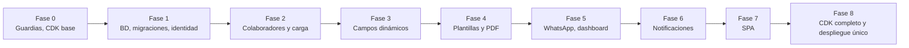

# Command Center v1: Plan de tareas de implementación

| Dato | Valor |
|---|---|
| Fase | 3 de spec-driven development (tareas). Este documento solo planea: no contiene código ni despliega nada. |
| Versión | 0.2: plan reducido y despliegue único al final (aprobado por Samuel el 14 de noviembre de 2026) |
| Fecha | 13 de noviembre de 2026; v0.2 del 14 de noviembre de 2026 |
| Deriva de | `.kiro/specs/requirements.md` (v0.1) y `.kiro/specs/design.md` (v0.1) |
| Estado de las tareas | Fases 0 y 1 ejecutadas (T-001 a T-049). Desde la v0.2 las tareas pendientes se agrupan en T-201 a T-230 y nada se despliega en AWS hasta T-229. El avance real está en `progreso.md`. |

---

## 0. Reglas de seguridad para AWS (obligatorias)

Aplican a **todas** las tareas que toquen AWS, desde la primera hasta la última. Si una regla no se puede cumplir, la ejecución se detiene y se pregunta.

### 0.1 Datos de la cuenta de prueba

| Dato | Valor |
|---|---|
| Perfil de AWS | `cc-test` (obtenido con `aws login`, credenciales temporales; o con IAM Identity Center). Es el único perfil permitido |
| Cuenta permitida | `034362033822` |
| Región | `us-east-1` |
| Etiqueta `responsable` | `Samuel Lopez` |
| Ambiente | `test` |
| Presupuesto | 50 USD al mes, con alertas a `samuel.lopez@honne.com` |

El número de cuenta es un identificador, no un secreto. Vive en `infra/config/ambientes.json` y nunca en el código de los stacks.

### 0.2 Las once reglas

1. **Credenciales.** No se piden, escriben ni guardan llaves de acceso de AWS en código, archivos del repositorio ni chat. Solo se usa el perfil definido en `AWS_PROFILE`, que en esta etapa es `cc-test`. El perfil `cc-test` se obtiene con `aws login` (usuario de IAM con credenciales temporales que rotan cada 15 minutos y duran hasta 12 horas) o con IAM Identity Center, y **nunca** con llaves de acceso de larga duración (cambio aprobado por Samuel el 13 de noviembre de 2026). Un hook de pre-commit con `detect-secrets` y una prueba lo verifican (T-001).
2. **Sesión activa.** Antes de cualquier comando de AWS se ejecuta `aws sts get-caller-identity --profile cc-test`. Si falla o la sesión venció, se detiene todo y se indica `aws login --profile cc-test --region us-east-1`. No se continúa con otro perfil.
3. **Cuenta correcta.** La cuenta devuelta debe ser `034362033822`. Si no coincide, se detiene.
4. **Guardia en CDK.** La aplicación de CDK rechaza la síntesis y el despliegue si `CDK_DEFAULT_ACCOUNT` no está en la lista permitida del ambiente. La lista vive en configuración. La guardia se implementa y se prueba antes que cualquier despliegue (T-004).
5. **Revisión antes de cambiar.** Antes de cada `cdk deploy` se ejecuta `cdk diff` y se muestra el resultado. No se despliega hasta que Samuel lo apruebe.
6. **Etiquetas obligatorias.** `proyecto=command-center`, `ambiente=<ambiente>` y `responsable=Samuel Lopez`, aplicadas en el nivel de la aplicación de CDK (T-005).
7. **Presupuesto.** Antes del primer despliegue (que incluye el bootstrap), se crea o verifica el presupuesto con alertas (T-008 y T-009).
8. **Sin borrado por el agente.** El agente no ejecuta nunca `cdk destroy`, `aws ... delete` ni ningún comando que borre recursos. Los borrados los ejecuta Samuel, a mano. Antes de cada borrado el agente muestra qué stacks o recursos se afectarían y entrega el comando exacto para que Samuel lo ejecute.
9. **Limpieza.** Si un despliegue termina en una cuenta equivocada, Samuel lo borra con el mismo perfil con el que se creó: `cdk destroy --all --profile <perfil>`. Después se revisa por etiqueta `proyecto=command-center` y se registra todo recurso que no se pueda borrar (llaves de KMS en espera, buckets con Object Lock, secretos con recuperación). El procedimiento se documenta en T-010.
10. **Bootstrap.** `cdk bootstrap` se ejecuta una sola vez por cuenta y región, solo tras confirmar la cuenta. En `cc-test` ya existe un `CDKToolkit` compartido con otros proyectos (versión 32): no se vuelve a ejecutar; T-012 solo lo verifica.
11. **Recursos con retención.** En `test`, RDS sin protección contra borrado, buckets con Object Lock en GOVERNANCE y retención mínima, y secretos configurados para poder borrarse. Las diferencias con producción se documentan (T-010, T-011) y no se implementan en producción sin revisión.

### 0.3 Protocolo AWS (PA)

Toda tarea marcada con `AWS` en su verificación empieza con este protocolo. Si cualquier paso falla, se detiene y se avisa.

| Paso | Acción |
|---|---|
| PA-1 | Fijar `AWS_PROFILE=cc-test` y la región `us-east-1`. Rechazar si hay otro perfil en la sesión |
| PA-2 | Ejecutar `scripts/aws_guard.ps1` (T-006): corre `aws sts get-caller-identity --profile cc-test`. Si falla: indicar `aws login --profile cc-test --region us-east-1` |
| PA-3 | Comprobar que la cuenta es `034362033822` (el mismo script) |
| PA-4 | Si la tarea despliega: mostrar `cdk diff` (T de diff previa) y esperar aprobación escrita |
| PA-5 | Si la tarea borra: mostrar qué se borra y esperar confirmación escrita |

### 0.4 Presupuesto de 50 USD al mes: riesgo y táctica

**Cambio de la v0.2 (decisión de Samuel, 14 de noviembre de 2026):** no se despliega nada en AWS hasta terminar la solución. Los stacks de las fases 0 y 1 se probaron en `cc-test` (T-018 y T-045 a T-049) y Samuel los destruyó con `cdk destroy`. El despliegue completo ocurre una sola vez, en T-229, con `scripts/desplegar.ps1` (T-227), de modo que el mismo procedimiento sirva para otras cuentas. Lo que sigue de esta sección se conserva como antecedente; donde cite T-044, T-146 o T-147, ahora aplica T-229.

El diseño completo (RDS, NAT, ALB, tareas de Fargate, WAF, CloudFront, Cognito con plan Essentials, claves de KMS y secretos) cuesta de forma fija más de lo que cubre un presupuesto de 50 USD si se deja encendido todo el mes. No incluyo cifras: se calculan con la calculadora de precios de AWS antes de cada despliegue de la Fase 1 y de la Fase 8.

**Vida útil prevista del prototipo (dato de Samuel):** se usará de 1 a 2 semanas y después Samuel lo destruirá a mano con `cdk destroy` (el agente no lo ejecuta). Eso cambia la táctica: el costo depende de cuánto tiempo estén encendidos los recursos, así que el reloj debe empezar lo más tarde posible.
- **Ventanas cortas en las fases 0 a 7.** Lo que se despliega en la Fase 0 (`CcSecurity`) y en la Fase 1 sirve para verificar la fase contra AWS real. Salvo que Samuel decida otra cosa, al aprobar el punto de control de la Fase 1 se propone que Samuel destruya a mano lo de la Fase 1 (el agente le da la lista y el comando) y que se vuelva a desplegar dentro del despliegue completo de la Fase 8. Así la red, RDS, NAT y Cognito no corren durante las semanas de desarrollo local.
- **Ventana de uso de 1 a 2 semanas desde T-147.** El despliegue completo (T-147 y T-148) marca el inicio. Antes de aprobar T-146 se estima el costo de esa ventana con la calculadora de precios y se compara con los 50 USD.
- **Cierre.** Al terminar la ventana, **Samuel** ejecuta `cdk destroy --all --profile cc-test` por su cuenta. El agente no lo ejecuta ni lo programa: en T-153 solo deja lista la guía con el comando y la lista de lo que se borrará (regla 8). Nada se borra automáticamente al cumplirse las dos semanas.
- Si el costo estimado de la ventana supera los 50 USD, se reduce el alcance del despliegue (por ejemplo, sin WAF, sin CloudFront o con una sola tarea por servicio) o se acorta la ventana, antes de desplegar.

**Configuración económica de `test` (acordada con Samuel):** para que una ventana de 1 a 2 semanas quepa en los 50 USD, `test` usa estos cambios sobre el diseño de producción. Todos son solo de `test`; `prod` conserva el diseño original (CC-NFR-005, CC-NFR-008) y las diferencias se documentan en T-010 y T-138.

| Id | Cambio en `test` | Tareas afectadas | Ahorro mensual aprox. |
|---|---|---|---|
| A | Instancia NAT (`t4g.micro`; `t4g.nano` no arranca por memoria, hallazgo de T-047) en lugar de NAT Gateway | T-014 | ~26 |
| B | Sin RDS Proxy; las Lambdas se conectan directo a la instancia | T-040, T-023, T-142 | evita ~22 |
| C | Sin WAF (`waf_habilitado = false`) | T-138, T-141 | ~12 |
| D | Workers (`pdf`, `cargas`, `whatsapp-entrada`) con mínimo 0 tareas | T-136, T-150 | evita ~48 |
| E | RDS `db.t4g.micro` en lugar de `small` | T-040 | ~13 |

Estimación de Samuel más lo que su lista no incluía (workers y RDS Proxy): unos 230 USD al mes sin cambios; con A a E, unos 105 USD al mes, es decir unos 50 USD en 2 semanas y entre 25 y 35 USD en 1 semana. Son órdenes de magnitud: el costo real se calcula con la calculadora de precios de AWS en T-044 y T-146 antes de aprobar cada despliegue. Consecuencias aceptadas: la NAT es una sola instancia sin alta disponibilidad; no hay protección de WAF en el prototipo; la primera constancia tras un periodo inactivo tarda en arrancar el worker; el p95 de 5 s del PDF se mide con el worker ya encendido; y la prueba de RDS Proxy queda para producción.
Táctica propuesta (se aprueba en cada punto de control):
- Mantener en `cc-test` solo lo que haga falta para verificar la fase y luego decidir con Samuel si se conserva o si él lo destruye. Destruir siempre lo hace Samuel (regla 8).
- Configuración económica de `test` (acordada, ver abajo): instancia NAT en lugar de NAT Gateway, RDS `db.t4g.micro` en una zona sin Multi-AZ y sin RDS Proxy, sin WAF, workers que escalan a 0 tareas, sin concurrencia aprovisionada, un solo servicio por tarea de ECS, sin endpoints de interfaz.
- Todo lo que se pueda verificar en local (Docker, LocalStack, simulador de Meta) se verifica en local antes de desplegar.
- Las alertas del presupuesto (80 % real, 100 % real y 100 % pronosticado) avisan por correo; no detienen recursos por sí solas.

### 0.5 Convenciones del plan

- **Desde la v0.2** una tarea agrupa un módulo completo con sus pruebas (antes, una sesión de 2 a 4 horas). La línea `Agrupa` indica las tareas de la v0.1 que reúne; su verificación es la suma de las verificaciones originales, que se conservan textualmente.
- **Requiere aprobación: sí** solo en T-229 y T-230, las únicas que tocan AWS. Las demás tareas son locales.
- Una tarea no empieza hasta que su verificación y la de sus dependencias estén terminadas.
- **Sin puntos de control por fase:** al cerrar cada fase se deja un resumen breve en `progreso.md` y se avisa a Samuel; el trabajo continúa salvo un bloqueo. Siguen vigentes las reglas de la sección 0, la regla de fallos (corregir una vez; si vuelve a fallar, detenerse y reportar) y la de detenerse antes de tocar archivos de otra tarea.
- Los requisitos de la columna `Requisitos` se explican en `requirements.md`; las secciones citadas son de `design.md`.

### 0.6 Asignación de piezas a las fases (acordada)

| Pieza | Fase |
|---|---|
| Cognito, triggers, usuarios, invitaciones, bitácora (servicio `dashboard`), base de datos y migraciones | 1 |
| Indicadores, alertas e historial de constancias | 5 |
| Chat de RH | 6 |
| CDK de API Gateway, CloudFront, WAF, Route 53, ECS y Lambdas; despliegue completo | 8 |
| Stub de `INT-CAM-01` en `colaboradores` (reemplazado en la Fase 3) | 2 y 3 |
| WhatsApp y Meta | Simulador hasta la Fase 8 (PQ-07); sin cuenta real de Meta en `cc-test` |
| Borde sin dominio propio (PQ-22) | Dominio de CloudFront y endpoint predeterminado de API Gateway protegido por el encabezado secreto de origen. Desviación del diseño §13.7, documentada en T-138 |

---

## Fase 0: Repositorio, configuración, guardias de AWS y base de CDK

Objetivo: dejar listas las protecciones antes de cualquier despliegue y desplegar solo `CcSecurity`.

- [x] T-001. Crear la estructura del monorepo y las herramientas de calidad
  - Fase: 0
  - Requisitos: CC-NFR-012, CC-NFR-013
  - Diseño: design.md §1.1, §1.2
  - Archivos: `pyproject.toml`, `Makefile`, `.editorconfig`, `.gitignore`, `.pre-commit-config.yaml` (ruff, mypy, gitleaks), `CODEOWNERS`, `README.md`, carpetas `infra/`, `services/`, `lambdas/`, `contracts/`, `frontend/`, `scripts/`, `docs/runbooks/`, `tests/`
  - Depende de: ninguna
  - Verificación: `make lint` pasa en un árbol vacío; el hook de `gitleaks` rechaza un commit de prueba que contiene una llave de AWS falsa; `.gitignore` excluye `cdk.out/`, `.env`, `*.pem` y credenciales
  - Requiere aprobación: no

- [x] T-002. Definir la configuración de ambientes y la lista permitida de cuentas
  - Fase: 0
  - Requisitos: CC-NFR-013
  - Diseño: design.md §13.8
  - Archivos: `infra/config/ambientes.json` (ambiente `test`: cuenta `034362033822`, región `us-east-1`, perfil `cc-test`, etiquetas, presupuesto de 50 USD y correo), `infra/config/esquema.py`
  - Depende de: T-001
  - Verificación: prueba unitaria que valida el esquema, rechaza un ambiente sin cuenta o con perfil distinto de `cc-test`, y comprueba que el archivo no contiene llaves de acceso
  - Requiere aprobación: no

- [x] T-003. Inicializar la aplicación de CDK en Python
  - Fase: 0
  - Requisitos: CC-NFR-013
  - Diseño: design.md §13, §1.2
  - Archivos: `infra/app.py`, `infra/cdk.json`, `infra/pyproject.toml`, `infra/requirements.txt`
  - Depende de: T-002
  - Verificación: `cdk synth` sin stacks termina sin error y lee el ambiente desde `-c ambiente=test`
  - Requiere aprobación: no

- [x] T-004. Implementar la guardia de cuenta en la aplicación de CDK
  - Fase: 0
  - Requisitos: CC-NFR-008, CC-NFR-013
  - Diseño: design.md §13 (restricciones de seguridad de la sección 0.2, regla 4)
  - Archivos: `infra/guardia.py`, `infra/app.py`, `infra/tests/test_guardia.py`
  - Depende de: T-003
  - Verificación: pruebas unitarias: cuenta permitida pasa; cuenta distinta, vacía o ausente en `CDK_DEFAULT_ACCOUNT`, y ambiente desconocido, fallan con un mensaje claro; `cdk synth` con `CDK_DEFAULT_ACCOUNT=111111111111` falla. **Ningún despliegue (T-012 en adelante) ocurre antes de que esta tarea esté verificada**
  - Requiere aprobación: no

- [x] T-005. Aplicar las etiquetas obligatorias en el nivel de la aplicación
  - Fase: 0
  - Requisitos: CC-NFR-013
  - Diseño: design.md §13 (convenciones)
  - Archivos: `infra/app.py`, `infra/tests/test_etiquetas.py`
  - Depende de: T-003; paralelo con T-004
  - Verificación: aserción de CDK que comprueba `proyecto=command-center`, `ambiente=test` y `responsable=Samuel Lopez` en un stack de prueba y que no se definen recurso por recurso
  - Requiere aprobación: no

- [x] T-006. Escribir el script de verificación de sesión y de cuenta
  - Fase: 0
  - Requisitos: CC-NFR-008
  - Diseño: design.md §13 (reglas 1 a 3 de la sección 0.2 de este documento)
  - Archivos: `scripts/aws_guard.ps1`, `scripts/tests/test_aws_guard.py`
  - Depende de: T-002; paralelo con T-004
  - Verificación: pruebas con salidas simuladas de `aws`: sesión vencida devuelve error con la indicación `aws sso login --profile cc-test`; cuenta distinta de `034362033822` aborta; un `AWS_PROFILE` distinto de `cc-test` aborta; la cuenta correcta devuelve éxito
  - Requiere aprobación: no

- [x] T-007. Ejecutar la verificación de sesión con el perfil cc-test (lectura)
  - Fase: 0
  - Requisitos: CC-NFR-008
  - Diseño: design.md §11.1 (acceso con perfil de IAM Identity Center)
  - Archivos: ninguno
  - Depende de: T-006
  - Verificación: AWS. PA completo (esta tarea ejecuta PA-1 a PA-3 por primera vez). El script devuelve el ARN del usuario y la cuenta `034362033822`. Si la sesión venció, se indica `aws sso login --profile cc-test` y se detiene hasta que Samuel inicie sesión
  - Requiere aprobación: no (solo lectura)

- [x] T-008. Preparar la definición y el script del presupuesto
  - Fase: 0
  - Requisitos: CC-NFR-011
  - Diseño: design.md §15.6
  - Archivos: `infra/budget/presupuesto.json` (50 USD al mes; alertas al 80 % real, 100 % real y 100 % pronosticado hacia `samuel.lopez@honne.com`), `scripts/crear_presupuesto.ps1` (idempotente: consulta primero, crea solo si falta)
  - Depende de: T-006
  - Verificación: revisión del JSON; el script, ejecutado en modo `-WhatIf`, muestra lo que haría sin llamar a AWS
  - Requiere aprobación: no

- [ ] T-009. Verificar o crear el presupuesto con alertas en cc-test
  - Fase: 0
  - Requisitos: CC-NFR-011
  - Diseño: design.md §15.6
  - Archivos: ninguno (usa `scripts/crear_presupuesto.ps1`)
  - Depende de: T-007, T-008
  - Verificación: AWS. PA completo. `aws budgets describe-budgets` y `describe-notifications-for-budget` muestran el presupuesto de 50 USD con las tres notificaciones al correo indicado. Si el perfil no tiene permiso de Budgets, se detiene y se pregunta
  - Requiere aprobación: sí

- [ ] T-010. Documentar las diferencias test y producción y el procedimiento de limpieza
  - Fase: 0
  - Requisitos: CC-NFR-009, CC-NFR-006
  - Diseño: design.md §13.8, §13.4, §14.5
  - Archivos: `docs/ambientes.md`
  - Depende de: T-002; paralelo con T-003
  - Verificación: revisión de Samuel. Incluye la tabla de diferencias (clase de RDS, RDS Proxy, Object Lock, secretos, instancia NAT o NAT Gateway, WAF, workers a 0, Multi-AZ), el procedimiento `cdk destroy --all --profile cc-test` (que ejecuta Samuel, no el agente) y la lista de recursos que no se borran de inmediato (claves de KMS en espera, secretos con recuperación, buckets con Object Lock)
  - Requiere aprobación: no

- [x] T-011. Implementar la política de retención por ambiente en los constructos de CDK
  - Fase: 0
  - Requisitos: CC-NFR-009, CC-NFR-013
  - Diseño: design.md §13.4, §13.8
  - Archivos: `infra/constructs/retencion.py`, `infra/tests/test_retencion.py`
  - Depende de: T-003
  - Verificación: aserción de CDK: en `test` la política devuelve borrado permitido, sin protección contra borrado y retención mínima de Object Lock; en `prod` devuelve conservar y proteger; ningún valor de `prod` se aplica sin revisión
  - Requiere aprobación: no

- [x] T-012. Verificar el bootstrap de CDK existente en cc-test (sin ejecutar cdk bootstrap)
  - Fase: 0
  - Requisitos: CC-NFR-013
  - Diseño: design.md §13.1, §13.9
  - Archivos: ninguno
  - Depende de: T-004, T-005, T-007, T-009
  - Verificación: AWS. PA completo. Solo lectura: el stack `CDKToolkit` existe en `034362033822/us-east-1` en estado `*_COMPLETE` y con versión de bootstrap compatible (6 o mayor). **No se ejecuta `cdk bootstrap`**: la cuenta es compartida con otros proyectos y volver a ejecutarlo modificaría su `CDKToolkit` (cambio aprobado por Samuel el 14 de noviembre de 2026)
  - Requiere aprobación: no (solo lectura)

- [x] T-013. Crear el stack CcSecurity (KMS, secretos y parámetros)
  - Fase: 0
  - Requisitos: CC-REQ-151, CC-REQ-152, CC-NFR-008
  - Diseño: design.md §8.3, §11.7, §13.1
  - Archivos: `infra/stacks/security.py`, `infra/tests/test_security.py`
  - Depende de: T-011
  - Verificación: aserciones de CDK: claves `cc-test-datos` y `cc-test-infra` con rotación anual; secretos `meta`, `hmac-celular`, `hmac-codigo`, `internal-auth` y `cf-signing-key` vacíos y cifrados con KMS; ninguna política con `Resource: "*"` salvo las que no admiten recurso; en `test` los recursos admiten borrado
  - Requiere aprobación: no

- [x] T-014. Crear el stack CcNetwork con la configuración mínima de test
  - Fase: 0
  - Requisitos: CC-NFR-005, CC-NFR-008
  - Diseño: design.md §13.3
  - Archivos: `infra/stacks/network.py`, `infra/tests/test_network.py`
  - Depende de: T-011; paralelo con T-013
  - Verificación: aserciones de CDK: VPC con subredes públicas, de aplicación y de datos; en `test`, una instancia NAT `t4g.nano` en lugar de NAT Gateway (en `prod`, una NAT Gateway por zona); endpoint de S3 de tipo gateway; grupos de seguridad con los orígenes de la sección 13.3; sin reglas de entrada abiertas a `0.0.0.0/0`
  - Requiere aprobación: no

- [x] T-015. Integrar cdk-nag y la síntesis de todos los stacks
  - Fase: 0
  - Requisitos: CC-NFR-008, CC-NFR-013
  - Diseño: design.md §13 (cdk-nag, DS-23)
  - Archivos: `infra/tests/test_nag.py`, `infra/app.py`
  - Depende de: T-013, T-014
  - Verificación: `cdk synth` termina sin errores de `cdk-nag`; toda supresión lleva su justificación escrita
  - Requiere aprobación: no

- [x] T-016. Armar el pipeline mínimo de integración (sin despliegue)
  - Fase: 0
  - Requisitos: CC-NFR-012, CC-NFR-013
  - Diseño: design.md §14.2 (versión mínima)
  - Archivos: `scripts/ci.ps1`, `Makefile` (objetivo `ci`), `infra/pipeline/buildspec-ci.yml` (definido, no desplegado)
  - Depende de: T-015
  - Verificación: `make ci` ejecuta lint, pruebas unitarias, `cdk synth` y construcción de imágenes sin subirlas ni llamar a AWS; el buildspec no contiene credenciales
  - Requiere aprobación: no

- [x] T-017. Mostrar el cdk diff de CcSecurity (lectura)
  - Fase: 0
  - Requisitos: CC-NFR-008
  - Diseño: design.md §13.1
  - Archivos: ninguno
  - Depende de: T-012, T-013, T-016
  - Verificación: AWS. PA completo. Se muestra el resultado de `cdk diff CcSecurity-test --profile cc-test` a Samuel. No se despliega
  - Requiere aprobación: no (solo lectura; el despliegue de T-018 depende de su aprobación)

- [x] T-018. Desplegar CcSecurity en cc-test
  - Fase: 0
  - Requisitos: CC-REQ-151, CC-REQ-152, CC-NFR-008
  - Diseño: design.md §13.1
  - Archivos: ninguno
  - Depende de: T-017
  - Verificación: AWS. PA completo y aprobación escrita del diff de T-017. El stack termina en `CREATE_COMPLETE`
  - Requiere aprobación: sí

- [x] T-019. Verificar etiquetas y recursos desplegados
  - Fase: 0
  - Requisitos: CC-NFR-013
  - Diseño: design.md §13
  - Archivos: `scripts/verificar_etiquetas.ps1`
  - Depende de: T-018
  - Verificación: AWS. PA completo. `aws resourcegroupstaggingapi get-resources --tag-filters Key=proyecto,Values=command-center` lista los recursos del stack y todos llevan las tres etiquetas con los valores correctos
  - Requiere aprobación: no (solo lectura)

- [x] T-020. Punto de control de la Fase 0
  - Fase: 0
  - Requisitos: CC-NFR-008, CC-NFR-011, CC-NFR-013
  - Diseño: design.md §13
  - Archivos: ninguno
  - Depende de: T-019
  - Verificación: se presenta a Samuel el resumen: guardia probada, etiquetas verificadas, presupuesto activo, bootstrap hecho y CcSecurity desplegado, con la lista de recursos y su costo esperado. **Se espera aprobación antes de iniciar la Fase 1**
  - Requiere aprobación: sí (decisión de continuar)

---

## Fase 1: Base de datos, migraciones e identidad

Objetivo: biblioteca común, esquema completo de PostgreSQL, servicio `dashboard` (acceso, invitaciones y bitácora), Cognito y la primera infraestructura de datos en `cc-test`.

- [x] T-021. Crear la base de `cc_common`: configuración, errores, logging y tipos de validación
  - Fase: 1
  - Requisitos: CC-REQ-025, CC-REQ-162, CC-NFR-010, CC-NFR-014
  - Diseño: design.md §9.1, §9.4, §10.1, §10.2, §15.1
  - Archivos: `services/shared/cc_common/config.py`, `errores.py`, `logging.py`, `tipos.py`, `tests/`
  - Depende de: T-001
  - Verificación: pruebas unitarias: el manejador problem+json no incluye el valor recibido; el filtro enmascara celular, RFC, CURP, NSS y correo; `Celular10`, `Rfc13`, `RfcOrg`, `Curp`, `Nss`, `RegistroPatronal` y `NumeroEmpleado` aceptan y rechazan la tabla de casos de §10.1 (con `hypothesis`)
  - Requiere aprobación: no

- [x] T-022. Montar el entorno local de pruebas (PostgreSQL 16 y LocalStack)
  - Fase: 1
  - Requisitos: CC-NFR-012
  - Diseño: design.md §16.1
  - Archivos: `docker-compose.yml`, `tests/conftest.py`, `tests/fixtures/`
  - Depende de: T-001; paralelo con T-021
  - Verificación: `make test-env` levanta PostgreSQL 16 con `pg_trgm` y `unaccent`, y LocalStack con S3, SQS, EventBridge, SNS y SES; las fixtures de Testcontainers crean y destruyen la base por prueba
  - Requiere aprobación: no

- [x] T-023. Implementar `cc_common.db` (motor, sesión, `app.empresa_id` y paginación)
  - Fase: 1
  - Requisitos: CC-REQ-150
  - Diseño: design.md §2.1, §3.1, §8.2
  - Archivos: `services/shared/cc_common/db.py`, `paginacion.py`, `tests/test_db.py`
  - Depende de: T-021, T-022
  - Verificación: prueba de integración: una sesión con `app.empresa_id = 1` no lee filas de la empresa 2 (con política RLS de prueba); el host de la base es configurable (instancia directa o RDS Proxy) para usar el mismo código en `test` y `prod`; reintento ante `serialization_failure`; paginación por cursor estable
  - Requiere aprobación: no

- [x] T-024. Implementar `cc_common.crypto` (cifrado de sobre y HMAC)
  - Fase: 1
  - Requisitos: CC-REQ-151, CC-REQ-152
  - Diseño: design.md §8.3, §8.4
  - Archivos: `services/shared/cc_common/crypto.py`, `tests/test_crypto.py`
  - Depende de: T-021; paralelo con T-023
  - Verificación: pruebas unitarias con KMS simulado: ida y vuelta de AES-GCM; un valor copiado a otra fila (AAD distinta) no descifra; una versión de DEK distinta descifra con su versión; el HMAC del celular es determinista y usa la llave inyectada; ningún método registra el valor
  - Requiere aprobación: no

- [x] T-025. Implementar `cc_common.auth` (claims, usuario actual y permisos)
  - Fase: 1
  - Requisitos: CC-REQ-009, CC-REQ-153, CC-NFR-017
  - Diseño: design.md §11.1, §11.6
  - Archivos: `services/shared/cc_common/auth.py`, `permisos.py`, `tests/test_auth.py`
  - Depende de: T-021
  - Verificación: pruebas unitarias: valida firma, `iss`, `token_use`, `client_id`, exp, y presencia de `empresa_id` y `rol`; `ROL_PERMISOS['RH']` contiene todos los permisos; una prueba recorre las rutas de un servicio de ejemplo y falla si alguna no declara permiso
  - Requiere aprobación: no

- [x] T-026. Implementar bitácora, outbox, eventos y cliente interno en `cc_common`
  - Fase: 1
  - Requisitos: CC-REQ-154, CC-REQ-156, CC-REQ-161, CC-NFR-007
  - Diseño: design.md §2.7, §3.8, §9.3
  - Archivos: `services/shared/cc_common/bitacora.py`, `outbox.py`, `eventos.py`, `internal_client.py`, `tests/`
  - Depende de: T-023
  - Verificación: pruebas de integración: `registrar()` rechaza claves de `detalle` no permitidas; el relay publica del `outbox` con `FOR UPDATE SKIP LOCKED` sin duplicar con dos relays; el consumidor ignora un `event_id` repetido; el cliente interno aplica tiempo máximo, reintentos solo en idempotentes y corte de circuito
  - Requiere aprobación: no

- [x] T-027. Escribir las migraciones de `identidad` y `auditoria`
  - Fase: 1
  - Requisitos: CC-REQ-007, CC-REQ-008, CC-REQ-010, CC-REQ-154, CC-REQ-155, CC-REQ-156
  - Diseño: design.md §2.2 (identidad, auditoria), §2.7, §2.8
  - Archivos: `services/dashboard/migrations/` (Alembic con tabla de versiones por esquema)
  - Depende de: T-022
  - Verificación: la migración sube y baja en el contenedor local; existen `empresa`, `usuario`, `invitacion_registro` y `bitacora` con sus restricciones; el `UPDATE` y el `DELETE` sobre `bitacora` fallan por el trigger
  - Requiere aprobación: no

- [x] T-028. Escribir las migraciones de `campos` y `colaboradores`
  - Fase: 1
  - Requisitos: CC-REQ-020, CC-REQ-023, CC-REQ-024, CC-REQ-043, CC-REQ-044, CC-REQ-045, CC-REQ-047, CC-REQ-049, CC-REQ-050
  - Diseño: design.md §2.2 (campos, colaboradores), §2.3, §2.4
  - Archivos: `services/campos/migrations/`, `services/colaboradores/migrations/`
  - Depende de: T-027
  - Verificación: las tablas coinciden con el `.dot` más los cambios de §2.3; existen los índices de §2.4 (incluido el trigrama); `UNIQUE (empresa_id, numero_empleado)` y `UNIQUE (empresa_id, celular_hash)` rechazan duplicados; los `CHECK` de `tipo_empleado`, `estatus` y `num_nonnulls` de `valor_campo` funcionan
  - Requiere aprobación: no

- [x] T-029. Escribir las migraciones de `whatsapp`, `constancias` y `notificaciones`, con vistas y funciones
  - Fase: 1
  - Requisitos: CC-REQ-011, CC-REQ-012, CC-REQ-013, CC-REQ-064, CC-REQ-066, CC-REQ-079, CC-REQ-081, CC-REQ-082, CC-REQ-084, CC-REQ-087, CC-REQ-090, CC-REQ-100, CC-REQ-101, CC-REQ-106, CC-REQ-112, CC-REQ-114, CC-REQ-117, CC-NFR-007
  - Diseño: design.md §2.2 (whatsapp, constancias, notificaciones), §2.3, §2.6, §2.7
  - Archivos: `services/whatsapp/migrations/`, `services/constancias/migrations/`, `services/notificaciones/migrations/`
  - Depende de: T-028
  - Verificación: tablas, `CHECK` de estados y enumeraciones, índices parciales y únicos (`folio` por empresa, `solicitud_id`, `codigo_verificacion`, `token_hash`, conversación abierta por número); triggers que rechazan `UPDATE` y `DELETE` sobre `version_plantilla` y los cambios no permitidos sobre `constancia_generada`; función `rango_estado_envio`; vistas `security_invoker` contractuales de `dashboard`
  - Requiere aprobación: no

- [x] T-030. Escribir el script de roles de base de datos y políticas RLS
  - Fase: 1
  - Requisitos: CC-REQ-150, CC-REQ-155, CC-NFR-012
  - Diseño: design.md §2.1, §2.6
  - Archivos: `infra/db/roles.sql`, `infra/db/rls.sql`, `infra/db/grants.sql`
  - Depende de: T-029
  - Verificación: script idempotente que crea `svc_*` y `migrador`, habilita RLS con la política por `app.empresa_id` en todas las tablas con `empresa_id`, concede solo `INSERT` en `auditoria.bitacora` y los permisos de §2.6; se ejecuta dos veces sin error
  - Requiere aprobación: no

- [x] T-031. Construir el script `migrar_todo` y la imagen de migraciones
  - Fase: 1
  - Requisitos: CC-NFR-012
  - Diseño: design.md §2.8
  - Archivos: `scripts/migrar_todo.py`, `infra/docker/migrar/Dockerfile`
  - Depende de: T-030
  - Verificación: la imagen aplica las migraciones en el orden `identidad`, `auditoria`, `campos`, `colaboradores`, `whatsapp`, `constancias`, `notificaciones`, y después `roles.sql`, `rls.sql` y `grants.sql`, contra PostgreSQL local; termina con código distinto de cero si una migración falla
  - Requiere aprobación: no

- [x] T-032. Probar el esquema: restricciones, inmutabilidad, RLS y permisos entre esquemas
  - Fase: 1
  - Requisitos: CC-REQ-023, CC-REQ-024, CC-REQ-150, CC-REQ-155, CC-NFR-012
  - Diseño: design.md §2.6, §2.7, §16.1
  - Archivos: `tests/integracion/test_esquema.py`
  - Depende de: T-031
  - Verificación: pruebas de integración: unicidad por empresa; `CHECK`; triggers de inmutabilidad; la lectura de otra empresa devuelve cero filas; un `SELECT` de `svc_notificaciones` sobre una tabla de `colaboradores` da `permission denied`
  - Requiere aprobación: no

- [x] T-033. Crear el esqueleto del servicio `dashboard` y la exportación de OpenAPI
  - Fase: 1
  - Requisitos: CC-NFR-012
  - Diseño: design.md §3.1, §3.2, §1.3
  - Archivos: `services/dashboard/app/main.py`, `api/`, `servicios/`, `repos/`, `schemas/`, `Dockerfile`, `scripts/exportar_openapi.py`, `contracts/openapi/dashboard.json`
  - Depende de: T-023, T-025, T-026
  - Verificación: `GET /salud` responde 200; la exportación de OpenAPI es determinista; las respuestas de error usan problem+json con `correlacion_id`
  - Requiere aprobación: no

- [x] T-034. Implementar DSH-06, DSH-07 y DSH-10 (sesión, usuario actual e invitaciones)
  - Fase: 1
  - Requisitos: CC-REQ-005, CC-REQ-007, CC-REQ-008, CC-REQ-009
  - Diseño: design.md §3.2, §11.2
  - Archivos: `services/dashboard/app/api/usuarios.py`, `servicios/invitacion_service.py`, `repos/`, `tests/`
  - Depende de: T-033
  - Verificación: pruebas de integración: la invitación devuelve el código una sola vez y guarda solo el SHA-256 con 72 horas de caducidad; `sesion/iniciar` registra `LOGIN` con la IP del encabezado de CloudFront y es idempotente por `jti`; `usuarios/yo` devuelve el rol RH
  - Requiere aprobación: no

- [x] T-035. Implementar DSH-08, DSH-09 y DSH-05 (usuarios, desactivación y bitácora)
  - Fase: 1
  - Requisitos: CC-REQ-010, CC-REQ-015
  - Diseño: design.md §3.2, §8.1
  - Archivos: `services/dashboard/app/api/usuarios.py`, `bitacora.py`, `servicios/`, `tests/`
  - Depende de: T-034
  - Verificación: pruebas de integración: no se puede desactivar a sí mismo ni al último usuario activo (409); la desactivación llama al cliente de Cognito simulado (`AdminDisableUser`, `AdminUserGlobalSignOut`); la bitácora filtra por fecha, usuario, colaborador y acción, con orden ascendente y descendente y paginación por cursor
  - Requiere aprobación: no

- [x] T-036. Implementar las Lambdas `cognito-pre-signup` y `cognito-post-confirmation`
  - Fase: 1
  - Requisitos: CC-REQ-001, CC-REQ-007, CC-REQ-008
  - Diseño: design.md §4.6, §11.2
  - Archivos: `lambdas/cognito_triggers/pre_signup.py`, `post_confirmation.py`, `tests/`
  - Depende de: T-027, T-026
  - Verificación: pruebas con eventos simulados: sin código, código vencido, código usado y correo distinto se rechazan con el mismo mensaje genérico; un código válido permite el registro; `post-confirmation` crea el usuario con empresa y rol RH y marca la invitación usada en una sola transacción y registra la bitácora
  - Requiere aprobación: no

- [x] T-037. Implementar la Lambda `cognito-pre-token`
  - Fase: 1
  - Requisitos: CC-REQ-004, CC-REQ-009, CC-REQ-010
  - Diseño: design.md §4.6, §11.2
  - Archivos: `lambdas/cognito_triggers/pre_token.py`, `tests/`
  - Depende de: T-027; paralelo con T-036
  - Verificación: pruebas con eventos simulados: agrega `empresa_id` y `rol` al token de acceso; rechaza si el usuario está inactivo o si `ultima_actividad` tiene más de 30 minutos; no agrega nada si el usuario no existe
  - Requiere aprobación: no

- [x] T-038. Escribir `bootstrap_admin.py` (empresa e invitación inicial)
  - Fase: 1
  - Requisitos: CC-REQ-008
  - Diseño: design.md §11.2, §13.9
  - Archivos: `scripts/bootstrap_admin.py`, `tests/`
  - Depende de: T-027
  - Verificación: prueba de integración: crea la empresa, genera una invitación y muestra el código una sola vez en la consola interactiva, sin escribirlo en logs; es idempotente si la empresa ya existe (no crea una segunda invitación sin una bandera explícita)
  - Requiere aprobación: no

- [x] T-039. Crear los stacks CcStorage y su prueba
  - Fase: 1
  - Requisitos: CC-REQ-081, CC-NFR-009
  - Diseño: design.md §13.4
  - Archivos: `infra/stacks/storage.py`, `infra/tests/test_storage.py`
  - Depende de: T-013; paralelo con T-040
  - Verificación: aserciones de CDK: buckets `frontend`, `plantillas`, `constancias` (Object Lock habilitado, versionado, GOVERNANCE con retención mínima en `test`), `cargas` (expiración a 7 días, CORS de `PUT`) y `logs`; bloqueo de acceso público; política que exige TLS; cifrado con KMS; el borrado permitido en `test`
  - Requiere aprobación: no

- [x] T-040. Crear el stack CcData (RDS, RDS Proxy opcional y secretos de roles)
  - Fase: 1
  - Requisitos: CC-NFR-005, CC-NFR-006
  - Diseño: design.md §13.4
  - Archivos: `infra/stacks/data.py`, `infra/tests/test_data.py`
  - Depende de: T-013, T-014
  - Verificación: aserciones de CDK: PostgreSQL 16, `db.t4g.micro` en una zona y sin protección contra borrado en `test` (`db.t4g.medium` Multi-AZ y con protección en `prod`), `storage_encrypted`, `rds.force_ssl = 1`, retención de respaldos de 1 día en `test`, RDS Proxy con TLS obligatorio solo en `prod` (en `test` no se despliega y las Lambdas se conectan directo a la instancia con TLS obligatorio), un secreto por rol de base de datos
  - Requiere aprobación: no

- [x] T-041. Crear el stack CcMessaging (colas, bus, Scheduler, SNS y SES)
  - Fase: 1
  - Requisitos: CC-NFR-007, CC-NFR-016, CC-REQ-164
  - Diseño: design.md §4.1, §13.5
  - Archivos: `infra/stacks/messaging.py`, `infra/tests/test_messaging.py`
  - Depende de: T-013; paralelo con T-039, T-040
  - Verificación: aserciones de CDK: las colas de §4.1 con su DLQ, visibilidad, máximo de recepciones, retención de 4 y 14 días y cifrado con KMS; el bus `cc-eventos` con sus reglas hacia las colas `ev-*`; el grupo de Scheduler y su rol de destino; el tema `alertas-rh` cifrado; la identidad de SES por correo (el dominio queda para PQ-22)
  - Requiere aprobación: no

- [x] T-042. Crear el stack CcAuth (Cognito y triggers)
  - Fase: 1
  - Requisitos: CC-REQ-001, CC-REQ-002, CC-REQ-003, CC-REQ-006, CC-REQ-004
  - Diseño: design.md §11.2, §13.1
  - Archivos: `infra/stacks/auth.py`, `infra/tests/test_auth.py`
  - Depende de: T-036, T-037, T-040
  - Verificación: aserciones de CDK: MFA `REQUIRED` con TOTP y sin SMS; contraseña de al menos 12 caracteres con las cuatro clases; token de acceso de 15 minutos y de actualización de 8 horas con rotación; registro propio habilitado con el trigger de pre-registro; recuperación de contraseña por correo; plan de funciones Essentials (DS-20; **tiene costo**, se indica en el diff); Lambdas en la VPC con concurrencia reservada de 5
  - Requiere aprobación: no

- [x] T-043. Crear el stack base de CcCompute (clúster, ECR y tareas `migrar` y `ops`)
  - Fase: 1
  - Requisitos: CC-NFR-012, CC-NFR-013
  - Diseño: design.md §13.6, §2.8, §13.9
  - Archivos: `infra/stacks/compute_base.py`, `infra/tests/test_compute_base.py`, `infra/docker/ops/Dockerfile`
  - Depende de: T-014, T-040, T-031
  - Verificación: aserciones de CDK: clúster de Fargate ARM64, repositorios de ECR con escaneo y política de ciclo de vida, definiciones de tarea `migrar` y `ops` (con ECS Exec registrado) y sus roles de IAM de mínimo privilegio
  - Requiere aprobación: no

- [x] T-044. Mostrar el cdk diff de los stacks de la Fase 1 (lectura)
  - Fase: 1
  - Requisitos: CC-NFR-008
  - Diseño: design.md §13.1
  - Archivos: ninguno
  - Depende de: T-039, T-040, T-041, T-042, T-043, T-018
  - Verificación: AWS. PA completo. `cdk diff` de `CcNetwork`, `CcStorage`, `CcData`, `CcMessaging`, `CcAuth` y `CcComputeBase` en `test`, junto con el cálculo de costo mensual esperado con la calculadora de precios de AWS contra el presupuesto de 50 USD y la táctica de la sección 0.4. Se espera aprobación escrita
  - Requiere aprobación: no (solo lectura; el despliegue de T-045 depende de su aprobación)

- [x] T-045. Desplegar los stacks de la Fase 1 en cc-test
  - Fase: 1
  - Requisitos: CC-NFR-005, CC-NFR-007, CC-NFR-016
  - Diseño: design.md §13.1
  - Archivos: ninguno
  - Depende de: T-044
  - Verificación: AWS. PA completo y aprobación escrita del diff de T-044. Cada stack termina en `CREATE_COMPLETE`
  - Requiere aprobación: sí

- [x] T-046. Construir y publicar la imagen de migraciones en ECR
  - Fase: 1
  - Requisitos: CC-NFR-012
  - Diseño: design.md §2.8, §14.2
  - Archivos: ninguno (usa `infra/docker/migrar/Dockerfile`)
  - Depende de: T-045
  - Verificación: AWS. PA completo. Inicio de sesión de Docker en ECR con el perfil `cc-test`, `docker push`, y la imagen visible con su resumen en el repositorio
  - Requiere aprobación: sí

- [x] T-047. Ejecutar las migraciones, los roles y las políticas RLS en cc-test
  - Fase: 1
  - Requisitos: CC-REQ-150, CC-NFR-012
  - Diseño: design.md §2.8, §14.2
  - Archivos: ninguno
  - Depende de: T-046
  - Verificación: AWS. PA completo. `ecs run-task` de la tarea `migrar` termina con código 0; el registro muestra las migraciones en el orden de §2.8; se vuelve a ejecutar y no cambia nada. No se imprimen credenciales
  - Requiere aprobación: sí

- [x] T-048. Verificar los recursos de la Fase 1 (lectura)
  - Fase: 1
  - Requisitos: CC-NFR-005, CC-NFR-007, CC-NFR-009, CC-NFR-016
  - Diseño: design.md §13.4, §13.5
  - Archivos: `scripts/verificar_f1.ps1`
  - Depende de: T-047
  - Verificación: AWS. PA completo. El script (solo lectura) confirma: RDS cifrado y sin acceso público; Object Lock activo en `constancias`; colas con su DLQ y cifrado; pool de Cognito con MFA `REQUIRED`; todas las etiquetas presentes
  - Requiere aprobación: no (solo lectura)

- [x] T-049. Ejecutar bootstrap_admin en cc-test
  - Fase: 1
  - Requisitos: CC-REQ-008
  - Diseño: design.md §11.2, §13.9
  - Archivos: ninguno
  - Depende de: T-047, T-038
  - Verificación: AWS. PA completo. La tarea `ops` crea la empresa y la primera invitación; el código se muestra una sola vez por una sesión interactiva de ECS Exec, no por los logs de CloudWatch; el grupo de logs de la tarea no contiene el código
  - Requiere aprobación: sí

- T-050. Probar el registro, el MFA y el inicio de sesión con Cognito real (v0.2: pasa a T-229, donde se prueba con el despliegue final)
  - Fase: 1
  - Requisitos: CC-REQ-001, CC-REQ-002, CC-REQ-004, CC-REQ-006, CC-REQ-007, CC-REQ-008
  - Diseño: design.md §11.2
  - Archivos: `scripts/probar_registro.py`
  - Depende de: T-049, T-042
  - Verificación: AWS. PA completo. Con el código de T-049: el registro y la confirmación de correo funcionan, se enrola TOTP, el inicio de sesión exige el código, el token de acceso trae `empresa_id` y `rol = RH`, un código ya usado se rechaza y la recuperación de contraseña envía el correo. Crea un usuario real en el pool
  - Requiere aprobación: sí

- T-051. Punto de control de la Fase 1 (v0.2: reemplazada: sin punto de control; resumen de la Fase 1 en `progreso.md`)
  - Fase: 1
  - Requisitos: CC-NFR-012
  - Diseño: design.md §2, §13
  - Archivos: ninguno
  - Depende de: T-050
  - Verificación: resumen para Samuel: esquema migrado, identidad probada con Cognito real, costo acumulado contra el presupuesto, y la decisión de mantener o destruir los stacks de `cc-test` (la destrucción pasa por las reglas 8 y 9). Dado que el prototipo vivirá de 1 a 2 semanas, la recomendación por defecto es que Samuel destruya a mano los stacks de la Fase 1 tras este punto de control (el agente entrega la lista de lo que se borraría y el comando exacto, pero no lo ejecuta) y volver a desplegarlos en la Fase 8. **Se espera aprobación antes de la Fase 2**
  - Requiere aprobación: sí (decisión de continuar)

---

## Fase 2: Servicio de colaboradores y carga masiva

Objetivo: CRUD de colaboradores, organizaciones y plantas con cifrado, elegibilidad, interfaces internas y carga masiva de Excel. Todo en local (Docker, PostgreSQL y LocalStack); no toca AWS.

- [x] T-201. Servicio `colaboradores`: esqueleto, repositorios con cifrado, organizaciones, logotipo y plantas
  - Fase: 2
  - Agrupa: T-052, T-053, T-054
  - Requisitos: CC-REQ-021, CC-REQ-024, CC-REQ-043, CC-REQ-044, CC-REQ-062, CC-REQ-151, CC-REQ-152, CC-REQ-161, CC-NFR-012
  - Diseño: design.md §2.2, §3.3, §8.3, §8.4, §10.2
  - Archivos: `services/colaboradores/app/main.py`, `api/`, `servicios/`, `repos/`, `schemas/`, `Dockerfile`, `app/campos_cliente.py` (cliente de INT-CAM-01 con un stub), `app/validador_campos.py`, `services/colaboradores/app/repos/colaborador.py`, `valor_campo.py`, `servicios/clave_datos.py`, `tests/`, `services/colaboradores/app/api/organizaciones.py`, `plantas.py`
  - Depende de: T-033, T-028, T-024
  - Verificación:
    - (T-052, Crear el esqueleto del servicio `colaboradores` y el cliente de definiciones de campos) `/salud` responde; `ValidadorCampos` valida tipo, obligatorio, `formato_validacion` (con `re2`) y lista contra definiciones del stub; el stub se marca para ser reemplazado en T-072
    - (T-053, Implementar los repositorios de colaborador y valor de campo con cifrado) prueba de integración: el celular se guarda cifrado con `celular_hash` y `celular_ultimos4`; los campos sensibles van a `valor_cifrado` y no a las columnas tipadas; `CHECK num_nonnulls` se respeta; no hay valores sensibles en el SQL registrado
    - (T-054, Implementar organizaciones, logotipo y plantas (COL-08 a COL-15)) pruebas de integración: clave única por empresa e inmutable; RFC de 12 o 13 caracteres; sin endpoint de borrado, solo `activa = false`; el logotipo valida tipo real, tamaño de 1 MB y la ruta bajo `logotipos/{empresa_id}/` con LocalStack; nombre de planta único sin distinguir mayúsculas
  - Requiere aprobación: no

- [x] T-202. Colaboradores: alta, detalle, edición, baja, reactivación, consentimiento, elegibilidad y listado (COL-01 a COL-07)
  - Fase: 2
  - Agrupa: T-055, T-056, T-057, T-058
  - Requisitos: CC-REQ-020, CC-REQ-021, CC-REQ-022, CC-REQ-023, CC-REQ-024, CC-REQ-025, CC-REQ-026, CC-REQ-027, CC-REQ-028, CC-REQ-029, CC-REQ-030, CC-REQ-031, CC-REQ-032, CC-REQ-033, CC-REQ-150, CC-REQ-153, CC-REQ-154, CC-REQ-156, CC-REQ-157, CC-REQ-161
  - Diseño: design.md §2.4, §3.3, §8.1, §8.2, §10.1
  - Archivos: `services/colaboradores/app/api/colaboradores.py`, `servicios/colaborador_service.py`, `schemas/`, `tests/`, `servicios/`, `servicios/elegibilidad_service.py`, `repos/listado.py`
  - Depende de: T-201
  - Verificación:
    - (T-055, Implementar el alta de colaborador (COL-02)) pruebas de integración: los once campos son obligatorios (incluido `tipo_empleado`); número y celular duplicados dan 409 con su código; formatos inválidos dan 422 sin eco del valor; sin consentimiento se guarda; registra `ALTA` en la bitácora; las constraints se traducen a códigos sin texto de PostgreSQL
    - (T-056, Implementar el detalle y la edición (COL-03 y COL-04)) pruebas de integración: los sensibles salen enmascarados salvo `incluir_sensibles=true`, que registra `CONSULTA_SENSIBLE` sin valores; el detalle registra `CONSULTA_DETALLE`; la edición exige `If-Match` (412 si hay desajuste), no cambia `estatus` ni `numero_empleado`, y registra `MODIFICACION` con nombres de campos y sin valores
    - (T-057, Implementar baja, reactivación, consentimiento y elegibilidad (COL-05 a COL-07)) pruebas de integración: la baja guarda la fecha y nunca borra; 409 si ya está en BAJA; reactivar sin consentimiento vigente da 422 `CONSENTIMIENTO_REQUERIDO` y con `consentimiento=true` lo registra; `ElegibilidadService` devuelve no elegible para BAJA, sin consentimiento o con consentimiento vencido
    - (T-058, Implementar el listado, la búsqueda y los filtros (COL-01)) pruebas de integración con 10,000 filas: búsqueda por nombre con acentos y parcial usa el índice trigrama; filtros por organización, planta, estatus, tipo y campo dinámico no sensible; columnas elegidas por el cliente; los campos sensibles no se filtran ni se devuelven; paginación con total
  - Requiere aprobación: no

- [x] T-203. Interfaces internas de colaboradores (INT-COL-01 a 05, 07 y 08)
  - Fase: 2
  - Agrupa: T-059
  - Requisitos: CC-REQ-071, CC-REQ-072, CC-REQ-073, CC-REQ-076, CC-REQ-115, CC-REQ-157
  - Diseño: design.md §3.3, §7.2
  - Archivos: `services/colaboradores/app/api/internas.py`, `servicios/`, `tests/`
  - Depende de: T-202
  - Verificación:
    - (T-059, Implementar las interfaces internas de colaboradores (INT-COL-01 a 05, 07 y 08)) pruebas de integración: buscar por celular devuelve el hash aun si no existe; el desafío elige NSS o fecha de ingreso; verificar compara en tiempo constante sin devolver el dato; `datos-constancia` devuelve valores y faltantes y registra `CONSULTA_SENSIBLE` con origen `SISTEMA`; `contactos:resolver` aplica elegibilidad y devuelve correo solo con propósito `CORREO`; sin token interno, 401
  - Requiere aprobación: no

- [x] T-204. Carga masiva: plantilla de Excel, validador, `worker-cargas`, endpoints y prueba con la plantilla real
  - Fase: 2
  - Agrupa: T-060, T-061, T-062, T-063, T-064, T-065
  - Requisitos: CC-REQ-025, CC-REQ-034, CC-REQ-035, CC-REQ-036, CC-REQ-037, CC-REQ-038, CC-REQ-039, CC-REQ-040, CC-REQ-041, CC-REQ-042, CC-REQ-150, CC-REQ-153, CC-REQ-162, CC-NFR-003, CC-NFR-004
  - Diseño: design.md §3.3, §4.7, §8.1, §10.1, §10.3, §15.4, §16.1
  - Archivos: `services/colaboradores/app/excel/generador.py`, `tests/`, `services/colaboradores/app/excel/lector.py`, `validador.py`, `services/colaboradores/app/workers/worker_cargas.py`, `services/colaboradores/app/api/cargas.py`, `servicios/carga_service.py`, `tests/integracion/test_carga_real.py`, `tests/carga/colaboradores_k6.js`
  - Depende de: T-202
  - Verificación:
    - Resumen de cierre de la Fase 2 en `progreso.md` (sustituye al punto de control T-065)
    - (T-060, Generar la plantilla de carga de Excel (COL-16)) prueba de integración: el archivo trae las hojas Instrucciones, Colaboradores, Organizaciones, Diccionario, Catálogos y `_meta` (ocultas donde corresponde), encabezados y fila 2 desde la configuración activa, tipo de empleado y apellido materno como obligatorios, validaciones de lista, y se abre con `openpyxl`; al activar un campo en el stub aparece en la siguiente descarga
    - (T-061, Implementar el lector y el validador de filas de la carga) pruebas unitarias con una fila por cada código de §10.3 (mensajes sin valores); duplicados dentro del archivo; archivo con más de 2,000 filas, de más de 5 MB o con estructura ajena rechazado sin procesar; fechas como celda y como texto `dd/mm/aaaa`; celular con otros formatos rechazado; la hoja de validación de Excel se ignora
    - (T-062, Implementar el `worker-cargas` (upsert por lotes)) pruebas de integración con LocalStack: alta y actualización por `numero_empleado` (`ON CONFLICT`); quien no aparece no cambia ni se da de baja; los nuevos quedan sin consentimiento y los existentes no cambian el suyo; una celda vacía no borra valores; una fila con error no detiene el resto; una repetición del mensaje no duplica filas (`UNIQUE (carga_id, numero_fila)`); la cancelación entre lotes funciona; al terminar borra el archivo de S3
    - (T-063, Implementar los endpoints de cargas (COL-17 a COL-22)) pruebas de integración: URL de subida de 15 minutos; la confirmación calcula el SHA-256 y valida estructura; un archivo ajeno pasa a `CANCELADA` con motivo; el reporte CSV va con BOM, sin datos personales y con celdas que empiezan por `=`, `+`, `-` o `@` neutralizadas; una carga sin confirmar en 1 hora se cancela con motivo `NO_CONFIRMADA`
    - (T-064, Probar la carga con la plantilla real del cliente y el aislamiento por empresa) la plantilla v1.3 del cliente (`plantilla_carga/*.xlsx`) y un archivo de 2,000 filas se procesan; se mide el tiempo y se registra frente al valor candidato de §15.3; con 10,000 colaboradores, listado y búsqueda se miden con k6; un usuario de la empresa 2 recibe 404 sobre registros de la empresa 1
    - (T-065, Punto de control de la Fase 2) resumen para Samuel con las pruebas y mediciones de la fase; no hay despliegue en esta fase salvo que Samuel lo pida. **Se espera aprobación antes de la Fase 3**
  - Requiere aprobación: no

## Fase 3: Campos dinámicos

Objetivo: Campos dinámicos con su catálogo e integración con colaboradores. Todo en local (Docker, PostgreSQL y LocalStack); no toca AWS.

- [x] T-205. Servicio `campos` completo: CRUD, protecciones, opciones de lista, catálogo sembrado e interfaces internas (CAM-01 a CAM-09, INT-CAM-01 y 02)
  - Fase: 3
  - Agrupa: T-066, T-067, T-068, T-069, T-070
  - Requisitos: CC-REQ-021, CC-REQ-045, CC-REQ-046, CC-REQ-047, CC-REQ-048, CC-REQ-049, CC-REQ-050, CC-REQ-051, CC-REQ-052
  - Diseño: design.md §3.4, §10.1
  - Archivos: `services/campos/app/main.py`, `api/campos.py`, `servicios/campo_service.py`, `repos/`, `schemas/`, `Dockerfile`, `tests/`, `services/campos/app/servicios/campo_service.py`, `app/clientes/colaboradores.py`, `clientes/constancias.py`, `services/campos/app/api/campos.py`, `servicios/`, `services/campos/app/api/opciones.py`, `services/campos/app/servicios/sembrado.py`, `api/internas.py`
  - Depende de: T-204
  - Verificación:
    - (T-066, Crear el servicio `campos` con listado, creación y detalle (CAM-01 a CAM-03)) pruebas de integración: la respuesta trae los once campos fijos como lista estática; `codigo_interno` `CAMP-nnnn` por contador y empresa; `clave` con patrón y fuera de las palabras reservadas (422 `CLAVE_RESERVADA`); `formato_validacion` probado con `re2` y limitado a 200 caracteres (un patrón catastrófico se rechaza); filtros de pestañas (todos, sugeridos y personalizados)
    - (T-067, Implementar la actualización de campos con sus protecciones (CAM-04)) pruebas de integración con clientes simulados: cambiar `tipo_dato` o `es_sensible` con valores da 409 `CAMPO_TIPO_INMUTABLE`; cambiar la clave de un campo usado en plantillas da 409 con las plantillas afectadas hasta enviar `confirmar=true`; activar, desactivar y renombrar no requieren confirmación; cada cambio registra la bitácora
    - (T-068, Implementar la eliminación y el reordenamiento (CAM-05 y CAM-06)) pruebas de integración: un campo sugerido da 409 `CAMPO_SUGERIDO_NO_ELIMINABLE`; un campo con valores da 409 `CAMPO_CON_VALORES`; un personalizado sin valores se marca `eliminado` y no activo; el reordenamiento conserva los valores; desactivar conserva los valores
    - (T-069, Implementar las opciones de campos de lista (CAM-07 a CAM-09)) pruebas de integración: solo campos `LISTA` aceptan opciones (422 en otros); `valor` único e inmutable; desactivar una opción no borra valores históricos; `descripcion` guarda el horario de un turno
    - (T-070, Implementar el catálogo sembrado y las interfaces internas de campos (INT-CAM-01 y INT-CAM-02)) pruebas de integración: la siembra crea los once campos sugeridos con el catálogo de §3.4 (ruta de transporte inactiva; sueldo, NSS, RFC y CURP sensibles; opciones de periodicidad); es idempotente; INT-CAM-01 devuelve solo campos activos con sus opciones
  - Requiere aprobación: no

- [x] T-206. Integración de campos con colaboradores: INT-COL-09 y 10, evento `campo.actualizado`, fin del stub y siembra en `bootstrap_admin.py`
  - Fase: 3
  - Agrupa: T-071, T-072, T-073, T-074, T-075
  - Requisitos: CC-REQ-013, CC-REQ-021, CC-REQ-025, CC-REQ-045, CC-REQ-048, CC-REQ-049, CC-REQ-050, CC-REQ-067, CC-NFR-012
  - Diseño: design.md §3.3, §3.4, §3.8, §11.2, §13.9, §16.1
  - Archivos: `services/colaboradores/app/api/internas.py`, `servicios/`, `tests/`, `services/campos/app/eventos.py`, `services/colaboradores/app/campos_cliente.py`, `app/consumidores.py`, `scripts/bootstrap_admin.py`, `tests/integracion/test_campos_colaboradores.py`
  - Depende de: T-205
  - Verificación:
    - Resumen de cierre de la Fase 3 (sustituye a T-075)
    - (T-071, Agregar a `colaboradores` las consultas INT-COL-09 e INT-COL-10) pruebas de integración: `faltantes:contar` devuelve cuántos colaboradores ACTIVO no tienen valor por campo; `campos/{id}/uso` indica si hay valores; ambas exigen token interno
    - (T-072, Publicar `campo.actualizado`, consumirlo y reemplazar el stub de `colaboradores`) prueba de integración con LocalStack: un cambio de campo publica el evento por `outbox`; `colaboradores` invalida su caché de 60 segundos; el cliente real de INT-CAM-01 reemplaza al stub y se eliminan los archivos del stub
    - (T-073, Extender `bootstrap_admin.py` con la siembra de campos) prueba de integración: la ejecución crea la empresa, siembra los campos sugeridos de forma idempotente y genera la invitación
    - (T-074, Probar la integración de campos dinámicos con colaboradores) pruebas de integración de extremo a extremo local: crear un campo `LISTA` personalizado, usarlo en un alta y en una carga, ver que el tipo no cambia con valores, desactivarlo y que los valores se conserven; la plantilla de Excel refleja el cambio
    - (T-075, Punto de control de la Fase 3) resumen para Samuel; sin despliegue salvo petición suya. **Se espera aprobación antes de la Fase 4**
  - Requiere aprobación: no

## Fase 4: Plantillas de constancia y generación de PDF

Objetivo: Plantillas de constancia, versiones, PDF, folio, entrega por enlace y verificación pública. Todo en local (Docker, PostgreSQL y LocalStack); no toca AWS.

- [x] T-207. Plantillas de constancia: CRUD, esquema JSON, borradores, catálogo de variables, resolutor y variables derivadas (CON-01 a CON-08 y CON-15)
  - Fase: 4
  - Agrupa: T-076, T-077, T-078, T-079
  - Requisitos: CC-REQ-060, CC-REQ-061, CC-REQ-062, CC-REQ-064, CC-REQ-069, CC-REQ-070, CC-REQ-078, CC-REQ-161
  - Diseño: design.md §3.5, §5.1, §5.2
  - Archivos: `services/constancias/app/main.py`, `api/plantillas.py`, `servicios/plantilla_service.py`, `repos/`, `Dockerfile`, `tests/`, `contracts/mensajes/contenido_plantilla.schema.json`, `services/constancias/app/api/borrador.py`, `servicios/borrador_service.py`, `services/constancias/app/render/resolutor_variables.py`, `api/variables.py`, `services/constancias/app/render/derivadas.py`
  - Depende de: T-206
  - Verificación:
    - (T-076, Crear el servicio `constancias` con el CRUD de plantillas (CON-01 a CON-06)) pruebas de integración: la plantilla nace inactiva y sin versión (estado visible BORRADOR); nombre único por empresa (409); activar sin versión da 409; duplicar copia el contenido a un borrador; eliminar es siempre lógico y no toca constancias emitidas
    - (T-077, Definir el esquema JSON del contenido y los borradores (CON-07 y CON-08)) pruebas de integración con LocalStack: el borrador se guarda en S3 con ruta y hash en `borrador_plantilla`; un contenido con HTML libre, color inválido, tamaño fuera de rango o más de 512 KB se rechaza (422 y 413); `If-Match` evita pisar ediciones
    - (T-078, Implementar el catálogo de variables y el resolutor (CON-15)) pruebas unitarias: el catálogo agrupa COLABORADOR, ORGANIZACION, SENSIBLES y SISTEMA; `registro_patronal` usa el del colaborador y, si falta, el de la organización; `horario` sale de la descripción de la opción del turno; una variable inexistente o inactiva se marca
    - (T-079, Implementar las variables derivadas (sueldo mensual, importe en letra y fechas)) pruebas unitarias: factores semanal 52/12, catorcenal 26/12, quincenal 2 y mensual 1 con `Decimal` y redondeo a dos decimales; importe en letra en mayúsculas con `00/100 MN` (por ejemplo 9,500 da "NUEVE MIL QUINIENTOS PESOS 00/100 MN"); fechas en texto con meses propios en español; `factores_version` queda en el resultado
  - Requiere aprobación: no

- [ ] T-208. Publicación, versiones y restauración; renderizador de HTML, logotipo, QR, PDF con WeasyPrint y vista previa (CON-09 a CON-14)
  - Fase: 4
  - Agrupa: T-080, T-081, T-082, T-083
  - Requisitos: CC-REQ-062, CC-REQ-063, CC-REQ-065, CC-REQ-066, CC-REQ-067, CC-REQ-068, CC-REQ-080, CC-NFR-001
  - Diseño: design.md §2.7, §3.5, §5.4, §8.2
  - Archivos: `services/constancias/app/servicios/publicacion_service.py`, `api/versiones.py`, `tests/`, `services/constancias/app/render/html.py`, `qr.py`, `plantillas_base/`, `fuentes/`, `services/constancias/app/render/pdf.py`, `api/vista_previa.py`, `Dockerfile`
  - Depende de: T-207
  - Verificación:
    - (T-080, Implementar la validación, la publicación y las versiones (CON-09 a CON-12)) pruebas de integración: una variable inexistente impide publicar (422); variables sensibles sin `confirmar_sensibles` dan 409; la advertencia por campo incluye cuántos colaboradores lo tienen vacío; la versión siguiente se numera bajo `FOR UPDATE` (50 publicaciones concurrentes sin duplicar `numero`); el contenido va a S3 con hash y el `UPDATE` sobre `version_plantilla` falla por el trigger; la primera publicación activa la plantilla
    - (T-081, Implementar la restauración de versiones (CON-13)) prueba de integración: restaurar crea la versión N+1 con el contenido de la elegida y la original no cambia; si una variable dejó de existir, 422
    - (T-082, Implementar el renderizador de HTML, el logotipo y el QR) pruebas unitarias: solo se renderizan las etiquetas permitidas; un valor con `<script>` queda escapado; el logotipo se incrusta como `data:`; el QR se decodifica a `https://{dominio}/v/{codigo}`; el HTML incluye `@page` Carta con folio y QR en el pie
    - (T-083, Generar el PDF con WeasyPrint y la vista previa (CON-14)) pruebas de integración con las tres plantillas de referencia (laboral, guardería y consulado, ya con las variables corregidas): el PDF es tamaño carta y se abre; el `url_fetcher` rechaza `http` y `file`; la vista previa devuelve HTML con folio de muestra y los faltantes, y registra `CONSULTA_SENSIBLE` cuando hay datos sensibles
  - Requiere aprobación: no

- [ ] T-209. Solicitudes y entrega: folio, INT-CON-01 a 06, `worker-pdf`, enlaces de un solo uso, descarga, reenvío, verificación pública y `alerta_plantilla`
  - Fase: 4
  - Agrupa: T-084, T-085, T-086, T-087, T-088, T-089
  - Requisitos: CC-REQ-013, CC-REQ-052, CC-REQ-067, CC-REQ-070, CC-REQ-075, CC-REQ-076, CC-REQ-077, CC-REQ-079, CC-REQ-081, CC-REQ-082, CC-REQ-083, CC-REQ-084, CC-REQ-088, CC-REQ-089, CC-REQ-090, CC-REQ-091, CC-NFR-001, CC-NFR-007
  - Diseño: design.md §2.2, §3.5, §4.7, §5.5, §5.6, §11.3
  - Archivos: `services/constancias/app/servicios/folio_service.py`, `api/internas.py`, `servicios/solicitud_service.py`, `tests/`, `services/constancias/app/workers/worker_pdf.py`, `services/constancias/app/servicios/enlace_descarga_service.py`, `entrega/estrategia.py`, `api/publico.py`, `services/constancias/app/api/constancias.py`, `servicios/firma_cloudfront.py`, `services/constancias/app/api/publico.py`, `services/constancias/app/api/internas.py`, `workers/alertas_plantilla.py`
  - Depende de: T-208
  - Verificación:
    - (T-084, Implementar el folio y las interfaces de solicitudes (INT-CON-01 a 05)) pruebas de integración: 50 reservas simultáneas dan folios únicos `CG-AAAA-NNNN`; un reintento reutiliza `folio_reservado`; las plantillas activas excluyen las inactivas, eliminadas o sin versión; una solicitud con campos faltantes pasa a `FALLIDA` con motivo `CAMPOS_FALTANTES`; cancelar deja `CANCELADA`; `UNIQUE` evita dos solicitudes abiertas por conversación
    - (T-085, Implementar el `worker-pdf` (generación, snapshot y almacenamiento)) pruebas de integración con LocalStack: verifica el hash de la plantilla; genera el PDF, calcula el SHA-256, lo guarda con las cabeceras de Object Lock y la suma de verificación; el snapshot guarda los valores sensibles cifrados; con una falla inyectada el mensaje se reintenta y al agotarse pasa a `FALLIDA` y avisa a RH; repetir el mensaje no crea una segunda constancia; cambiar después los datos del colaborador no altera la constancia
    - (T-086, Implementar los enlaces de un solo uso y la estrategia de entrega (CON-20 y CON-21)) pruebas de integración: el token de 256 bits solo se guarda como SHA-256 y caduca a las 24 horas; `GET /d/{token}` no lo consume; `POST /d/{token}/descargar` lo consume una sola vez y redirige a una URL de 60 segundos; un segundo uso o uno vencido da 410; la estrategia se elige por parámetro (`enlace` o `adjunto`) y el modo `adjunto` está cubierto por una prueba del contrato
    - (T-087, Implementar el detalle, la descarga y el reenvío de constancias (CON-16 a CON-18)) pruebas de integración: una constancia `PENDIENTE` da 409 `CONSTANCIA_PENDIENTE`; con otra el servicio devuelve una URL firmada con grupo de claves y caducidad de 24 horas (la firma se verifica con la clave pública de prueba); registra `CONSTANCIA_DESCARGADA`; reenviar solo con `FALLIDA`, genera un token nuevo y registra `CONSTANCIA_REENVIADA` con el usuario
    - (T-088, Implementar la verificación pública (CON-19)) pruebas de integración y de seguridad: la respuesta trae nombre, folio, fecha y estado (VIGENTE o CANCELADA) y ningún dato sensible; un código inexistente da 404 uniforme; las cabeceras `Cache-Control: no-store` y `X-Robots-Tag: noindex` están presentes; la enumeración de códigos no es viable (128 bits)
    - (T-089, Implementar INT-CON-06 y el trabajo de `alerta_plantilla`) pruebas de integración: el uso de una variable devuelve las plantillas (versión vigente y borrador) que la usan; el trabajo recalcula `alerta_plantilla` al publicar y por evento `campo.actualizado`, con conteos desde INT-COL-09
  - Requiere aprobación: no

- [ ] T-210. Pruebas de rendimiento del PDF, concurrencia de folios y seguridad del renderizado y los enlaces
  - Fase: 4
  - Agrupa: T-090, T-091, T-092
  - Requisitos: CC-REQ-063, CC-REQ-079, CC-NFR-001, CC-NFR-008
  - Diseño: design.md §5, §5.4, §15.3, §16.1
  - Archivos: `tests/carga/pdf_k6.js`, `tests/integracion/test_folios_concurrencia.py`, `tests/seguridad/test_render.py`
  - Depende de: T-209
  - Verificación:
    - Resumen de cierre de la Fase 4 (sustituye a T-092)
    - (T-090, Probar rendimiento del PDF y concurrencia de folios) se miden 100 generaciones en el contenedor del worker (1 vCPU y 2 GB) y el p95 de la generación queda menor a 5 s, o se documenta la brecha y el plan de mejora; 50 hilos no producen folios repetidos
    - (T-091, Probar la seguridad del renderizado y de los enlaces) pruebas con cargas hostiles: variables con HTML y script no se ejecutan en el PDF ni en la vista previa; intentos de SSRF y de lectura de archivos locales por el renderizador fallan; los tokens y códigos de verificación no aparecen en los logs
    - (T-092, Punto de control de la Fase 4) resumen para Samuel con las mediciones del PDF y las pruebas de seguridad. **Se espera aprobación antes de la Fase 5**
  - Requiere aprobación: no

## Fase 5: WhatsApp (verificación, conversación y estados), dashboard e historial

Objetivo: WhatsApp con simulador de Meta, bot de verificación y solicitud, dashboard e historial. Todo en local (Docker, PostgreSQL y LocalStack); no toca AWS.

- [ ] T-211. Servicio `whatsapp`, simulador de Meta y Lambdas `webhook-meta`, `estados-entrega` y `enviador`
  - Fase: 5
  - Agrupa: T-093, T-094, T-095, T-096
  - Requisitos: CC-REQ-085, CC-REQ-086, CC-REQ-104, CC-REQ-114, CC-REQ-116, CC-REQ-157, CC-REQ-158, CC-NFR-012
  - Diseño: design.md §3.7, §4.2, §4.3, §4.4, §7.3, §7.5
  - Archivos: `services/whatsapp/app/main.py`, `servicios/`, `repos/`, `Dockerfile`, `tests/simulador_meta/` (servidor que firma webhooks, recibe envíos y emite estados), `lambdas/webhook_meta/handler.py`, `tests/`, `lambdas/estados_entrega/handler.py`, `lambdas/enviador/handler.py`, `services/whatsapp/app/servicios/ventana_service.py`
  - Depende de: T-210
  - Verificación:
    - (T-093, Crear el servicio `whatsapp` y el simulador de la API de Meta) `/salud` responde; el simulador firma con HMAC, acepta envíos con identificador de mensaje, emite `sent`, `delivered`, `read` y `failed`, y simula errores de ventana y de número no válido
    - (T-094, Implementar la Lambda `webhook-meta`) pruebas con eventos simulados: `GET` de verificación válido e inválido; `POST` con firma válida encola en `wa-entrada.fifo` (grupo y deduplicación correctos) o en `wa-estados`; firma inválida da 403 sin encolar y cuenta la métrica; `phone_number_id` desconocido se ignora con 200; el cuerpo no se registra; un fallo de SQS da 500
    - (T-095, Implementar la Lambda `estados-entrega`) pruebas con eventos simulados: los estados solo avanzan (fuera de orden y duplicados no retroceden); publica `wa.mensaje_estado`, `wa.plantilla_estado` y `wa.numero_invalido` por `outbox`; un estado desconocido se registra sin cambiar estados; el lote con una falla parcial devuelve `batchItemFailures`
    - (T-096, Implementar la Lambda `enviador` y `VentanaService`) pruebas con eventos simulados: un colaborador en BAJA o sin consentimiento no recibe; los mensajes de rechazo del bot (`RECHAZO_BOT`) se envían como respuesta fija dentro de la ventana; un mensaje de notificación siempre es plantilla; texto libre fuera de ventana no sale; constancias reintentan 2 intentos y notificaciones 3, con espera creciente; un error permanente no reintenta; `clave_idempotencia` evita enviar dos veces
  - Requiere aprobación: no

- [ ] T-212. Bot de WhatsApp completo: máquina de estados, verificación, menú, solicitud de constancia, `worker-whatsapp-entrada`, antiabuso y cierre por inactividad
  - Fase: 5
  - Agrupa: T-097, T-098, T-099
  - Requisitos: CC-REQ-071, CC-REQ-072, CC-REQ-073, CC-REQ-074, CC-REQ-075, CC-REQ-076, CC-REQ-086, CC-REQ-091, CC-REQ-159
  - Diseño: design.md §4.7, §7.1, §7.2, §7.4, §7.5
  - Archivos: `services/whatsapp/app/bot/maquina_estados.py`, `verificacion.py`, `mensajes_es.py`, `tests/`, `services/whatsapp/app/bot/menu.py`, `solicitud.py`, `services/whatsapp/app/workers/worker_entrada.py`, `servicios/antiabuso.py`
  - Depende de: T-211
  - Verificación:
    - (T-097, Implementar el bot: máquina de estados, mensajes y verificación) pruebas unitarias y de integración: el aviso de privacidad precede a todo; el código de seis dígitos (`secrets`) se guarda solo como HMAC y caduca a los 10 minutos; el dato adicional se verifica por INT-COL-03; tres intentos fallidos bloquean la conversación por 24 horas; un código vencido envía otro sin contar intento; las transiciones inválidas se rechazan
    - (T-098, Implementar el bot: menú y solicitud de constancia) pruebas de integración: número no registrado, BAJA y sin consentimiento reciben la respuesta fija correspondiente y se alerta a RH donde aplica; con más de una plantilla se ofrece la lista (paginada con "Ver más") y con una sola se usa; campos faltantes responden "falta información" y avisan a RH; las palabras clave se normalizan sin acentos
    - (T-099, Implementar el `worker-whatsapp-entrada`, el antiabuso y el cierre por inactividad) pruebas de integración con LocalStack: consume `wa-entrada.fifo` en orden por número; una repetición no duplica efectos; 20 mensajes por minuto y 5 solicitudes por día por número se limitan; 30 minutos de inactividad cierran la conversación y dejan `CANCELADA` la solicitud sin confirmar
  - Requiere aprobación: no

- [ ] T-213. Estados de entrega en `constancias`, avisos a RH, indicadores y alertas del dashboard e historial (DSH-01 a 04 y DSH-11)
  - Fase: 5
  - Agrupa: T-100, T-101, T-102
  - Requisitos: CC-REQ-011, CC-REQ-012, CC-REQ-013, CC-REQ-014, CC-REQ-084, CC-REQ-085, CC-REQ-087, CC-REQ-164
  - Diseño: design.md §2.6, §3.2, §3.8, §5.6
  - Archivos: `services/constancias/app/consumidores.py`, `cc_common/alertas.py`, `tests/`, `services/dashboard/app/api/dashboard.py`, `repos/vistas.py`, `services/dashboard/app/api/historial.py`
  - Depende de: T-212
  - Verificación:
    - (T-100, Implementar el consumidor de estados en `constancias` y los avisos a RH) pruebas de integración: `delivered` o `read` pasan la constancia y la solicitud a `ENTREGADA`; un fallo definitivo las pasa a `FALLIDA`; una constancia `PENDIENTE` más de 24 horas genera alerta; cada falla de la lista de CC-REQ-164 publica un aviso a SNS sin datos personales
    - (T-101, Implementar los indicadores, solicitudes recientes y alertas del dashboard (DSH-01 a DSH-04)) pruebas de integración: las cifras salen de las vistas `security_invoker` y solo cubren la empresa del usuario; mes calendario en la zona de la empresa; sin datos, `vacio: true`; las alertas incluyen consentimiento faltante, constancias fallidas y campos vacíos con sus enlaces
    - (T-102, Implementar el historial de constancias (DSH-11)) pruebas de integración y de contrato: filtros por fechas, plantilla, colaborador y estado; búsqueda por folio o nombre con los índices; canal siempre `WHATSAPP`; paginación por cursor
  - Requiere aprobación: no

- [ ] T-214. Prueba completa de solicitud de constancia con el simulador
  - Fase: 5
  - Agrupa: T-103, T-104
  - Requisitos: CC-REQ-071, CC-REQ-083, CC-REQ-086, CC-REQ-088
  - Diseño: design.md §0.4, §7, §16.1
  - Archivos: `tests/e2e/test_flujo_constancia.py`
  - Depende de: T-213
  - Verificación:
    - Resumen de cierre de la Fase 5 (sustituye a T-104)
    - (T-103, Probar el flujo completo de solicitud de constancia con el simulador) el recorrido de §0.4 funciona: palabra clave, aviso de privacidad, código, verificación, menú, generación, enlace de un solo uso, estado `delivered` y `ENTREGADA`; los casos de §7.4 responden con su texto; una falla inyectada de PDF y una de envío terminan como `FALLIDA` con aviso; el reenvío por RH funciona
    - (T-104, Punto de control de la Fase 5) resumen para Samuel con el recorrido grabado; sin despliegue salvo petición suya. **Se espera aprobación antes de la Fase 6**
  - Requiere aprobación: no

## Fase 6: Notificaciones y chat de RH

Objetivo: Notificaciones masivas con embudo, programación, respaldo por correo y chat de RH. Todo en local (Docker, PostgreSQL y LocalStack); no toca AWS.

- [ ] T-215. Servicio `notificaciones`: audiencias, `AudienciaQueryService`, INT-COL-06, embudo y revisión (NOT-01 a 06 y NOT-18)
  - Fase: 6
  - Agrupa: T-105, T-106, T-107
  - Requisitos: CC-REQ-028, CC-REQ-100, CC-REQ-101, CC-REQ-105, CC-REQ-106, CC-REQ-107
  - Diseño: design.md §3.6, §6.1
  - Archivos: `services/notificaciones/app/main.py`, `api/audiencias.py`, `servicios/`, `repos/`, `Dockerfile`, `tests/`, `services/colaboradores/app/servicios/audiencia_query_service.py`, `api/internas.py`, `services/notificaciones/app/api/audiencias.py`, `services/notificaciones/app/servicios/embudo_service.py`, `api/notificaciones.py`
  - Depende de: T-214
  - Verificación:
    - (T-105, Crear el servicio `notificaciones` y las audiencias (NOT-01 a NOT-05)) pruebas de integración: los criterios se validan contra INT-CAM-01 (solo campos activos y no sensibles, operadores de la lista cerrada, hasta 20 criterios); nombre único entre activas (409); DELETE desactiva
    - (T-106, Implementar `AudienciaQueryService` e INT-COL-06 en `colaboradores` (y NOT-06)) pruebas unitarias del compilador por operador y por tipo; pruebas de seguridad: un valor con comillas o `;` no altera la consulta (parámetros enlazados) y un campo fuera de la lista cerrada se rechaza; `no_es` incluye a quien no tiene valor; antigüedad con `make_interval`; `solo_conteo` devuelve el total; un cambio de planta de un colaborador cambia el resultado en la siguiente evaluación
    - (T-107, Implementar el embudo y la revisión (NOT-18)) prueba de integración que reproduce el ejemplo de `cv1_09` (61, 56, 54, 54, con 5 sin consentimiento y 2 en BAJA); un solo motivo por colaborador en el orden consentimiento, estatus y celular; un renglón por colaborador seleccionado con `colaborador_nombre`, `planta_nombre` y `celular_ultimos4`; se guarda `criterios_snapshot_json` y los totales; repetir la revisión reemplaza los renglones pendientes
  - Requiere aprobación: no

- [ ] T-216. Plantillas de mensaje, cliente de Meta, CRUD de notificaciones, indicadores, confirmación, horario y programación
  - Fase: 6
  - Agrupa: T-108, T-109, T-110
  - Requisitos: CC-REQ-102, CC-REQ-103, CC-REQ-104, CC-REQ-108, CC-REQ-109, CC-REQ-110, CC-REQ-117, CC-REQ-119, CC-REQ-120, CC-REQ-121, CC-REQ-122
  - Diseño: design.md §3.6, §6.3, §7.5
  - Archivos: `services/notificaciones/app/api/plantillas_mensaje.py`, `meta/plantillas_meta_client.py`, `tests/`, `services/notificaciones/app/api/notificaciones.py`, `servicios/notificacion_service.py`, `services/notificaciones/app/servicios/programador_service.py`, `horario.py`
  - Depende de: T-215
  - Verificación:
    - (T-108, Implementar las plantillas de mensaje y el cliente de Meta (NOT-07 a NOT-13)) pruebas de integración con el simulador: nombre válido para Meta y variables consecutivas; solo se edita en BORRADOR o RECHAZADA; enviar a revisión guarda `id_plantilla_meta` y pasa a EN_REVISION; la aprobación o el rechazo por evento actualiza el estado y guarda el motivo; duplicar crea un borrador; sincronizar respalda al webhook; un error de Meta da 502
    - (T-109, Implementar el CRUD de notificaciones, duplicar e indicadores (NOT-14 a NOT-17, NOT-21, NOT-23 y NOT-24)) pruebas de integración y de contrato: solo plantillas APROBADAS (422 en otro caso); el contrato no admite texto libre; edición solo en BORRADOR; el detalle de destinatarios muestra el celular enmascarado `+52 •• •••• nnnn`; los indicadores del mes salen del servicio; duplicar copia plantilla, variables y criterios
    - (T-110, Implementar la confirmación, el horario y la programación (NOT-19)) pruebas unitarias del horario (inclusive 08:00 a 20:00 en la zona de la empresa); pruebas de integración con LocalStack: fuera de horario programar da 422; enviar ahora fuera de horario da 409 hasta `confirmar_fuera_horario`, y se registra quién confirmó; sin destinatarios válidos da 422; se crea un schedule único con el nombre guardado; la bitácora lleva criterios y totales
  - Requiere aprobación: no

- [ ] T-217. Lambdas `despachador`, `conciliador` y `respaldo-correo`, consumidores de eventos, máquina de estados, reintentar y cancelar
  - Fase: 6
  - Agrupa: T-111, T-112, T-113, T-114, T-115
  - Requisitos: CC-REQ-103, CC-REQ-108, CC-REQ-109, CC-REQ-110, CC-REQ-111, CC-REQ-112, CC-REQ-113, CC-REQ-114, CC-REQ-115, CC-REQ-118
  - Diseño: design.md §3.3, §3.6, §3.8, §4.5, §6.2, §6.4
  - Archivos: `lambdas/despachador/handler.py`, `tests/`, `lambdas/conciliador/handler.py`, `services/notificaciones/app/consumidores.py`, `servicios/estado_service.py`, `lambdas/respaldo_correo/handler.py`, `services/notificaciones/app/api/notificaciones.py`, `services/colaboradores/app/api/internas.py`
  - Depende de: T-216
  - Verificación:
    - (T-111, Implementar la Lambda `despachador`) pruebas con eventos simulados: pasa de `PROGRAMADA` a `ENVIANDO`; toma pendientes con `SKIP LOCKED` en bloques de 500 y publica en lotes de 10 con `mensaje_uuid` determinista; fuera de horario sin confirmación reprograma al siguiente inicio; `CONTINUAR` retoma tras el límite de tiempo; 10,000 destinatarios se despachan sin duplicar; una notificación cancelada no despacha
    - (T-112, Implementar la Lambda `conciliador`) pruebas con eventos simulados: reencola una `PROGRAMADA` con más de 10 minutos de atraso; libera destinatarios encolados hace más de 30 minutos sin avance; programa respaldos pendientes; no genera trabajo duplicado en dos ciclos seguidos
    - (T-113, Implementar los consumidores de eventos y la máquina de estados de la notificación) pruebas de integración: los estados del destinatario solo avanzan (`rango_estado_envio`); `COMPLETADA` si no quedan pendientes ni fallidos y `CON_FALLAS` si hay fallidos; `wa.respuesta_recibida` marca `RESPONDIO` y vincula la conversación; `wa.numero_invalido` marca `celular_invalido` en `colaboradores`; las transiciones usan comparar y cambiar
    - (T-114, Implementar la Lambda `respaldo-correo`) pruebas con eventos simulados y SES en LocalStack: a las 24 horas toma `ENVIADO` o `FALLIDO` sin `ENTREGADO`, pide correo con propósito `CORREO` (exige ACTIVO y consentimiento), envía y registra el canal `CORREO`; sin correo marca `FALLIDO` con motivo y alerta a RH; fuera de horario espera al siguiente inicio; los rebotes llegan al tema de SNS
    - (T-115, Implementar reintentar, cancelar y las variables de plantilla (NOT-20, NOT-22 e INT-COL-05 ampliado)) pruebas de integración: reintentar solo toca `FALLIDO` de una notificación `CON_FALLAS`, respeta el horario y no incluye a quien tiene `celular_invalido`; nunca reenvía a quien ya recibió; cancelar solo desde BORRADOR o PROGRAMADA y elimina el schedule; `contactos:resolver` devuelve las variables solicitadas no sensibles por destinatario
  - Requiere aprobación: no

- [ ] T-218. Chat de RH (WAP-01 a 05) y prueba completa de notificaciones con el simulador
  - Fase: 6
  - Agrupa: T-116, T-117, T-118
  - Requisitos: CC-REQ-104, CC-REQ-105, CC-REQ-108, CC-REQ-111, CC-REQ-113, CC-REQ-115, CC-REQ-116, CC-REQ-157
  - Diseño: design.md §0.5, §3.7, §6, §7.3, §16.1
  - Archivos: `services/whatsapp/app/api/conversaciones.py`, `servicios/chat_service.py`, `tests/`, `tests/e2e/test_flujo_notificacion.py`
  - Depende de: T-217
  - Verificación:
    - Resumen de cierre de la Fase 6 (sustituye a T-118)
    - (T-116, Implementar el chat de RH (WAP-01 a WAP-05)) pruebas de integración: lista conversaciones por notificación y asignación, con la ventana abierta o cerrada; los mensajes se guardan y se leen cifrados; texto libre con ventana cerrada da 409 `VENTANA_24H_CERRADA` y solo se acepta una plantilla aprobada; la asignación valida que el usuario exista
    - (T-117, Probar el flujo completo de notificaciones con el simulador) el recorrido de §0.5 funciona de punta a punta: borrador, revisión, programación, despacho, estados, respaldo por correo, reintento y chat; BAJA y sin consentimiento no reciben; el estado de la notificación llega a `COMPLETADA` o `CON_FALLAS` según el caso
    - (T-118, Punto de control de la Fase 6) resumen para Samuel. **Se espera aprobación antes de la Fase 7**
  - Requiere aprobación: no

## Fase 7: SPA de React

Objetivo: SPA de React con todas las pantallas de los diseños. Todo en local (Docker, PostgreSQL y LocalStack); no toca AWS.

- [ ] T-219. SPA base: proyecto React, cliente tipado, errores, acceso con MFA, registro, recuperación, navegación y cierre por inactividad
  - Fase: 7
  - Agrupa: T-119, T-120, T-121
  - Requisitos: CC-REQ-001, CC-REQ-002, CC-REQ-004, CC-REQ-006, CC-REQ-007, CC-NFR-012, CC-NFR-014
  - Diseño: design.md §1.3, §9.1, §11.2, §11.4
  - Archivos: `frontend/package.json`, `vite.config.ts`, `src/app/`, `src/api-client/` (generado desde OpenAPI), `src/shared/errores.ts`, `src/shared/i18n/es.ts`, `frontend/src/features/auth/`, `frontend/src/app/layout/`, `src/shared/sesion/`
  - Depende de: T-218
  - Verificación:
    - (T-119, Crear el proyecto React, el cliente de API tipado y el manejo de errores) la compilación pasa; el cliente se regenera desde `contracts/openapi/`; los errores problem+json se muestran por campo; fechas y zona en `America/Mexico_City` (prueba unitaria)
    - (T-120, Implementar el acceso: inicio de sesión con MFA, registro y recuperación) pruebas de componente con Cognito simulado: pasos de correo y contraseña, enrolamiento y código TOTP, entrada al dashboard; formulario de registro con código de invitación; recuperación de contraseña; los tokens solo en memoria o `sessionStorage`. Las pantallas de MFA y de registro no tienen diseño: se marcan para validación visual con Samuel (PQ-09)
    - (T-121, Implementar el diseño base, la navegación, el cierre por inactividad y las cabeceras de desarrollo) pruebas de componente: menú de Dashboard, Colaboradores, Constancias y Notificaciones; la sesión se cierra tras 30 minutos sin actividad; la CSP de desarrollo no permite recursos externos
  - Requiere aprobación: no

- [ ] T-220. Pantallas de dashboard, colaboradores, campos, carga masiva, organizaciones y plantas (`cv1_01` a `cv1_04`)
  - Fase: 7
  - Agrupa: T-122, T-123, T-124, T-125
  - Requisitos: CC-REQ-011, CC-REQ-012, CC-REQ-013, CC-REQ-014, CC-REQ-020, CC-REQ-022, CC-REQ-031, CC-REQ-032, CC-REQ-033, CC-REQ-034, CC-REQ-035, CC-REQ-040, CC-REQ-043, CC-REQ-044, CC-REQ-045, CC-REQ-051, CC-REQ-052
  - Diseño: design.md §3.2, §3.3, §3.4
  - Archivos: `frontend/src/features/dashboard/`, `frontend/src/features/colaboradores/`, `frontend/src/features/campos/`, `frontend/src/features/carga/`, `features/organizaciones/`
  - Depende de: T-219
  - Verificación:
    - (T-122, Implementar el dashboard (`cv1_01`)) pruebas de componente con datos simulados: tarjetas, solicitudes recientes, constancias recientes, alertas y estado sin datos con mensaje; comparación visual con `cv1_01`
    - (T-123, Implementar el listado y el formulario de colaboradores (`cv1_02` y `cv1_03`)) pruebas de componente: buscador, filtros, selector de columnas y paginación; formulario generado desde la configuración, once campos obligatorios, campos sensibles marcados, casilla de consentimiento; errores por campo; baja y reactivación
    - (T-124, Implementar la configuración de campos (`cv1_04`)) pruebas de componente: pestañas Todos, Sugeridos y Personalizados; panel de edición con clave, código interno, tipo, opciones y sensible; la advertencia de uso en plantillas con confirmación; los once campos fijos no editables
    - (T-125, Implementar la carga masiva, las organizaciones y las plantas) pruebas de componente: descarga de la plantilla, subida con URL firmada, seguimiento del estado, resumen y descarga del reporte de errores; catálogos de organizaciones (con logotipo) y plantas con desactivación
  - Requiere aprobación: no

- [ ] T-221. Pantallas de plantillas: listado, editor visual, vista previa, validación, versiones, historial y verificación pública (`cv1_05` a `cv1_07`)
  - Fase: 7
  - Agrupa: T-126, T-127, T-128
  - Requisitos: CC-REQ-060, CC-REQ-061, CC-REQ-062, CC-REQ-063, CC-REQ-064, CC-REQ-065, CC-REQ-066, CC-REQ-067, CC-REQ-068, CC-REQ-069, CC-REQ-070, CC-REQ-087, CC-REQ-088, CC-REQ-089, CC-REQ-090
  - Diseño: design.md §3.2, §3.5, §5.1
  - Archivos: `frontend/src/features/constancias/plantillas/`, `editor/`, `frontend/src/features/constancias/editor/`, `frontend/src/features/constancias/historial/`, `features/publico/verificacion/`, `features/publico/descarga/`
  - Depende de: T-220
  - Verificación:
    - (T-126, Implementar el listado de plantillas y el editor visual (`cv1_05` y `cv1_06`)) pruebas de componente: listado con estado, acciones y versión; editor TipTap con negrita, cursiva, subrayado, tamaño, alineación y color; nodo de variable con el panel agrupado y el buscador; inserción del logotipo; guardado de borrador con `If-Match`
    - (T-127, Implementar la vista previa, la validación y las versiones del editor) pruebas de componente: la vista previa se muestra en un `iframe` con `sandbox`; panel de validación con errores y avisos; confirmación de variables sensibles al publicar; lista de versiones con Restaurar que crea una versión nueva
    - (T-128, Implementar el historial de constancias y la página pública de verificación (`cv1_07`)) pruebas de componente: filtros, descarga y reenvío (solo con `FALLIDA`), la acción de descarga no se ofrece con `PENDIENTE`; ruta pública `/v/:codigo` sin sesión que muestra nombre, folio, fecha y estado; página `/d/:token` con botón de descarga y mensaje de enlace inválido
  - Requiere aprobación: no

- [ ] T-222. Pantallas de notificaciones, plantillas de mensaje, embudo, detalle de envío, chat, usuarios e invitaciones (`cv1_08` a `cv1_10`)
  - Fase: 7
  - Agrupa: T-129, T-130, T-131
  - Requisitos: CC-REQ-008, CC-REQ-010, CC-REQ-100, CC-REQ-101, CC-REQ-102, CC-REQ-103, CC-REQ-105, CC-REQ-107, CC-REQ-108, CC-REQ-109, CC-REQ-110, CC-REQ-115, CC-REQ-116, CC-REQ-117, CC-REQ-118, CC-REQ-119, CC-REQ-120, CC-REQ-121, CC-REQ-122
  - Diseño: design.md §3.2, §3.6, §3.7, §6.1
  - Archivos: `frontend/src/features/notificaciones/listado/`, `plantillas_mensaje/`, `frontend/src/features/notificaciones/nueva/`, `detalle/`, `frontend/src/features/chat/`, `features/usuarios/`
  - Depende de: T-221
  - Verificación:
    - (T-129, Implementar el listado de notificaciones y las plantillas de mensaje (`cv1_08`)) pruebas de componente: indicadores del mes, pestañas Envíos, Programadas y Borradores; catálogo de plantillas de mensaje con estado de Meta, motivo de rechazo, duplicar y enviar a revisión
    - (T-130, Implementar la nueva notificación con el embudo y el detalle de envío (`cv1_09` y `cv1_10`)) pruebas de componente: constructor de criterios con Y y O y antigüedad; el embudo con el ejemplo de `cv1_09` y sus excluidos por motivo; el botón "Enviar a N colaboradores" deshabilitado sin destinatarios; horario con leyenda y confirmación fuera de horario; detalle con celular enmascarado, reintentar fallidos y duplicar envío
    - (T-131, Implementar el chat de RH y la administración de usuarios e invitaciones) pruebas de componente: lista de conversaciones con la ventana y asignación; envío de texto solo con ventana abierta y de plantilla con ventana cerrada; listado de usuarios, desactivación e invitaciones con el código mostrado una sola vez
  - Requiere aprobación: no

- [ ] T-223. Pruebas de la SPA: localización, accesibilidad, contratos y extremo a extremo con Playwright contra el stack local
  - Fase: 7
  - Agrupa: T-132, T-133, T-134
  - Requisitos: CC-REQ-001, CC-REQ-020, CC-REQ-035, CC-REQ-066, CC-REQ-108, CC-NFR-012, CC-NFR-014
  - Diseño: design.md §1.3, §16.1
  - Archivos: `frontend/tests/`, `tests/e2e/spa/`
  - Depende de: T-222
  - Verificación:
    - Resumen de cierre de la Fase 7 (sustituye a T-134)
    - (T-132, Probar localización, accesibilidad básica y contratos de la SPA) todas las cadenas están en español; las fechas muestran la zona de México; las pruebas de contrato fallan si un OpenAPI cambia sin regenerar el cliente; revisión automática de accesibilidad sin errores críticos
    - (T-133, Probar de extremo a extremo la SPA con Playwright contra el stack local) los flujos de los casos de uso (login con MFA simulado, alta, carga, publicación de plantilla, constancia por WhatsApp simulado, notificación con embudo, chat) pasan contra Docker Compose con el simulador de Meta
    - (T-134, Punto de control de la Fase 7) demostración para Samuel de la SPA completa en local y revisión visual contra los diseños. **Se espera aprobación antes de la Fase 8**
  - Requiere aprobación: no

## Fase 8: Infraestructura completa, despliegue replicable y despliegue a cc-test

Objetivo: Infraestructura completa en CDK, despliegue replicable con un solo script y despliegue final a `cc-test`. T-224 a T-228 son locales. Solo T-229 y T-230 tocan AWS, cada una con una aprobación escrita.

- [ ] T-224. CDK de cómputo: servicios de ECS, ALB con reglas por ruta, workers y Lambdas de mensajería
  - Fase: 8
  - Agrupa: T-135, T-136
  - Requisitos: CC-NFR-005, CC-NFR-007, CC-NFR-008, CC-NFR-016
  - Diseño: design.md §4, §12, §13.6, §13.7
  - Archivos: `infra/stacks/compute.py`, `infra/tests/test_compute.py`, `infra/stacks/workers_lambdas.py`, `infra/tests/test_workers_lambdas.py`, `infra/stacks/compute.py`, `infra/stacks/workers_lambdas.py`
  - Depende de: T-223, T-043
  - Verificación:
    - Las imágenes de los servicios, workers y tareas se declaran como activos de CDK (`ecs.ContainerImage.from_asset`, `linux/arm64`): `cdk deploy` las construye y publica, sin etiquetas manuales (decisión D-11, aprobada por Samuel el 14 de noviembre de 2026)
    - (T-135, Crear los stacks de cómputo: servicios de ECS, ALB y reglas por ruta) aserciones de CDK: seis servicios de Fargate ARM64 con tamaño y escalado (1 tarea en `test`, 2 en `prod`), verificación de salud `/salud`, corte de circuito con reversión, ALB interno HTTPS con las reglas de §13.7 (incluida la prioridad de `/api/v1/constancias/historial` y la separación de `/plantillas` y `/plantillas-mensaje`), grupos de seguridad y roles de IAM de §12
    - (T-136, Crear los workers y las Lambdas de mensajería en CDK) aserciones de CDK: `worker-pdf`, `worker-cargas` y `worker-whatsapp-entrada` con su escalado por cola (mínimo 0 tareas en `test` y 1 en `prod`); Lambdas `webhook-meta` (fuera de la VPC), `enviador`, `estados-entrega`, `despachador`, `conciliador` y `respaldo-correo` con memoria, tiempo, concurrencia reservada, DLQ, alias `live` y políticas de mínimo privilegio; concurrencia aprovisionada en 0 en `test`
  - Requiere aprobación: no

- [ ] T-225. CDK de API, borde, SPA y observabilidad: `CcApi`, `CcEdge`, `CcFrontend` y `CcObservability`
  - Fase: 8
  - Agrupa: T-137, T-138, T-139
  - Requisitos: CC-REQ-088, CC-REQ-158, CC-NFR-008, CC-NFR-010, CC-NFR-012
  - Diseño: design.md §11.1, §11.4, §13.1, §13.2, §13.7, §15.1, §15.2
  - Archivos: `infra/stacks/api.py`, `infra/tests/test_api.py`, `infra/stacks/edge.py`, `infra/tests/test_edge.py`, `docs/desviaciones.md`, `infra/stacks/frontend.py`, `observability.py`, `infra/tests/`
  - Depende de: T-224
  - Verificación:
    - (T-137, Crear el stack CcApi (API Gateway, VPC Link y autorizador JWT)) aserciones de CDK: HTTP API con VPC Link al ALB; autorizador JWT de Cognito en `/api/*`; rutas públicas sin autorizador solo para `/api/v1/publico/*` y `/d/*`; `/webhook/meta` hacia la Lambda; límites de tasa por ruta; en `test` se usa el endpoint predeterminado con el encabezado secreto de origen, sin dominio propio (desviación documentada, PQ-22)
    - (T-138, Crear el stack CcEdge en us-east-1 (CloudFront, WAF y firma de descargas)) aserciones de CDK: el stack se fija en `us-east-1`; distribución con función de reescritura de la SPA (sin páginas de error globales), comportamientos `/api/*`, `/webhook/*`, `/d/*` y `/descargas/*` con grupo de claves, política de encabezados de seguridad con CSP, WAF con los conjuntos administrados y las reglas de tasa solo si `waf_habilitado` es verdadero (en `test` es falso y no se crea; en `prod` bloquea); `docs/desviaciones.md` registra la ausencia de dominio propio y las desviaciones económicas de `test` (instancia NAT, sin RDS Proxy, sin WAF, `db.t4g.micro`, workers a 0)
    - (T-139, Crear los stacks CcFrontend y CcObservability) aserciones de CDK: despliegue de la SPA con configuración de ejecución e invalidación; paneles de Operación, Colas, WhatsApp, Constancias y Base de datos; las alarmas de §15.2 con sus umbrales marcados como valores por confirmar; retención de logs de 30 días; CloudTrail con validación de integridad
  - Requiere aprobación: no

- [ ] T-226. CDK de respaldo y pipeline, aserciones completas de infraestructura y revisión de IAM
  - Fase: 8
  - Agrupa: T-140, T-141
  - Requisitos: CC-NFR-005, CC-NFR-006, CC-NFR-008, CC-NFR-009, CC-NFR-013
  - Diseño: design.md §12, §14.2, §14.5, §15.5, §16.1
  - Archivos: `infra/stacks/backup.py`, `pipeline.py`, `infra/tests/`, `infra/tests/test_global.py`
  - Depende de: T-225
  - Verificación:
    - Cada permiso de lectura de un secreto cifrado incluye `kms:Decrypt` sobre la llave (lección de T-047) y lo comprueba una aserción por stack
    - (T-140, Crear los stacks CcBackup y CcPipeline) aserciones de CDK: plan de AWS Backup con copia a `us-east-2` y réplica de `constancias` (solo definidos; la región de recuperación no se despliega en `test` porque no está bootstrappeada); CodePipeline y CodeBuild con aprobación manual antes de `prod`, instantánea previa a migraciones y migraciones en el orden de §2.8; el pipeline completo no se despliega en `test` sin aprobación
    - (T-141, Completar las aserciones de infraestructura y la revisión de IAM) pruebas que fallan si: alguna política contiene `Resource: "*"` fuera de las acciones que no admiten recurso; falta el cifrado en RDS, buckets o colas; falta DLQ; falta Object Lock en `constancias`; MFA no es obligatorio; falta una etiqueta; `CcEdge` no está en `us-east-1`; la guardia de cuenta no está activa; las aserciones de WAF, RDS Proxy, NAT Gateway y mínimo de tareas de workers son condicionales por ambiente (en `test` se verifica su ausencia o su valor económico, en `prod` su presencia)
  - Requiere aprobación: no

- [ ] T-227. Despliegue replicable: `scripts/desplegar.ps1 -Ambiente <nombre>` y guía para otra cuenta de AWS
  - Fase: 8
  - Agrupa: tarea nueva
  - Requisitos: CC-NFR-011, CC-NFR-013
  - Diseño: design.md §13.1, §13.9, §14.2
  - Archivos: `scripts/desplegar.ps1`, `scripts/desplegar.py`, `docs/despliegue.md`, `docs/ambientes.md`, `tests/test_desplegar.py`
  - Depende de: T-226
  - Verificación:
    - Un solo comando por ambiente: guardia de cuenta (PA-1 a PA-3), verificación previa, empaquetado de Lambdas, `cdk diff`, pausa para aprobación, `cdk deploy --all`, migraciones con la tarea `migrar`, contraseñas de roles con la tarea `ops` y salida con los datos para el primer usuario
    - Verificación previa sin cambios en AWS: bootstrap de CDK presente, cuotas (concurrencia de Lambda), nombres en conflicto (secretos pendientes de borrado, alias de KMS, grupos de logs y buckets retenidos), Docker con `linux/arm64` y carpeta temporal de credenciales de Docker (el almacén de Windows rechaza el token de ECR, lección de T-046)
    - Modo `-SoloRevisar`: ejecuta la verificación previa y `cdk synth`/`diff` sin desplegar. Pruebas con AWS simulado: cuenta incorrecta, sesión vencida, conflicto de nombres y orden de los pasos
    - Guía `docs/despliegue.md` para otra cuenta: agregar el ambiente en `ambientes.json`, crear el perfil, hacer `cdk bootstrap`, ejecutar el script y destruir (lo hace la persona, regla 8). Incluye la revisión de `docs/ambientes.md` (antes T-010)
  - Requiere aprobación: no

- [ ] T-228. Pruebas finales en local: carga con k6, seguridad, runbooks y brecha de retención y borrado
  - Fase: 8
  - Agrupa: T-142, T-143, T-144
  - Requisitos: CC-REQ-150, CC-REQ-153, CC-REQ-160, CC-REQ-162, CC-NFR-001, CC-NFR-002, CC-NFR-003, CC-NFR-004, CC-NFR-006, CC-NFR-008, CC-NFR-010, CC-NFR-015
  - Diseño: design.md §11, §11.7, §14.6, §15.3, §15.4, §16.1
  - Archivos: `tests/carga/`, `tests/seguridad/`, `docs/runbooks/*.md`, `docs/retencion-y-derechos-arco.md`, `docs/cumplimiento-lfpdppp.md`
  - Depende de: T-227
  - Verificación:
    - (T-142, Ejecutar pruebas de carga con k6 en local) se miden y se registran: p95 de listados y búsquedas con 10,000 colaboradores, carga de 2,000 filas, 500 constancias en un mes simulado, despacho de 10,000 destinatarios y concurrencia de folios; en `prod` se comprueba que RDS Proxy no provoca "pinning" con `set_config` local (en `test` no hay RDS Proxy); los resultados se comparan con los valores candidatos de §15.3
    - (T-143, Ejecutar las pruebas de seguridad) pruebas de aislamiento por empresa y por token, webhook sin firma, enumeración de códigos y tokens, XSS en el editor y la vista previa, inyección de fórmulas en el CSV, ReDoS en `formato_validacion`, y revisión de los logs de los flujos completos sin celulares, nombres, RFC, CURP, NSS, textos de mensajes, tokens ni URLs firmadas
    - (T-144, Escribir los runbooks y documentar la brecha de retención y borrado a solicitud) un runbook por cada alarma de §14.6, enlazado desde su alarma; `docs/cumplimiento-lfpdppp.md` mapea cada control de §11.7 (aviso de privacidad, consentimiento, cifrado, bitácora, mínimo acceso) a su componente y prueba, para revisión del área jurídica (PQ-12); `docs/retencion-y-derechos-arco.md` describe la brecha (sin plazo de retención ni procedimiento de atención al titular, conflicto con Object Lock) y las opciones, y queda marcado como bloqueado por PQ-12 y PQ-24 (CC-REQ-160 no tiene componente)
  - Requiere aprobación: no

- [ ] T-229. Despliegue completo en cc-test con el script replicable, datos iniciales y prueba real de registro y MFA
  - Fase: 8
  - Agrupa: T-145, T-146, T-147, T-148, T-149, T-050, T-051
  - Requisitos: CC-REQ-001, CC-REQ-002, CC-REQ-004, CC-REQ-006, CC-REQ-007, CC-REQ-008, CC-REQ-158, CC-NFR-005, CC-NFR-008, CC-NFR-010, CC-NFR-011, CC-NFR-012, CC-NFR-016
  - Diseño: design.md §2, §11.2, §13, §13.1, §14.2
  - Archivos: `scripts/humo.ps1`, `scripts/probar_registro.py`
  - Depende de: T-228
  - Verificación:
    - **Aprobación 1 de 2.** AWS. PA completo. `scripts/desplegar.ps1 -Ambiente test -SoloRevisar` muestra el diff completo y el costo de la ventana calculado con la calculadora de precios contra los 50 USD; se despliega solo con la frase `apruebo T-229`
    - Tras el despliegue: migraciones, contraseñas de roles y `bootstrap_admin` por ECS Exec (el código lo ve solo Samuel); `scripts/verificar_f1.ps1` y las pruebas de humo pasan
    - (T-145, Construir y publicar las imágenes de los servicios y los paquetes de las Lambdas) AWS. PA completo. Imágenes de los seis servicios y de los workers en ECR con escaneo sin vulnerabilidades críticas, y paquetes de las Lambdas listos para el despliegue; se muestra el resumen de cada imagen
    - (T-146, Mostrar el cdk diff completo de la Fase 8 (lectura)) AWS. PA completo. `cdk diff` de todos los stacks que se van a desplegar (incluidos los de la Fase 1 si se destruyeron), con el cálculo de costo de la ventana de uso de 1 a 2 semanas frente al presupuesto de 50 USD, con la calculadora de precios de AWS, y la fecha propuesta de cierre. Si el costo supera el presupuesto, se propone un alcance menor antes de desplegar. Se espera aprobación escrita
    - (T-147, Desplegar cómputo, workers, Lambdas y API en cc-test) AWS. PA completo y aprobación escrita de T-146. Los stacks terminan en `CREATE_COMPLETE`; las tareas de ECS pasan su verificación de salud
    - (T-148, Desplegar el borde, la SPA y la observabilidad en cc-test) AWS. PA completo y aprobación escrita de T-146. `CcEdge` en `us-east-1`; la SPA responde por el dominio de CloudFront; el WAF está asociado; paneles y alarmas existen
    - (T-149, Ejecutar migraciones y pruebas de humo en cc-test) AWS. PA completo. La tarea `migrar` no cambia nada si ya está al día; `/salud` de cada servicio; un `POST /webhook/meta` firmado con el simulador entra a la cola; una consulta autenticada responde con el token de Cognito; sin firma, el webhook da 403
    - (T-050, Probar el registro, el MFA y el inicio de sesión con Cognito real) AWS. PA completo. Con el código de T-049: el registro y la confirmación de correo funcionan, se enrola TOTP, el inicio de sesión exige el código, el token de acceso trae `empresa_id` y `rol = RH`, un código ya usado se rechaza y la recuperación de contraseña envía el correo. Crea un usuario real en el pool
    - (T-051, Punto de control de la Fase 1) resumen para Samuel: esquema migrado, identidad probada con Cognito real, costo acumulado contra el presupuesto, y la decisión de mantener o destruir los stacks de `cc-test` (la destrucción pasa por las reglas 8 y 9). Dado que el prototipo vivirá de 1 a 2 semanas, la recomendación por defecto es que Samuel destruya a mano los stacks de la Fase 1 tras este punto de control (el agente entrega la lista de lo que se borraría y el comando exacto, pero no lo ejecuta) y volver a desplegarlos en la Fase 8. **Se espera aprobación antes de la Fase 2**
  - Requiere aprobación: sí

- [ ] T-230. Pruebas en cc-test, restauración, resultados, guía de limpieza y cierre
  - Fase: 8
  - Agrupa: T-150, T-151, T-152, T-153, T-154
  - Requisitos: CC-REQ-088, CC-NFR-001, CC-NFR-002, CC-NFR-003, CC-NFR-005, CC-NFR-006, CC-NFR-009, CC-NFR-011
  - Diseño: design.md §13.8, §14, §14.5, §15.3, §15.5, §15.6, §16.1, §17, §18
  - Archivos: `tests/e2e/`, `tests/carga/`, `docs/runbooks/restauracion.md`, `docs/resultados-fase8.md`, `docs/ambientes.md`, `docs/limpieza-cc-test.md`
  - Depende de: T-229
  - Verificación:
    - **Aprobación 2 de 2.** Las pruebas crean datos y la restauración a un punto en el tiempo crea una instancia temporal de RDS; la destrucción la hace Samuel (reglas 8 y 9)
    - (T-150, Ejecutar las pruebas de extremo a extremo y de carga en cc-test) AWS. PA completo. Los flujos de la SPA y de WhatsApp (con el simulador) pasan en `cc-test`; se miden p95 de PDF y de listados contra los objetivos (con el worker de PDF ya encendido, porque en `test` escala a 0); las descargas por URL firmada de CloudFront funcionan; los datos de prueba se identifican para su limpieza
    - (T-151, Probar la restauración de RDS a un punto en el tiempo en cc-test) AWS. PA completo. Se restaura a una instancia nueva a un punto en el tiempo, se comparan conteos y se registra el tiempo; la instancia restaurada la borra Samuel a mano (regla 8); el agente entrega el identificador y el comando. Con el respaldo de 1 día de `test` el resultado se contrasta con el RTO de 4 horas propuesto
    - (T-152, Registrar resultados, ajustes y brechas) documento con mediciones reales, costo observado frente al presupuesto, los valores de CC-NFR-002 propuestos con datos, y la lista de pendientes (PQ abiertas, vinculación con Meta, dominio y retención)
    - (T-153, Preparar la guía de limpieza de cc-test, que ejecuta Samuel a mano) revisión de Samuel. La guía contiene el comando exacto `cdk destroy --all --profile cc-test`, el orden de borrado y la lista de stacks y recursos que se borrarían, más los que no se borran de inmediato (claves de KMS en espera, secretos con recuperación, buckets con Object Lock, que requieren `BypassGovernanceRetention`, y las imágenes de ECR). El agente **no ejecuta** el borrado y no lo programa: Samuel lo ejecuta cuando termine la ventana de uso de 1 a 2 semanas. Cuando Samuel avise que terminó, el agente puede hacer una revisión de solo lectura (AWS. PA completo) por etiqueta `proyecto=command-center` y registrar lo que queda
    - (T-154, Punto de control de la Fase 8 y cierre del plan) informe final para Samuel: lo construido, lo verificado en `cc-test`, el costo, los pendientes y los pasos siguientes (vinculación real con Meta, dominio, retención, producción). **Se espera aprobación para dar por cerrada la v1**
  - Requiere aprobación: sí

---

## Anexo A. Dependencias entre fases (v0.2)

| Fase | Tareas | Depende de | Despliegue a AWS |
|---|---|---|---|
| 0 | T-001 a T-020 | Ninguna | Hecho y destruido (`CcSecurity`) |
| 1 | T-021 a T-049 | 0 | Hecho y destruido (Fase 1 completa) |
| 2 | T-201 a T-204 | 1 | Ninguno |
| 3 | T-205 y T-206 | 2 | Ninguno |
| 4 | T-207 a T-210 | 3 | Ninguno |
| 5 | T-211 a T-214 | 4 | Ninguno |
| 6 | T-215 a T-218 | 5 | Ninguno |
| 7 | T-219 a T-223 | 6 | Ninguno |
| 8 | T-224 a T-230 | 7 | Solo T-229 y T-230, con aprobación escrita |

Reglas del anexo:
- Cada tarea depende solo de tareas con número menor. Las fases se ejecutan en orden para simplificar el seguimiento (en la v0.1 algunas admitían paralelo).
- El único despliegue (T-229) usa el script replicable de T-227 y empieza con su modo `-SoloRevisar` (diff y costo) antes de la aprobación.

## Anexo B. Trazabilidad inversa (requisito a tareas)

Generado a partir de la línea Requisitos de cada tarea (v0.2: las tareas de la v0.1 agrupadas se sustituyen por su tarea nueva). Todo CC-REQ y todo CC-NFR tiene al menos una tarea.

| Requisito | Tareas |
|---|---|
| CC-REQ-001 | T-036, T-042, T-219, T-223, T-229 |
| CC-REQ-002 | T-042, T-219, T-229 |
| CC-REQ-003 | T-042 |
| CC-REQ-004 | T-037, T-042, T-219, T-229 |
| CC-REQ-005 | T-034 |
| CC-REQ-006 | T-042, T-219, T-229 |
| CC-REQ-007 | T-027, T-034, T-036, T-219, T-229 |
| CC-REQ-008 | T-027, T-034, T-036, T-038, T-049, T-222, T-229 |
| CC-REQ-009 | T-025, T-034, T-037 |
| CC-REQ-010 | T-027, T-035, T-037, T-222 |
| CC-REQ-011 | T-029, T-213, T-220 |
| CC-REQ-012 | T-029, T-213, T-220 |
| CC-REQ-013 | T-029, T-206, T-209, T-213, T-220 |
| CC-REQ-014 | T-213, T-220 |
| CC-REQ-015 | T-035 |
| CC-REQ-020 | T-028, T-202, T-220, T-223 |
| CC-REQ-021 | T-201, T-202, T-205, T-206 |
| CC-REQ-022 | T-202, T-220 |
| CC-REQ-023 | T-028, T-032, T-202 |
| CC-REQ-024 | T-028, T-032, T-201, T-202 |
| CC-REQ-025 | T-021, T-202, T-204, T-206 |
| CC-REQ-026 | T-202 |
| CC-REQ-027 | T-202 |
| CC-REQ-028 | T-202, T-215 |
| CC-REQ-029 | T-202 |
| CC-REQ-030 | T-202 |
| CC-REQ-031 | T-202, T-220 |
| CC-REQ-032 | T-202, T-220 |
| CC-REQ-033 | T-202, T-220 |
| CC-REQ-034 | T-204, T-220 |
| CC-REQ-035 | T-204, T-220, T-223 |
| CC-REQ-036 | T-204 |
| CC-REQ-037 | T-204 |
| CC-REQ-038 | T-204 |
| CC-REQ-039 | T-204 |
| CC-REQ-040 | T-204, T-220 |
| CC-REQ-041 | T-204 |
| CC-REQ-042 | T-204 |
| CC-REQ-043 | T-028, T-201, T-220 |
| CC-REQ-044 | T-028, T-201, T-220 |
| CC-REQ-045 | T-028, T-205, T-206, T-220 |
| CC-REQ-046 | T-205 |
| CC-REQ-047 | T-028, T-205 |
| CC-REQ-048 | T-205, T-206 |
| CC-REQ-049 | T-028, T-205, T-206 |
| CC-REQ-050 | T-028, T-205, T-206 |
| CC-REQ-051 | T-205, T-220 |
| CC-REQ-052 | T-205, T-209, T-220 |
| CC-REQ-060 | T-207, T-221 |
| CC-REQ-061 | T-207, T-221 |
| CC-REQ-062 | T-201, T-207, T-208, T-221 |
| CC-REQ-063 | T-208, T-210, T-221 |
| CC-REQ-064 | T-029, T-207, T-221 |
| CC-REQ-065 | T-208, T-221 |
| CC-REQ-066 | T-029, T-208, T-221, T-223 |
| CC-REQ-067 | T-206, T-208, T-209, T-221 |
| CC-REQ-068 | T-208, T-221 |
| CC-REQ-069 | T-207, T-221 |
| CC-REQ-070 | T-207, T-209, T-221 |
| CC-REQ-071 | T-203, T-212, T-214 |
| CC-REQ-072 | T-203, T-212 |
| CC-REQ-073 | T-203, T-212 |
| CC-REQ-074 | T-212 |
| CC-REQ-075 | T-209, T-212 |
| CC-REQ-076 | T-203, T-209, T-212 |
| CC-REQ-077 | T-209 |
| CC-REQ-078 | T-207 |
| CC-REQ-079 | T-029, T-209, T-210 |
| CC-REQ-080 | T-208 |
| CC-REQ-081 | T-029, T-039, T-209 |
| CC-REQ-082 | T-029, T-209 |
| CC-REQ-083 | T-209, T-214 |
| CC-REQ-084 | T-029, T-209, T-213 |
| CC-REQ-085 | T-211, T-213 |
| CC-REQ-086 | T-211, T-212, T-214 |
| CC-REQ-087 | T-029, T-213, T-221 |
| CC-REQ-088 | T-209, T-214, T-221, T-225, T-230 |
| CC-REQ-089 | T-209, T-221 |
| CC-REQ-090 | T-029, T-209, T-221 |
| CC-REQ-091 | T-209, T-212 |
| CC-REQ-100 | T-029, T-215, T-222 |
| CC-REQ-101 | T-029, T-215, T-222 |
| CC-REQ-102 | T-216, T-222 |
| CC-REQ-103 | T-216, T-217, T-222 |
| CC-REQ-104 | T-211, T-216, T-218 |
| CC-REQ-105 | T-215, T-218, T-222 |
| CC-REQ-106 | T-029, T-215 |
| CC-REQ-107 | T-215, T-222 |
| CC-REQ-108 | T-216, T-217, T-218, T-222, T-223 |
| CC-REQ-109 | T-216, T-217, T-222 |
| CC-REQ-110 | T-216, T-217, T-222 |
| CC-REQ-111 | T-217, T-218 |
| CC-REQ-112 | T-029, T-217 |
| CC-REQ-113 | T-217, T-218 |
| CC-REQ-114 | T-029, T-211, T-217 |
| CC-REQ-115 | T-203, T-217, T-218, T-222 |
| CC-REQ-116 | T-211, T-218, T-222 |
| CC-REQ-117 | T-029, T-216, T-222 |
| CC-REQ-118 | T-217, T-222 |
| CC-REQ-119 | T-216, T-222 |
| CC-REQ-120 | T-216, T-222 |
| CC-REQ-121 | T-216, T-222 |
| CC-REQ-122 | T-216, T-222 |
| CC-REQ-150 | T-023, T-030, T-032, T-047, T-202, T-204, T-228 |
| CC-REQ-151 | T-013, T-018, T-024, T-201 |
| CC-REQ-152 | T-013, T-018, T-024, T-201 |
| CC-REQ-153 | T-025, T-202, T-204, T-228 |
| CC-REQ-154 | T-026, T-027, T-202 |
| CC-REQ-155 | T-027, T-030, T-032 |
| CC-REQ-156 | T-026, T-027, T-202 |
| CC-REQ-157 | T-202, T-203, T-211, T-218 |
| CC-REQ-158 | T-211, T-225, T-229 |
| CC-REQ-159 | T-212 |
| CC-REQ-160 | T-228 |
| CC-REQ-161 | T-026, T-201, T-202, T-207 |
| CC-REQ-162 | T-021, T-204, T-228 |
| CC-REQ-164 | T-041, T-213 |
| CC-NFR-001 | T-208, T-209, T-210, T-228, T-230 |
| CC-NFR-002 | T-228, T-230 |
| CC-NFR-003 | T-204, T-228, T-230 |
| CC-NFR-004 | T-204, T-228 |
| CC-NFR-005 | T-014, T-040, T-045, T-048, T-224, T-226, T-229, T-230 |
| CC-NFR-006 | T-010, T-040, T-226, T-228, T-230 |
| CC-NFR-007 | T-026, T-029, T-041, T-045, T-048, T-209, T-224 |
| CC-NFR-008 | T-004, T-006, T-007, T-013, T-014, T-015, T-017, T-018, T-020, T-044, T-210, T-224, T-225, T-226, T-228, T-229 |
| CC-NFR-009 | T-010, T-011, T-039, T-048, T-226, T-230 |
| CC-NFR-010 | T-021, T-225, T-228, T-229 |
| CC-NFR-011 | T-008, T-009, T-020, T-227, T-229, T-230 |
| CC-NFR-012 | T-001, T-016, T-022, T-030, T-031, T-032, T-033, T-043, T-046, T-047, T-201, T-206, T-211, T-219, T-223, T-225, T-229 |
| CC-NFR-013 | T-001, T-002, T-003, T-004, T-005, T-011, T-012, T-015, T-016, T-019, T-020, T-043, T-226, T-227 |
| CC-NFR-014 | T-021, T-219, T-223 |
| CC-NFR-015 | T-228 |
| CC-NFR-016 | T-041, T-045, T-048, T-224, T-229 |
| CC-NFR-017 | T-025 |
