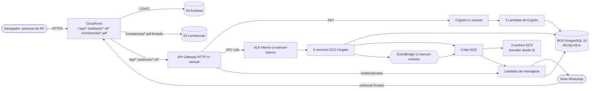

# Arquitectura desplegada: ambiente `samuel`

Inventario leído de CloudFormation el 15 de noviembre de 2026 (cuenta `795359731321`, región
`us-east-1`): **14 stacks**, todos `CREATE_COMPLETE`. Los nombres siguen el patrón `cc-samuel-...`.
Para regenerarlo: `aws cloudformation list-stack-resources --stack-name <stack> --profile cc-samuel-sdk`.

La URL de la SPA es `https://d1rfl8tkfjvltv.cloudfront.net`. El diagrama visual va en la sesión; aquí
queda el diagrama de flujo y los nombres.

## Stacks y recursos

| Stack | Recursos principales (nombres reales) |
|---|---|
| `CcSecurity-samuel` | KMS: `alias/cc-samuel-datos`, `alias/cc-samuel-infra`. Secretos: `cc/samuel/meta`, `hmac-celular`, `hmac-codigo`, `internal-auth`, `cf-signing-key`, `origin-verify`. Parámetros SSM `/cc/samuel/`: `antiabuso-mensajes-minuto`, `antiabuso-solicitudes-dia`, `estrategia-entrega`, `horario-envio-inicio`, `horario-envio-fin`, `tope-mensajes-dia`, `zona-horaria` |
| `CcNetwork-samuel` | 1 VPC con 6 subredes (2 públicas, 2 de aplicación, 2 de datos), instancia NAT `t4g.micro`, endpoint de S3, 7 grupos de seguridad (`alb`, `ecs`, `lambda`, `proxy`, `rds`, `vpclink`, `nat`) |
| `CcStorage-samuel` | Buckets: `cc-samuel-795359731321-frontend`, `-constancias` (Object Lock), `-plantillas`, `-cargas`, `-logs` |
| `CcData-samuel` | RDS `ccdata-samuel-postgres9dc8bb04-bp86pcbehpiq` (PostgreSQL 16.13, `db.t4g.micro`, 20 GB, una zona, cifrado). Secretos `cc/samuel/db/`: `admin`, `migrador`, `svc_dashboard`, `svc_colaboradores`, `svc_campos`, `svc_constancias`, `svc_notificaciones`, `svc_whatsapp` |
| `CcMessaging-samuel` | Bus `cc-samuel-eventos` (5 reglas: `campo-actualizado`, `wa-mensaje-estado`, `wa-numero-invalido`, `wa-plantilla-estado`, `wa-respuesta-recibida`); grupo de Scheduler `cc-samuel-envios`; SNS `cc-samuel-alertas-rh` y `cc-samuel-ses-eventos`; SES `samuel.lopez@honne.com`; 10 colas con su DLQ (tabla de abajo) |
| `CcAuth-samuel` | User Pool `cc-samuel` (`us-east-1_4drFq06pA`), cliente de la SPA, Lambdas `cc-samuel-cognito-pre-signup`, `cc-samuel-cognito-post-confirmation`, `cc-samuel-cognito-pre-token` |
| `CcComputeBase-samuel` | Clúster ECS `cc-samuel`; repositorios ECR `cc-samuel/migrar` y `cc-samuel/ops`; tareas `migrar` y `ops` (bajo demanda) |
| `CcCompute-samuel` | ALB interno `cc-samuel-interno` (listener HTTP 80, 13 reglas, 6 grupos destino); servicios ECS `cc-samuel-dashboard`, `-colaboradores`, `-campos`, `-constancias`, `-notificaciones`, `-whatsapp` (1 tarea cada uno) |
| `CcWorkersLambdas-samuel` | Workers ECS `cc-samuel-worker-pdf`, `-worker-cargas`, `-worker-whatsapp-entrada` (0 tareas; escalan por cola). Lambdas `cc-samuel-webhook-meta`, `-enviador`, `-estados-entrega`, `-despachador`, `-conciliador` (regla programada), `-respaldo-correo` |
| `CcApi-samuel` | API Gateway HTTP `cc-samuel` (autorizador JWT de Cognito, 7 rutas), VPC Link, registro de acceso `/cc/samuel/api-gateway` |
| `CcEdge-samuel` | Distribución de CloudFront (`EH2QGM4NDUY9K`) con 3 orígenes (API Gateway, S3 constancias, S3 frontend), llave pública y grupo de llaves para URL firmadas, funciones y políticas de cabeceras, SNS `cc-samuel-alertas-edge` |
| `CcFrontend-samuel` | Despliegue de la SPA en el bucket `frontend` y `config.json` de ejecución |
| `CcObservability-samuel` | Paneles `cc-samuel-operacion`, `cc-samuel-colas-whatsapp`, `cc-samuel-constancias`; 36 alarmas; CloudTrail `cc-samuel-gestion` (bucket `cc-samuel-795359731321-cloudtrail`); SNS `cc-samuel-alertas-ops` |
| `CcBackup-samuel` | Bóveda `cc-samuel-respaldos` y plan de respaldo de RDS |

## Colas SQS (cada una con su DLQ `...-dlq`)

| Cola | Tipo | Productor → consumidor |
|---|---|---|
| `cc-samuel-cola-pdf` | estándar | `constancias` → `worker-pdf` |
| `cc-samuel-cola-cargas` | estándar | `colaboradores` → `worker-cargas` |
| `cc-samuel-wa-entrada.fifo` | FIFO | Lambda `webhook-meta` → `worker-whatsapp-entrada` |
| `cc-samuel-wa-salida.fifo` | FIFO | bot, `worker-pdf`, `despachador` → Lambda `enviador` |
| `cc-samuel-wa-estados` | estándar | `webhook-meta` → Lambda `estados-entrega` |
| `cc-samuel-notif-despacho`, `cc-samuel-notif-respaldo` | estándar | `notificaciones`, Scheduler → `despachador`, `respaldo-correo` |
| `cc-samuel-ev-colaboradores`, `-ev-constancias`, `-ev-notificaciones` | estándar | EventBridge → consumidor de cada servicio |

## Comportamientos de CloudFront

| Ruta | Origen |
|---|---|
| `/` (por defecto, `index.html`) | S3 `frontend` |
| `/api/*`, `/webhook/*`, `/d/*` | API Gateway `cc-samuel` |
| `/constancias/*.pdf` | S3 `constancias` (solo con URL firmada) |

## Estado de ejecución (15 de noviembre de 2026)

- Los 6 servicios de ECS tienen 1 tarea en ejecución.
- Los 3 workers están en 0 tareas por diseño en `samuel`; escalan cuando hay mensajes en su cola.
- Sin MFA y con registro abierto para `@honne.com` (ver `desviaciones.md`).
- La empresa `HONNE` (id 1) existe; falta crear el primer usuario con el inicio de sesión corregido.
